# Приклади: 40 речей огляду за проєктом коду

Фото · код · стислий рядок для стилістки · факти описів поза кодом. Закодовано вручну за `КАРТКИ.md` з фото (`ohliad-zapysu/foto/`) і слів крамниці (каталог v1); моделлю нічого не проганяли. «·к» — факт зі слів крамниці, без позначки — з фото, «·код» — виводить код. Першими — десять речей, де новий код міняє найбільше. Згенеровано `скрипти/перевірка.py` з `приклади.yaml`.

## 1. ж-03119 · Камізелька з вишивкою (1, S-M, Bronze embroidery, чорний)

*вишивка, кант і бахрома жили лише у вільному описі — тепер оздоба «що · де · скільки · масштаб · мотив»; волокно основи й підкладки окремо*

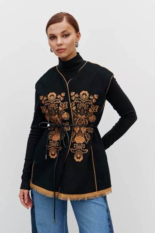

```
вид: жилет
колір: [black, moderate_yellowish_brown]
матеріал: текстиль
волокно: [{волокно: бавовна, частка: 96, де: основа}, {волокно: еластан, частка: 4, де: основа}, {волокно: льон, частка: 100, де: підкладка}, {волокно: віскоза, де: оздоба}] ·к
полотно: тканина
різновид_полотна: денім ·к
поверхня: гладка
блиск: матовий
прозорість: непрозора
товщина: середня
структура: напівжорстка
малюнок: немає
оздоба: [{що: вишивка, де: перед, скільки: кілька, масштаб: великий, мотив: рослинний}, {що: кант, де: горловина, скільки: один}, {що: кант, де: бік, скільки: кілька}, {що: бахрома, де: поділ, скільки: суцільно, масштаб: середній}]
бортність: однобортна
застібка: [{засіб: гачки, де: перед, видимість: потайна}]
кишені: [{вид: невідомо, де: невідомо, скільки: кілька}] ·к
комір: немає
довжина_рукава: без_рукава
силует: прямий
прилягання: вільне
довжина: середина_стегна
підкладка: повна ·к
додані_частини: [{що: пасок, знімна: так}]
мірки_крамниці: [{що: довжина_виробу, число: 72, розмір: M}, {що: обхват_грудей, число: 104, розмір: M}, {що: ширина_плечей, число: 46, розмір: M}, {що: зріст_моделі, число: 173}] ·к
ошатність: everyday–neat ·код
тепло: medium ·код
погода: cool–mild ·код
розтяжність: тягнеться ·код
```

**Рядок** (84 ток.): жилет; до середина стегна; силует прямий; вільне; без рукава; денім; бавовна; напівжорстка; вишивка великий рослинний, кант, бахрома; + пасок; ошатність щодня–охайно; погода прохолода–помірно; тягнеться

Мітки нині (Sonnet, новий запис): слот="верх"; тип="vest"; крій="straight"; довжина="mid_thigh"; тканина="cotton"; візерунок="solid"; ошатність="невідомо"; сезон_тканини="невідомо"

Поза кодом (2): вишивку розміщено дзеркально обабіч центру — розміщення дрібніше за зону «перед»; бахрома ручної роботи — спосіб виготовлення з фото не видно

## 2. ж-01590 · Сукня А-подібного крою з паском, розрізом та кишенями, виріз V-подібний (Versace) Versace AN26

*тон-в-тон жакард: мітки давали «однотонний» чи «квітковий» — тепер малюнок з контрастом; довжина «не певний», бо фото до талії, а крамниця каже лише «довгі»*

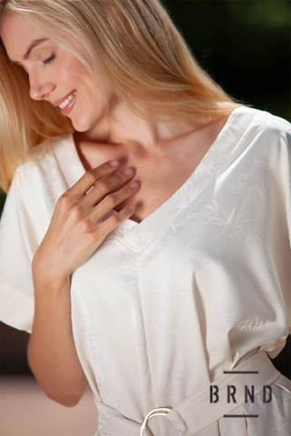

```
вид: сукня
колір: [yellowish_white]
матеріал: текстиль
волокно: [{волокно: віскоза, частка: 60, де: основа}, {волокно: шовк, частка: 40, де: основа}] ·к
полотно: тканина
різновид_полотна: жакард
поверхня: гладка
блиск: шовковистий
малюнок: {мотив: рослинний, техніка: ткацтво, масштаб: дрібний, розміщення: суцільний, контраст: тон_в_тон}
виріз: {форма: v, глибина: груди}
довжина_рукава: вище_ліктя
форма_рукава: широкий
деталі: [{що: відвороти}, {що: розріз}] ·к
кишені: [{вид: у_шві, де: бік, скільки: кілька}] ·к
додані_частини: [{що: пасок, знімна: так}]
колір_металу: жовтий
силует: трапеція
прилягання: вільне
лінія_талії: на_талії
довжина: {не_певний: [низ_литки, щиколотка]} ·к
ошатність: smart–very_smart ·код
тепло: light ·код
погода: warm ·код
```

**Рядок** (105 ток.): сукня; до низ литки чи щиколотка; силует трапеція; вільне; талія на талії; виріз V; рукав вище ліктя; рукав широкий; жакард; віскоза; шовковистий; рослинний дрібний тон у тон; відвороти, розріз чи шліца; + пасок; ошатність ошатно–дуже ошатно; погода тепло

Мітки нині (Sonnet, новий запис): слот="сукня"; тип="dress_generic"; крій="a-line"; довжина="maxi"; тканина="satin"; візерунок="solid"; ошатність="невідомо"; сезон_тканини="невідомо"

Поза кодом (2): кругле кільце паска — поза: форма_фурнітури; Versace — поза: бренд

## 3. ж-12297 · Рожева спідниця довге міді зі щільного сатину, артикул - 17695, 【MustHave ❤️】ціна

*довжина: моделі писали midi чи maxi — тепер орієнтир на тілі за фото (низ литки) і 89 см крамниці окремо*

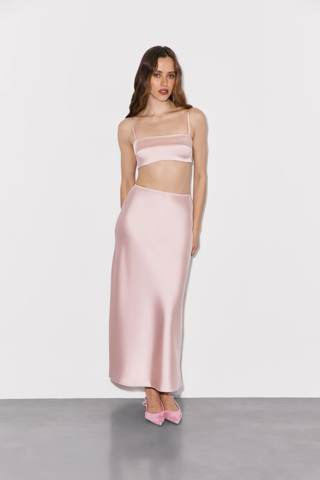

```
вид: спідниця
колір: [moderate_pink]
матеріал: текстиль
полотно: тканина
різновид_полотна: сатин
поверхня: гладка
блиск: шовковистий
прозорість: непрозора
товщина: середня
структура: м'яка
малюнок: немає
оздоба: немає
застібка: немає
деталі: [{що: резинка}]
силует: кльош
прилягання: по_фігурі
посадка: висока
довжина: низ_литки
мірки_крамниці: [{що: довжина_виробу, число: 89}] ·к
ошатність: neat–smart ·код
```

**Рядок** (53 ток.): спідниця; до низ литки; силует кльош; по фігурі; посадка висока; сатин чи атлас; шовковистий; резинка; ошатність охайно–ошатно

Мітки нині (Sonnet, новий запис): слот="низ"; тип="skirt"; крій="bias-slip"; довжина="midi"; тканина="satin"; візерунок="solid"; ошатність="невідомо"; сезон_тканини="невідомо"

Поза кодом (2): крій по косій — спосіб крою; його видимий наслідок несуть силует, прилягання й структура; топ на бретелях і туфлі в тон — не про цю річ (поза: не_про_цю_річ)

## 4. ж-12411 · Човники жіночі Tamaris 1-22437-47 350 MAHOGANY LEA. (2026-2027)

*замість «каблук mid» — 5 см, форма «розширений», виріз взуття й носок; носок «не певний» між двома сусідами*

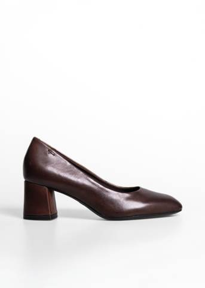

```
вид: туфлі
колір: [dark_reddish_brown]
матеріал: шкіра
поверхня: гладка
блиск: глянцевий
висота_взуття: стопа
каблук_см: 5 ·к
форма_каблука: розширений
товщина_підошви: тонка
носок: {не_певний: [квадратний, круглий]}
п'ята: закрита
виріз_взуття: {глибина: помірний, форма: округла}
застібка: немає
оздоба: немає
сезон_крамниці: [всесезон] ·к
прізвисько: човники ·код
ошатність: neat–smart ·код
```

**Рядок** (59 ток.): човники; до стопа; шкіра; глянцевий; каблук 5 см; розширений; носок квадратний чи круглий; виріз помірний округла; ошатність охайно–ошатно

Мітки нині (Sonnet, новий запис): слот="взуття"; тип="pumps"; тканина="leather"; візерунок="solid"; ошатність="невідомо"; сезон_тканини=["cool", "mild", "warm"]; каблук=5; підошва="невідомо"; водостійкість="невідомо"; утеплення="невідомо"

Поза кодом (2): металева емблема бренду з внутрішнього боку біля п'яти — на нозі не видно; легке потемніння носка й п'яти та каблук «під дерево» — тонкий ефект фарбування, дрібніший за колір

## 5. ж53-4a9d516e7b29fa71ff64 · Сірий костюм з подовженим піджаком

*комплект: кожна частина — окрема річ зі своїми полями; «костюм» — прізвисько, яке виводить код, а не мітка моделі*

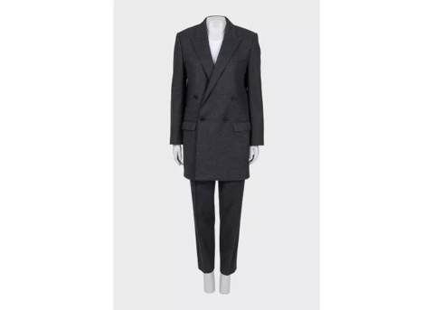

```
вид: комплект
колір: [dark_gray]
матеріал: текстиль
волокно: [{волокно: вовна, де: основа}, {волокно: купро, де: підкладка}, {волокно: віскоза, де: підкладка}, {волокно: бавовна, де: підкладка}] ·к
полотно: тканина
різновид_полотна: костюмна
поверхня: гладка
блиск: матовий
товщина: середня
малюнок: немає
склад → верхній_шар: вид="жакет"; бортність="двобортна"; комір="лацкани"; застібка=[{"засіб": "ґудзики", "де": "перед", "видимість": "видима"}]; кишені=[{"вид": "з_клапаном", "де": "перед", "скільки": "кілька"}]; силует="прямий"; довжина="середина_стегна"; підкладка="повна"
склад → низ: вид="штани"; силует="звужений"; прилягання="по_фігурі"; довжина="щиколотка"; підкладка="повна"
прізвисько: костюм ·код
ошатність: neat–formal ·код
тепло: medium ·код
погода: cool–mild ·код
```

**Рядок** (82 ток.): костюм; жакет; до середина стегна; силует прямий; двобортна; комір лацкани + штани; до щиколотка; силует звужений; по фігурі; костюмна; вовна; ошатність охайно–формально; погода прохолода–помірно

Мітки нині (Sonnet, новий запис): слот="комплект"; тип="suit"; крій="double-breasted"; довжина="mid_thigh"; тканина="wool"; візерунок="solid"; ошатність="невідомо"; сезон_тканини="невідомо"

Поза кодом (3): гострі лацкани — форма лацкана дрібніша за «лацкани»; на фото колір темніший за «сірий» крамниці — поза: розбіжність_фото_крамниці; на манекені поверх білого топа — не про цю річ

## 6. ж-07949 · Сумка жіноча Salon

*сумка: форма, розмір, ручки зі знімністю, магнітна застібка й змішаний тон металу — раніше лише в описі*

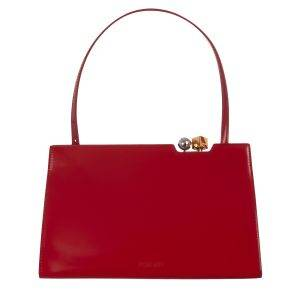

```
вид: сумка
колір: [strong_red]
матеріал: шкіра
волокно: [{волокно: бавовна, де: підкладка}] ·к
поверхня: гладка
блиск: глянцевий
структура: жорстка
форма_сумки: трапеція
розмір_сумки: мала
ручки: [{вид: коротка, скільки: один, знімна: ні}, {вид: довга, скільки: один, знімна: так}] ·к
застібка: [{засіб: магніт, де: центр, видимість: видима}]
колір_металу: змішаний
деталі: [{що: виріз_вставка}]
оздоба: [{що: логотип, де: перед, скільки: один, масштаб: дрібний}]
підкладка: повна ·к
сезон_крамниці: [весна_осінь, літо] ·к
мірки_крамниці: [{що: ширина, число: 28}, {що: висота, число: 16}, {що: глибина, число: 7}] ·к
як_носять: у_руці ·код
ошатність: neat–smart ·код
```

**Рядок** (58 ток.): сумка; шкіра; глянцевий; жорстка; логотип чи напис дрібний; виріз у полотні; змішаний метал; трапеція; мала; у руці; ошатність охайно–ошатно

Мітки нині (Sonnet, новий запис): слот="сумка"; тип="bag_generic"; тканина="leather"; візерунок="solid"; ошатність="невідомо"

Поза кодом (3): застібка-шарм у вигляді кулі й куба — поза: форма_фурнітури; особливий догляд — поза: догляд; Jacquemus Salon — поза: бренд

## 7. ж-11745 · Золоті сережки з підвіскою

*прикраса: вставки, мотив і довжина на тілі — окремі поля; метал «невідомо», бо крамниця не називає, а тон металу — окреме поле*

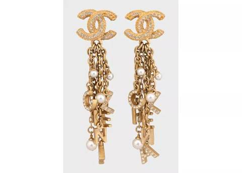

```
вид: підвіски
колір_металу: жовтий
матеріал: метал
метал: невідомо
поверхня: фактурна
блиск: матовий
вставки: [{що: прозорий_камінь, скільки: розсип}, {що: перли, скільки: кілька}]
оздоба: [{що: ланцюжок, де: центр, скільки: кілька, масштаб: середній}]
мотив_прикраси: [монограма, напис]
масштаб_прикраси: середній
довжина_на_тілі: щелепа
ошатність: smart–very_smart ·код
```

**Рядок** (62 ток.): підвіски; до лінія щелепи; фактурна; ланцюжок; жовтий метал; прозорий камінь, перли; монограма, напис; середній розмір; ошатність ошатно–дуже ошатно

Мітки нині (Sonnet, новий запис): слот="сережки"; тип="earrings"; ошатність="невідомо"; метал="невідомо"

Поза кодом (1): Chanel — поза: бренд

## 8. ж-07687 · Берет зі стразовим бантом червоний

*стразовий бант — оздоба з мотивом і зоною; волокна з частками, підкладка й резинка — зі слів крамниці*

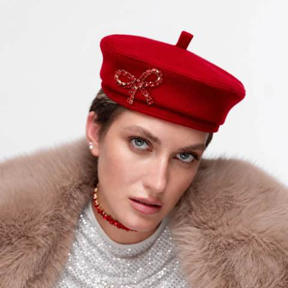

```
вид: берет
колір: [strong_red]
матеріал: текстиль
волокно: [{волокно: вовна, частка: 90, де: основа}, {волокно: кашемір, частка: 10, де: основа}, {волокно: віскоза, де: підкладка}] ·к
полотно: {не_певний: [нетканий, в'язане]}
поверхня: гладка
блиск: матовий
товщина: середня
структура: напівжорстка
малюнок: немає
оздоба: [{що: стрази, де: бік, скільки: один, масштаб: середній, мотив: бант}, {що: кант, де: обідок, скільки: суцільно}]
поля_убору: немає
прилягання: по_фігурі
деталі: [{що: резинка}] ·к
підкладка: повна ·к
сезон_крамниці: [весна_осінь, зима] ·к
мірки_крамниці: [{що: обхват_голови, число: 54.5–58.5}] ·к
ошатність: everyday–smart ·код
погода: cool ·код
```

**Рядок** (58 ток.): берет; по фігурі; нетканий чи в'язане; вовна; напівжорстка; стрази чи кристали бант, кант; резинка; ошатність щодня–ошатно; погода прохолода

Мітки нині (Sonnet, новий запис): слот="головний_убір"; тип="beret"; тканина="wool"; візерунок="solid"; ошатність="невідомо"; сезон_тканини=["cool", "cold"]; утеплення="light"

Поза кодом (1): хвостик-стебельце на верху — дрібна деталь берета

## 9. ж-16333 · Сорочка з коміром

*крамниця пише «білий», фото показує зелений рослинний друк: колір і малюнок беруться з фото, і рядок не бреше стилістці*

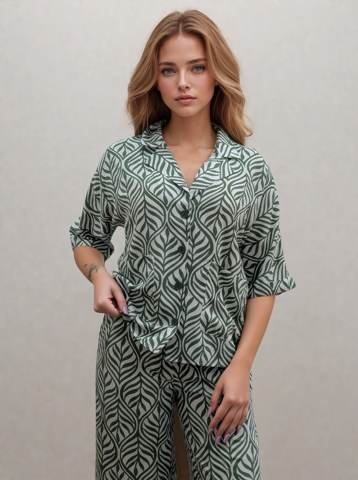

```
вид: сорочка
колір: [light_greenish_gray, dark_green]
матеріал: текстиль
полотно: тканина
поверхня: гладка
блиск: матовий
товщина: тонка
структура: м'яка
малюнок: {мотив: рослинний, техніка: друк, масштаб: середній, розміщення: суцільний, контраст: контрастний}
комір: апаш
застібка: [{засіб: ґудзики, де: перед, видимість: видима}]
довжина_рукава: нижче_ліктя
пройма: спущене_плече
силует: прямий
прилягання: вільне
довжина: невідомо
ошатність: everyday–neat ·код
тепло: light ·код
погода: warm ·код
```

**Рядок** (66 ток.): сорочка; силует прямий; вільне; комір апаш; рукав нижче ліктя (три чверті); спущене плече; тонка; рослинний контрастний; ошатність щодня–охайно; погода тепло

Мітки нині (Sonnet, новий запис): слот="верх"; тип="shirt"; крій="relaxed"; довжина="не_певний"; тканина="viscose"; візерунок="geometric"; ошатність="everyday"; сезон_тканини=["mild", "warm", "hot"]; водостійкість="невідомо"; утеплення="none"

Поза кодом (1): штани з тим самим принтом — не про цю річ

## 10. ж53-589c8deecfc59ecdf031 · Жіночий спортивний пуховик гусячий пух з капюшоном на осінь-весну Basic

*пуховик: утеплення «тепле · пух», капюшон, додані пасок і гаманець; «пуховик» і погода — вивід коду, і сезон крамниці «осінь-весна» не дає погоді впасти до морозу*

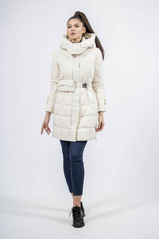

```
вид: куртка
колір: [yellowish_white]
матеріал: текстиль
волокно: [{волокно: поліестер, де: основа}] ·к
полотно: тканина
різновид_полотна: плащова
поверхня: стьобана
блиск: глянцевий
товщина: товста
структура: м'яка
малюнок: немає
капюшон: є
комір: стійка
застібка: [{засіб: блискавка, де: перед, видимість: видима}, {засіб: кнопки, де: перед, видимість: видима}]
деталі: [{що: хлястик}]
додані_частини: [{що: пасок, знімна: так}, {що: гаманець, знімна: так}]
колір_металу: білий
силует: приталений
прилягання: по_фігурі
довжина: середина_стегна
утеплення: {ступінь: тепле, наповнювач: пух} ·к
сезон_крамниці: [весна_осінь] ·к
нагода_крамниці: [спорт, щодня] ·к
мірки_крамниці: [{що: довжина_виробу, число: 93}] ·к
прізвисько: пуховик ·код
ошатність: everyday ·код
тепло: warm ·код
погода: cold ·код
```

**Рядок** (93 ток.): пуховик; до середина стегна; силует приталений; по фігурі; комір стійка; капюшон; плащова; поліестер; стьобана; глянцевий; товста; хлястик; утеплення тепле пух; + пасок, гаманець чи косметичка; ошатність щодня; погода холод

Мітки нині (Sonnet, новий запис): слот="верхній_шар"; тип="down_jacket"; крій="belted"; довжина="mid_thigh"; тканина="polyester"; візерунок="solid"; ошатність="everyday"; сезон_тканини=["cool", "cold"]; водостійкість="невідомо"; утеплення="warm"

Поза кодом (2): шевронне стьобання — форма стьобання дрібніша за «стьобана»; у крамниці є й чорний колір — інший варіант товару

## 11. ж53-cf6f6813bd3e883a55cc · Вовняний подовжений жилет в діловому стилі Лаціо

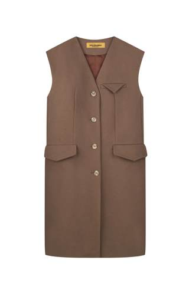

```
вид: жилет
колір: [grayish_brown]
матеріал: текстиль
волокно: [{волокно: вовна, частка: 80, де: основа}, {волокно: поліестер, частка: 20, де: основа}] ·к
полотно: тканина
різновид_полотна: костюмна
поверхня: гладка
блиск: матовий
товщина: середня
структура: напівжорстка
малюнок: немає
оздоба: немає
бортність: однобортна
застібка: [{засіб: ґудзики, де: перед, видимість: видима}]
кишені: [{вид: з_клапаном, де: перед, скільки: кілька}, {вид: з_клапаном, де: груди, скільки: один}]
комір: немає
виріз: {форма: v, глибина: груди}
довжина_рукава: без_рукава
силует: прямий
прилягання: по_фігурі
довжина: середина_стегна
підкладка: повна
ошатність: neat–smart ·код
тепло: medium ·код
погода: cool ·код
розтяжність: не_тягнеться ·код
```

**Рядок** (61 ток.): жилет; до середина стегна; силует прямий; по фігурі; виріз V; без рукава; костюмна; вовна; напівжорстка; ошатність охайно–ошатно; погода прохолода

Мітки нині (Sonnet, новий запис): слот="верхній_шар"; тип="vest"; крій="straight"; довжина="mid_thigh"; тканина="wool"; візерунок="solid"; ошатність="smart"; сезон_тканини="невідомо"; водостійкість="невідомо"; утеплення="невідомо"

Поза кодом (3): брендова нашивка з виворіту біля горловини — на людині не видно; на другому фото колір темніший, оливковий — розбіжність знімків (поза: розбіжність_фото_крамниці); плечі «злегка підкреслені» — ознака без межі, підплічників не видно

## 12. ж53-f281452ccb7266c5049d · Білий костюм з шортами, майкою та блузою

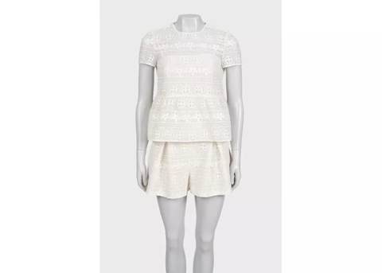

```
вид: комплект
колір: [white]
матеріал: текстиль
волокно: [{волокно: поліестер, частка: 85, де: основа}, {волокно: віскоза, частка: 15, де: основа}] ·к
полотно: тканина
прозорість: {не_певний: [непрозора, напівпрозора]}
товщина: тонка
малюнок: немає
оздоба: [{що: мереживо, де: вся_поверхня, скільки: суцільно, масштаб: середній, мотив: орнамент}]
склад → верх: вид="блуза"; довжина_рукава="вище_ліктя"; виріз={"форма": "круглий", "глибина": "шия"}; силует="прямий"; прилягання="вільне"
склад → верх: вид="топ"
склад → низ: вид="шорти"; деталі=[{"що": "складки"}]; прилягання="вільне"; довжина="верх_стегон"
ошатність: everyday–neat ·код
тепло: light ·код
погода: warm ·код
розтяжність: не_тягнеться ·код
```

**Рядок** (91 ток.): комплект; блуза; силует прямий; вільне; виріз круглий; рукав вище ліктя + топ + шорти; до верх стегон; вільне; складки; поліестер; непрозора чи напівпрозора; тонка; мереживо орнамент; ошатність щодня–охайно; погода тепло

Мітки нині (Sonnet, новий запис): слот="комплект"; тип="two_piece_set"; крій="relaxed"; довжина="mini"; тканина="lace"; візерунок="solid"; ошатність="невідомо"; сезон_тканини="невідомо"

Поза кодом (1): мереживо смугами з круглих медальйонів із хрестоподібним малюнком і дрібними квітками — подробиця мотиву «орнамент»

## 13. ж-00580 · Сукня-жакет костюмна на гудзиках з відкладним коміром бежева

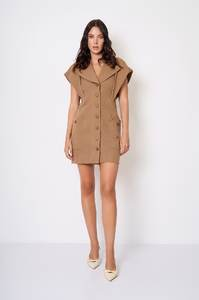

```
вид: сукня
колір: [light_yellowish_brown]
матеріал: текстиль
полотно: тканина
різновид_полотна: костюмна
поверхня: гладка
блиск: матовий
товщина: середня
структура: напівжорстка
малюнок: немає
оздоба: немає
бортність: однобортна
застібка: [{засіб: ґудзики, де: перед, видимість: видима}]
кишені: [{вид: накладна, де: перед, скільки: кілька}]
комір: лацкани
виріз: {форма: під_комір, глибина: груди}
довжина_рукава: плече
форма_рукава: крильце
пройма: вшитий
деталі: [{що: підплічники}]
силует: приталений
прилягання: по_фігурі
лінія_талії: на_талії
довжина: середина_стегна
ошатність: neat–smart ·код
тепло: medium ·код
погода: mild ·код
```

**Рядок** (81 ток.): сукня; до середина стегна; силует приталений; по фігурі; талія на талії; комір лацкани; рукав плече; рукав крильце; костюмна; напівжорстка; підплічники; ошатність охайно–ошатно; погода помірно

Мітки нині (Sonnet, новий запис): слот="сукня"; тип="dress_generic"; крій="fitted"; довжина="mini"; тканина="невідомо"; візерунок="solid"; ошатність="невідомо"; сезон_тканини="невідомо"

## 14. ж-07824 · КЛАТЧ-ОРІГАМІ GIA ШКІРЯНИЙ

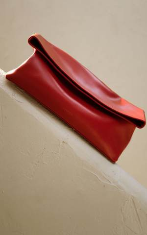

```
вид: клатч
колір: [strong_red]
матеріал: шкіра ·к
поверхня: гладка
блиск: шовковистий
структура: м'яка
форма_сумки: конверт
розмір_сумки: {не_певний: [мала, середня]}
деталі: [{що: складки}, {що: клапан}]
застібка: [{засіб: кнопки, де: клапан, видимість: потайна}]
оздоба: [{що: логотип, де: перед, скільки: один, масштаб: дрібний}]
підкладка: повна
водостійкість: не_захищена ·к
як_носять: у_руці ·код
ошатність: neat–smart ·код
```

**Рядок** (58 ток.): клатч; шкіра; шовковистий; логотип чи напис дрібний; складки, клапан; конверт; мала чи середня; у руці; не захищена; ошатність охайно–ошатно

Мітки нині (Sonnet, новий запис): слот="сумка"; тип="clutch"; тканина="leather"; візерунок="solid"; ошатність="smart"

Поза кодом (2): підкладка в рубчик і золотиста блискавка внутрішньої кишені — всередині, з образу не видно; декоративний прошив навколо кнопки — під клапаном

## 15. ж-05797 · Сірі костюмні штани — класичний елемент гардероба, який втілює елегантність і універсальність


```
вид: штани
колір: [light_gray]
матеріал: текстиль
волокно: [{волокно: віскоза, частка: 50, де: основа}, {волокно: поліестер, частка: 45, де: основа}, {волокно: еластан, частка: 5, де: основа}] ·к
полотно: тканина
різновид_полотна: костюмна
поверхня: гладка
блиск: матовий
товщина: середня
структура: м'яка
малюнок: немає
оздоба: немає
деталі: [{що: стрілки}]
посадка: висока
силует: прямий
прилягання: вільне
довжина: щиколотка–стопа
сезон_крамниці: [весна_осінь, зима] ·к
нагода_крамниці: [щодня] ·к
мірки_крамниці: [{що: зріст_моделі, число: 175}, {що: розмір_на_моделі, розмір: S}] ·к
ошатність: neat–formal ·код
розтяжність: тягнеться ·код
```

**Рядок** (55 ток.): штани; до щиколотка–стопа; силует прямий; вільне; посадка висока; костюмна; віскоза; стрілки; ошатність охайно–формально; тягнеться

Мітки нині (Sonnet, новий запис): слот="низ"; тип="trousers"; крій="wide"; довжина="maxi"; тканина="viscose"; візерунок="solid"; ошатність="everyday"; сезон_тканини=["cool", "cold"]

Поза кодом (2): на моделі з укороченим жакетом і топом у тон — не про цю річ; друге фото — інша річ (білі шорти й жакет) — поза: розбіжність_фото_крамниці

## 16. ж-12408 · Човники жіночі Tamaris 1-22455-47 537 MERLOT (2026-2027)

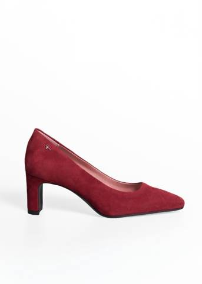

```
вид: туфлі
колір: [dark_purplish_red]
матеріал: шкіра
поверхня: ворсова
блиск: матовий
висота_взуття: стопа
каблук_см: 6 ·к
форма_каблука: розширений
товщина_підошви: тонка
носок: квадратний
п'ята: закрита
виріз_взуття: {глибина: помірний, форма: округла}
застібка: немає
підкладка: повна
прізвисько: човники ·код
ошатність: neat–smart ·код
```

**Рядок** (53 ток.): човники; до стопа; шкіра; ворсова; каблук 6 см; розширений; носок квадратний; виріз помірний округла; ошатність охайно–ошатно

Мітки нині (Sonnet, новий запис): слот="взуття"; тип="pumps"; тканина="suede"; візерунок="solid"; ошатність="невідомо"; сезон_тканини=["cool", "mild"]; каблук=6; підошва="невідомо"; водостійкість="no"; утеплення="невідомо"

Поза кодом (2): металева емблема бренду на задникові — дрібна, на нозі майже не видно; рожево-червона підкладка — всередині

## 17. ж-12238 · Вʼязані сірі штани з віскозою, артикул - 18393, 【MustHave ❤️】ціна

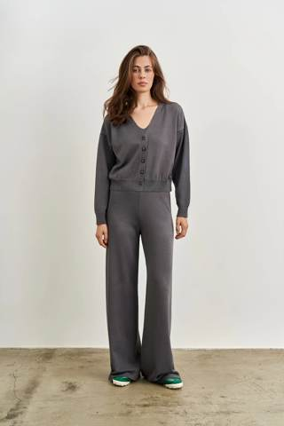

```
вид: штани
колір: [medium_gray]
матеріал: текстиль
волокно: [{волокно: віскоза, частка: 93, де: основа}, {волокно: еластан, частка: 7, де: основа}] ·к
полотно: в'язане
поверхня: гладка
блиск: матовий
товщина: середня
структура: м'яка
малюнок: немає
оздоба: немає
застібка: немає
деталі: [{що: резинка}]
посадка: висока
силует: {не_певний: [прямий, трапеція]}
прилягання: вільне
довжина: щиколотка
ошатність: home–everyday ·код
розтяжність: тягнеться ·код
```

**Рядок** (54 ток.): штани; до щиколотка; силует прямий чи трапеція; вільне; посадка висока; в'язане; віскоза; резинка; ошатність дім–щодня; тягнеться

Мітки нині (Sonnet, новий запис): слот="низ"; тип="trousers"; крій="wide"; довжина="maxi"; тканина="knitted"; візерунок="solid"; ошатність="невідомо"; сезон_тканини="невідомо"

Поза кодом (1): з в'язаним кардиганом у тон — не про цю річ

## 18. ж53-5219f329cca9e91969d8 · Піджак теплий з класичними кишенями графіт

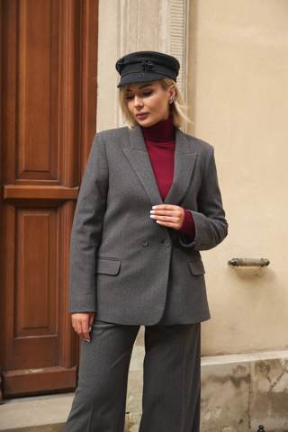

```
вид: жакет
колір: [dark_gray]
матеріал: текстиль
волокно: [{волокно: вовна, частка: 55, де: основа}] ·к
полотно: тканина
різновид_полотна: костюмна
поверхня: фактурна
блиск: матовий
товщина: середня
структура: напівжорстка
малюнок: немає
бортність: двобортна
застібка: [{засіб: ґудзики, де: перед, видимість: видима}]
кишені: [{вид: з_клапаном, де: перед, скільки: кілька}]
комір: лацкани
довжина_рукава: зап'ястя
силует: прямий
прилягання: вільне
довжина: середина_стегна
ошатність: neat–formal ·код
тепло: medium ·код
погода: cool–mild ·код
```

**Рядок** (72 ток.): жакет; до середина стегна; силует прямий; вільне; двобортна; комір лацкани; костюмна; вовна; фактурна; напівжорстка; ошатність охайно–формально; погода прохолода–помірно

Мітки нині (Sonnet, новий запис): слот="верхній_шар"; тип="blazer"; крій="double-breasted"; довжина="mid_thigh"; тканина="wool"; візерунок="solid"; ошатність="neat"; сезон_тканини=["cool", "cold"]; водостійкість="no"; утеплення="light"

Поза кодом (2): саржа чи ялинка — переплетення з фото не розрізнити; у коді лише поверхня «фактурна»; лацкан із виїмкою — форма лацкана дрібніша за комір «лацкани»

## 19. ж-11666 · Сережка із золота Juste un Clou

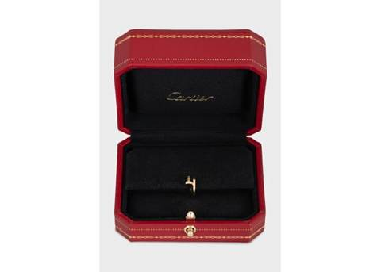

```
вид: кільця
колір_металу: жовтий
матеріал: метал
метал: золото ·к
проба: 750 ·к
поверхня: гладка
блиск: глянцевий
масштаб_прикраси: дрібний
мотив_прикраси: [фігуративний]
довжина_на_тілі: мочка
мірки_крамниці: [{що: діаметр, число: 1}] ·к
ошатність: neat–smart ·код
```

**Рядок** (46 ток.): кільця; до мочка вуха; глянцевий; золото; жовтий метал; фігуративний; дрібний розмір; ошатність охайно–ошатно

Мітки нині (Sonnet, новий запис): слот="сережки"; тип="earrings"; ошатність="невідомо"; метал="gold"

Поза кодом (4): вага 1,4 г — поза: вага; червона коробка бренду — поза: пакування; Cartier Juste un Clou — поза: бренд; в товарі одна сережка, не пара — властивість пропозиції, не речі

## 20. ж-07704 · Берет з джинсу з паєткою

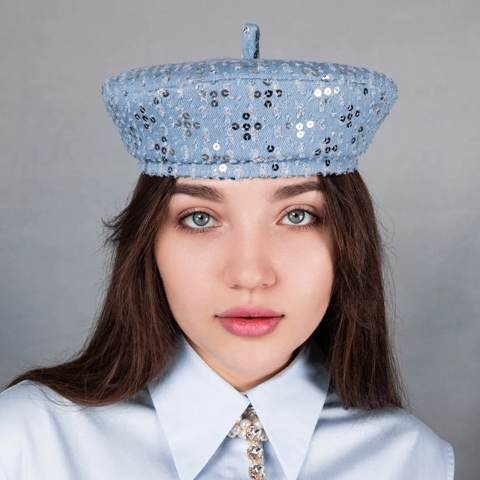

```
вид: берет
колір: [light_blue]
матеріал: текстиль
волокно: [{волокно: бавовна, частка: 100, де: основа}, {волокно: віскоза, де: підкладка}] ·к
полотно: тканина
різновид_полотна: денім
поверхня: потерта
блиск: мерехтливий
товщина: середня
структура: напівжорстка
малюнок: немає
оздоба: [{що: паєтки, де: вся_поверхня, скільки: розсип, масштаб: дрібний}, {що: кант, де: обідок, скільки: суцільно}]
поля_убору: немає
деталі: [{що: резинка}] ·к
підкладка: повна ·к
сезон_крамниці: [весна_осінь] ·к
ошатність: everyday ·код
погода: mild–warm ·код
```

**Рядок** (53 ток.): берет; денім; бавовна; потерта; мерехтливий; напівжорстка; паєтки дрібний, кант; резинка; ошатність щодня; погода помірно–тепло

Мітки нині (Sonnet, новий запис): слот="головний_убір"; тип="beret"; тканина="denim"; візерунок="solid"; ошатність="smart"; сезон_тканини=["mild", "warm"]; утеплення="none"

Поза кодом (1): хвостик-петелька зверху — дрібна деталь берета

## 21. ж53-b36eeeb300b791ed2f1c · Заколка молочний шовковий бант

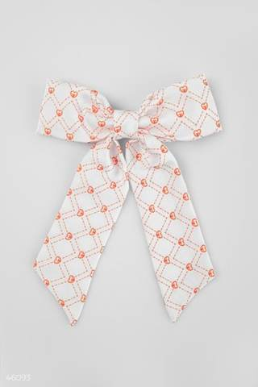

```
вид: заколка
колір: [yellowish_white, strong_orange]
матеріал: текстиль
волокно: [{волокно: шовк, де: основа}] ·к
полотно: тканина
блиск: шовковистий
малюнок: [{мотив: серця, техніка: друк, масштаб: дрібний, розміщення: суцільний, контраст: помірний}, {мотив: геометричний, техніка: друк, масштаб: дрібний, розміщення: суцільний, контраст: помірний}]
мотив_прикраси: [бант]
масштаб_прикраси: великий
застібка: [{засіб: автомат, де: центр, видимість: потайна}] ·к
ошатність: everyday–neat ·код
```

**Рядок** (46 ток.): заколка; шовк; шовковистий; серця дрібний, геометричний дрібний; бант; великий розмір; ошатність щодня–охайно

Мітки нині (Sonnet, новий запис): слот="прикраси"; тип="hair_clip"; візерунок="print_generic"; ошатність="невідомо"; тканина="невідомо"

Поза кодом (1): кінці банта зрізані навскіс — дрібниця форми

## 22. ж-12316 · Синя сорочка вільного крою з деніму, артикул - 17318, 【MustHave ❤️】ціна

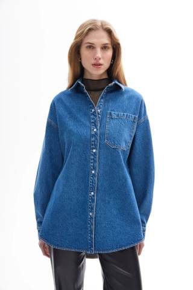

```
вид: сорочка
колір: [moderate_blue]
матеріал: текстиль
волокно: [{волокно: бавовна, частка: 100, де: основа}] ·к
полотно: тканина
різновид_полотна: денім
поверхня: потерта
блиск: матовий
товщина: середня
структура: напівжорстка
малюнок: немає
оздоба: [{що: строчка, де: поділ, скільки: суцільно}]
комір: {не_певний: [відкладний, стійка]}
застібка: [{засіб: ґудзики, де: перед, видимість: видима}]
кишені: [{вид: накладна, де: груди, скільки: один}]
пройма: спущене_плече
довжина_рукава: зап'ястя
деталі: [{що: кокетка}, {що: складки}]
силует: прямий
прилягання: оверсайз
довжина: стегна–середина_стегна
мірки_крамниці: [{що: довжина_виробу, число: 81}] ·к
ошатність: everyday ·код
тепло: medium ·код
погода: mild ·код
розтяжність: не_тягнеться ·код
```

**Рядок** (90 ток.): сорочка; до стегна–середина стегна; силует прямий; оверсайз; комір відкладний чи стійка; спущене плече; денім; бавовна; потерта; напівжорстка; декоративна строчка; кокетка, складки; ошатність щодня; погода помірно

Мітки нині (Sonnet, новий запис): слот="верх"; тип="shirt"; крій="relaxed"; довжина="не_певний"; тканина="denim"; візерунок="solid"; ошатність="невідомо"; сезон_тканини="невідомо"

Поза кодом (1): низ заокруглений з боків — форма подолу дрібніша за силует

## 23. ж-04598 · Туніка в'язана

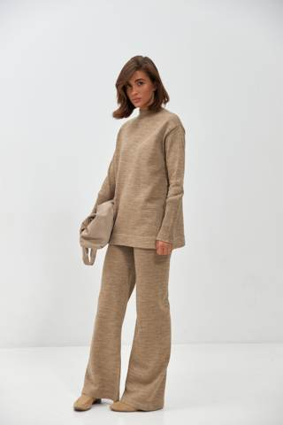

```
вид: пуловер
колір: [light_grayish_yellowish_brown]
матеріал: текстиль
полотно: в'язане
поверхня: гладка
блиск: матовий
товщина: середня
структура: м'яка
малюнок: немає
оздоба: немає
комір: стійка
довжина_рукава: зап'ястя
пройма: спущене_плече
форма_рукава: прямий
силует: прямий
прилягання: вільне
довжина: середина_стегна
сезон_крамниці: [зима] ·к
ошатність: everyday ·код
тепло: medium ·код
погода: cool ·код
розтяжність: тягнеться ·код
```

**Рядок** (56 ток.): пуловер; до середина стегна; силует прямий; вільне; комір стійка; спущене плече; в'язане; ошатність щодня; погода прохолода; тягнеться

Мітки нині (Sonnet, новий запис): слот="верх"; тип="knitwear"; крій="relaxed"; довжина="mid_thigh"; тканина="knitted"; візерунок="solid"; ошатність="everyday"; сезон_тканини=["cold", "cool"]

Поза кодом (2): манжети й низ у рубчик, манжети розширені донизу — фактура й форма частин дрібніші за поля поверхні й рукава; з широкими в'язаними штанами в тон — не про цю річ

## 24. ж-05296 · Жіноче вовняне пальто капучино з штучним хутром, casual стиль Stella Polare

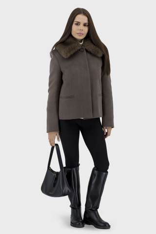

```
вид: пальто
колір: [grayish_brown]
матеріал: текстиль
волокно: [{волокно: вовна, частка: 70, де: основа}, {волокно: альпака, частка: 20, де: основа}, {волокно: поліамід, частка: 10, де: основа}, {волокно: ацетат, де: підкладка}, {волокно: віскоза, де: підкладка}] ·к
полотно: тканина
різновид_полотна: драп
поверхня: ворсиста
блиск: матовий
товщина: товста
структура: напівжорстка
малюнок: немає
комір: відкладний ·к
додані_частини: [{що: хутряний_комір, знімна: так}]
застібка: [{засіб: ґудзики, де: перед, видимість: потайна}]
кишені: [{вид: прорізна, де: перед, скільки: кілька}]
пройма: вшитий
довжина_рукава: зап'ястя
силует: прямий
прилягання: вільне
довжина: стегна
підкладка: повна ·к
утеплення: {ступінь: немає} ·к
нагода_крамниці: [щодня] ·к
мірки_крамниці: [{що: довжина_виробу, число: 59}] ·к
ошатність: everyday–neat ·код
тепло: warm ·код
погода: cold–cool ·код
```

**Рядок** (70 ток.): пальто; до стегна; силует прямий; вільне; комір відкладний; драп; вовна; ворсиста; товста; напівжорстка; + хутряний комір; ошатність щодня–охайно; погода холод–прохолода

Мітки нині (Sonnet, новий запис): слот="верхній_шар"; тип="coat"; крій="straight"; довжина="waist"; тканина="wool"; візерунок="solid"; ошатність="everyday"; сезон_тканини=["cool", "cold", "mild"]; водостійкість="невідомо"; утеплення="none"

Поза кодом (2): хутро коміра штучне — уточнення матеріалу знімної частини (додані_частини не мають поля матеріалу); Comfortemp — назва технології (поза: стиль_крамниці_маркетинговий)

## 25. ж-07768 · В'язана шапка Аманда з бусинами та перлинами пісочна

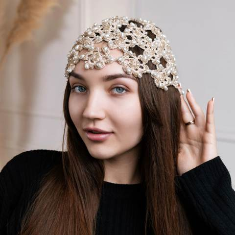

```
вид: шапка
колір: [light_grayish_yellowish_brown]
матеріал: текстиль
волокно: [{волокно: віскоза, частка: 100, де: основа}] ·к
полотно: в'язане
прозорість: напівпрозора
блиск: матовий
товщина: тонка
структура: м'яка
малюнок: {мотив: квітковий, техніка: в'язання, масштаб: середній, розміщення: суцільний, контраст: тон_в_тон}
оздоба: [{що: перли, де: вся_поверхня, скільки: розсип, масштаб: дрібний}, {що: стрази, де: вся_поверхня, скільки: розсип, масштаб: дрібний}, {що: перли, де: обідок, скільки: кілька, масштаб: дрібний}]
поля_убору: немає
прилягання: облягає
ошатність: everyday–smart ·код
погода: mild–warm ·код
```

**Рядок** (68 ток.): шапка; облягає; в'язане; віскоза; напівпрозора; тонка; квітковий тон у тон; перли дрібний, стрази чи кристали дрібний; ошатність щодня–ошатно; погода помірно–тепло

Мітки нині (Sonnet, новий запис): слот="головний_убір"; тип="beanie"; тканина="viscose"; візерунок="solid"; ошатність="smart"; сезон_тканини="невідомо"; утеплення="none"

Поза кодом (2): кристали біконусні — форма кристала дрібніша за «стрази»; хвилястий фігурний нижній край — дрібниця форми

## 26. ж53-1f0604cfb3ed39b4c76d · Намисто – Coral

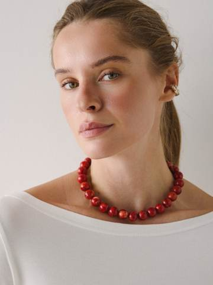

```
вид: намистини
колір: [strong_red]
матеріал: органіка ·к
поверхня: гладка
блиск: шовковистий
масштаб_прикраси: {не_певний: [дрібний, середній]}
довжина_на_тілі: ключиці
застібка: [{засіб: карабін, де: кінці, видимість: видима}]
колір_металу: жовтий
ошатність: everyday–smart ·код
```

**Рядок** (46 ток.): намисто; до ключиці; органіка; шовковистий; жовтий метал; дрібний чи середній розмір; ошатність щодня–ошатно

Мітки нині (Sonnet, новий запис): слот="намисто"; тип="necklace"; ошатність="невідомо"; метал="невідомо"

Поза кодом (2): кожна намистина з власним відтінком і прожилками — природний малюнок каменю, дрібніший за колір; металева коробочка — поза: пакування

## 27. ж53-6bf7868b130aba2a10de · Зелений шарф із вовни декорований бахромою

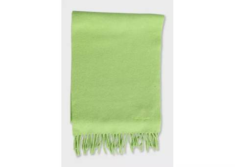

```
вид: шарф
колір: [strong_yellow_green]
матеріал: текстиль
волокно: [{волокно: вовна, де: основа}] ·к
полотно: {не_певний: [тканина, нетканий]}
поверхня: ворсиста
блиск: матовий
товщина: середня
структура: м'яка
малюнок: немає
оздоба: [{що: бахрома, де: кінці, скільки: суцільно, масштаб: середній}, {що: вишивка, де: кінці, скільки: один, масштаб: дрібний, мотив: напис}]
ширина_шарфа: середній
мірки_крамниці: [{що: довжина_виробу, число: 151}, {що: ширина, число: 28}] ·к
ошатність: everyday ·код
```

**Рядок** (42 ток.): шарф; тканина чи нетканий; вовна; ворсиста; бахрома, вишивка дрібний напис; середній; ошатність щодня

Мітки нині (Sonnet, новий запис): слот="шарф"; тип="scarf_generic"; тканина="wool"; візерунок="solid"; ошатність="невідомо"; сезон_тканини="невідомо"

## 28. ж53-21d0f3c915628ae7c545 · Сережки-гвоздики золотистого кольору

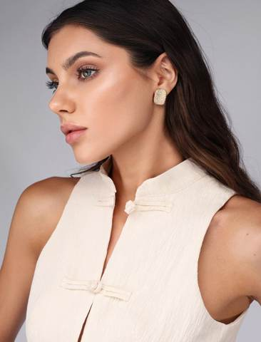

```
вид: гвоздики
колір_металу: жовтий
матеріал: метал
метал: невідомо
поверхня: зерниста
блиск: мерехтливий
масштаб_прикраси: дрібний
мотив_прикраси: [геометричний]
застібка: [{засіб: штифт, видимість: потайна}]
довжина_на_тілі: мочка
ошатність: everyday–smart ·код
```

**Рядок** (48 ток.): гвоздики; до мочка вуха; зерниста; мерехтливий; жовтий метал; геометричний; дрібний розмір; ошатність щодня–ошатно

Мітки нині (Sonnet, новий запис): слот="сережки"; тип="earrings"; ошатність="невідомо"; метал="невідомо"

## 29. ж53-d610b32dd519cef6cb7d · Костюм: піджак прямого крою зі вшитим акцентним коміром та фактурними плечима, на кнопках; штани з косими кишенями, прямі, широкі, пасок ком

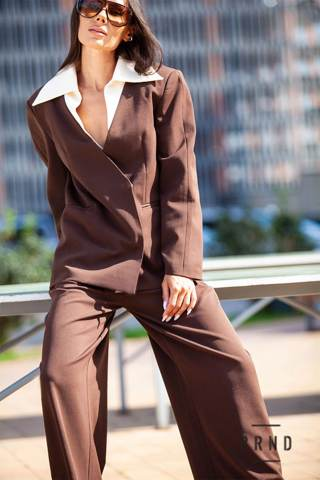

```
вид: комплект
колір: [dark_brown, white]
матеріал: текстиль
волокно: [{волокно: віскоза, частка: 70, де: основа}, {волокно: бавовна, частка: 30, де: основа}] ·к
полотно: тканина
різновид_полотна: костюмна
поверхня: гладка
блиск: матовий
товщина: середня
малюнок: немає
склад → верхній_шар: вид="жакет"; бортність="на_запах"; комір="відкладний"; застібка=[{"засіб": "кнопки", "де": "перед", "видимість": "потайна"}]; кишені=[{"вид": "прорізна", "де": "перед", "скільки": "кілька"}]; деталі=[{"що": "підплічники"}]; силует="прямий"; прилягання="вільне"; довжина="середина_стегна"
склад → низ: вид="штани"; посадка="висока"; силует="прямий"; прилягання="вільне"; кишені=[{"вид": "коса", "де": "бік", "скільки": "кілька"}]; деталі=[{"що": "резинка"}]; довжина="стопа"
прізвисько: костюм ·код
ошатність: neat–formal ·код
тепло: medium ·код
погода: mild ·код
```

**Рядок** (94 ток.): костюм; жакет; до середина стегна; силует прямий; вільне; на запах; комір відкладний; підплічники + штани; до стопа; силует прямий; вільне; посадка висока; резинка; костюмна; віскоза; ошатність охайно–формально; погода помірно

Мітки нині (Sonnet, новий запис): слот="комплект"; тип="suit"; крій="straight"; довжина="maxi"; тканина="viscose"; візерунок="solid"; ошатність="neat"; сезон_тканини="невідомо"

Поза кодом (2): «фактурні плечі» з назви крамниці — на фото видно лише форму плеча (підплічники), фактури не видно; Max Mara — поза: бренд

## 30. ж-09983 · LeBERDES Чоботи зимові 00

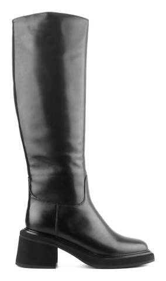

```
вид: чоботи
колір: [black]
матеріал: шкіра
поверхня: гладка
блиск: шовковистий
висота_взуття: коліно
каблук_см: 7 ·к
форма_каблука: стовпчик
товщина_підошви: товста
протектор: рифлений
носок: круглий
застібка: [{засіб: блискавка, де: бік, видимість: видима}]
прилягання: по_фігурі
підкладка: повна ·к
утеплення: {ступінь: тепле, наповнювач: хутро} ·к
сезон_крамниці: [зима] ·к
мірки_крамниці: [{що: висота_халяви, число: 44}, {що: обхват_халяви, число: 37}, {що: висота_каблука, число: 7}, {що: висота_платформи, число: 2}] ·к
ошатність: everyday–neat ·код
погода: deep_frost–frost ·код
```

**Рядок** (83 ток.): чоботи; до коліно; по фігурі; шкіра; шовковистий; каблук 7 см; стовпчик; підошва товста; протектор рифлений; носок круглий; утеплення тепле хутро; ошатність щодня–охайно; погода лютий мороз–мороз

Мітки нині (Sonnet, новий запис): слот="взуття"; тип="boots"; тканина="leather"; візерунок="solid"; ошатність="невідомо"; сезон_тканини=["frost", "cold"]; каблук=7; підошва="невідомо"; водостійкість="невідомо"; утеплення="warm"

Поза кодом (1): еластична вставка біля верху халяви й виступні шви навколо п'яти — дрібні деталі, на образ не впливають

## 31. ж-05307 · Жіноче вовняне пальто без утеплювача з англійським коміром Stella Polare

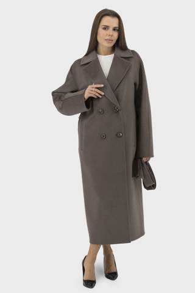

```
вид: пальто
колір: [light_brownish_gray]
матеріал: текстиль
волокно: [{волокно: вовна, частка: 70, де: основа}, {волокно: альпака, частка: 20, де: основа}, {волокно: поліамід, частка: 10, де: основа}] ·к
полотно: тканина
різновид_полотна: драп
поверхня: гладка
блиск: матовий
товщина: товста
структура: напівжорстка
малюнок: немає
бортність: двобортна
застібка: [{засіб: ґудзики, де: перед, видимість: видима}]
комір: лацкани
пройма: {не_певний: [кімоно, спущене_плече]}
довжина_рукава: зап'ястя
деталі: [{що: відвороти}]
кишені: [{вид: у_шві, де: бік, скільки: кілька}]
силует: прямий
прилягання: вільне
довжина: середина_литки
утеплення: {ступінь: немає} ·к
мірки_крамниці: [{що: довжина_виробу, число: 118}] ·к
ошатність: neat–smart ·код
тепло: warm ·код
погода: cold–cool ·код
```

**Рядок** (81 ток.): пальто; до середина литки; силует прямий; вільне; двобортна; комір лацкани; кімоно чи спущене плече; драп; вовна; товста; напівжорстка; відвороти; ошатність охайно–ошатно; погода холод–прохолода

Мітки нині (Sonnet, новий запис): слот="верхній_шар"; тип="coat"; крій="straight"; довжина="midi"; тканина="wool"; візерунок="solid"; ошатність="невідомо"; сезон_тканини=["cool", "mild"]; водостійкість="невідомо"; утеплення="none"

Поза кодом (1): пояс у руках моделі — не певно, чи йде з пальтом: крамниця мовчить (поза: розбіжність_фото_крамниці)

## 32. ж-16642 · Шарф кашеміровий дреди

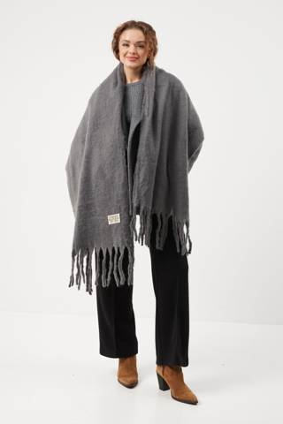

```
вид: шарф
колір: [medium_gray]
матеріал: текстиль
волокно: [{волокно: кашемір, де: основа}] ·к
поверхня: ворсиста
блиск: матовий
товщина: товста
структура: м'яка
малюнок: немає
оздоба: [{що: бахрома, де: кінці, скільки: суцільно, масштаб: великий}]
ширина_шарфа: широкий
прізвисько: палантин ·код
ошатність: everyday–neat ·код
```

**Рядок** (36 ток.): палантин; кашемір; ворсиста; товста; бахрома великий; широкий; ошатність щодня–охайно

Мітки нині (Sonnet, новий запис): слот="шарф"; тип="scarf_generic"; тканина="cashmere"; візерунок="solid"; ошатність="невідомо"; сезон_тканини=["cold", "frost"]

Поза кодом (2): світла етикетка біля краю — дрібниця; накинуто на плечі — поза: спосіб_пов'язати

## 33. ж53-a21de79cb8e023715fa1 · Сапоги VS000096998

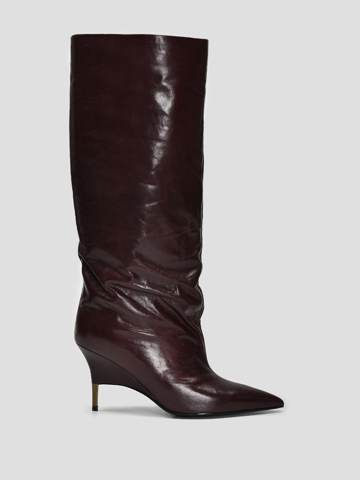

```
вид: чоботи
колір: [very_dark_red]
матеріал: шкіра
поверхня: фактурна
блиск: глянцевий
висота_взуття: нижче_коліна
каблук_см: 8.5 ·к
форма_каблука: шпилька
товщина_підошви: тонка
матеріал_підошви: теп ·к
носок: гострий
прилягання: вільне
деталі: [{що: складки}]
колір_металу: жовтий
підкладка: повна ·к
утеплення: {ступінь: легке, наповнювач: байка} ·к
сезон_крамниці: [весна_осінь] ·к
нагода_крамниці: [щодня, вечір] ·к
мірки_крамниці: [{що: висота_каблука, число: 8.5}, {що: висота_платформи, число: 0.5}, {що: висота_халяви, число: 36}] ·к
ошатність: neat–smart ·код
погода: cold–cool ·код
```

**Рядок** (85 ток.): чоботи; до нижче коліна; вільне; шкіра; фактурна; глянцевий; складки; жовтий метал; каблук 8,5 см; шпилька; носок гострий; утеплення легке байка чи фліс; ошатність охайно–ошатно; погода холод–прохолода

Мітки нині (Sonnet, новий запис): слот="взуття"; тип="boots"; тканина="leather"; візерунок="solid"; ошатність="невідомо"; сезон_тканини=["cool", "mild"]; каблук=8.5; підошва="polyurethane"; водостійкість="невідомо"; утеплення="light"

Поза кодом (1): ефект потертостей поверх зім'ятої шкіри — поверхня одна, складки важать більше

## 34. ж-04812 · Гірчичне пальто прямого крою - купити Пальта в Києві та Україні, ціни на Пальта в інтернет-магазині жіночого одягу a LOT

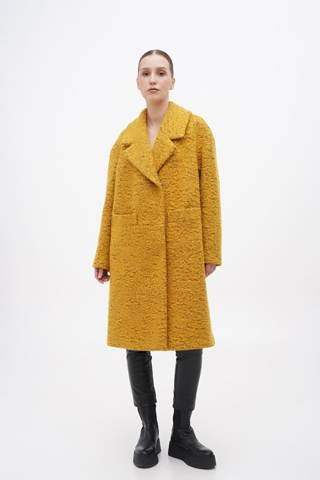

```
вид: пальто
колір: [deep_orange_yellow]
матеріал: текстиль
волокно: [{волокно: вовна, частка: 50, де: основа}, {волокно: віскоза, частка: 30, де: основа}, {волокно: акрил, частка: 20, де: основа}] ·к
полотно: тканина
різновид_полотна: букле
поверхня: петлиста
блиск: матовий
товщина: товста
структура: напівжорстка
малюнок: немає
бортність: двобортна
застібка: [{засіб: кнопки, де: перед, видимість: потайна}] ·к
комір: лацкани
кишені: [{вид: прорізна, де: перед, скільки: кілька}] ·к
пройма: спущене_плече
довжина_рукава: зап'ястя–кисть
деталі: [{що: розріз}] ·к
силует: прямий
прилягання: вільне
довжина: коліно
нагода_крамниці: [щодня, відпочинок] ·к
мірки_крамниці: [{що: довжина_виробу, число: 101}] ·к
ошатність: everyday–neat ·код
тепло: warm ·код
погода: cold–cool ·код
```

**Рядок** (89 ток.): пальто; до коліно; силует прямий; вільне; двобортна; комір лацкани; рукав зап'ястя–кисть; спущене плече; букле; вовна; петлиста; товста; напівжорстка; розріз чи шліца; ошатність щодня–охайно; погода холод–прохолода

Мітки нині (Sonnet, новий запис): слот="верхній_шар"; тип="coat"; крій="straight"; довжина="knee"; тканина="boucle"; візерунок="solid"; ошатність="невідомо"; сезон_тканини="невідомо"; водостійкість="невідомо"; утеплення="невідомо"

## 35. ж53-c798e8240e681bb63092 · Худі Oversize Espresso із футера 3-нитка | YULA

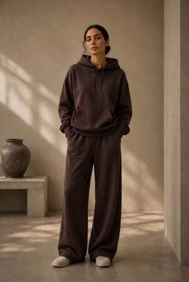

```
вид: пуловер
колір: [dark_brown]
матеріал: текстиль
полотно: трикотаж
різновид_полотна: футер ·к
поверхня: гладка
блиск: матовий
товщина: товста
структура: м'яка
малюнок: немає
оздоба: немає
капюшон: є
деталі: [{що: кулиска}]
кишені: [{вид: кенгуру, де: перед, скільки: один}]
пройма: спущене_плече
довжина_рукава: зап'ястя
силует: прямий
прилягання: оверсайз
довжина: стегна
сезон_крамниці: [весна_осінь, зима] ·к
мірки_крамниці: [{що: щільність, число: 340}] ·к
прізвисько: худі ·код
ошатність: home–everyday ·код
тепло: medium ·код
погода: cool–mild ·код
розтяжність: тягнеться ·код
```

**Рядок** (61 ток.): худі; до стегна; силует прямий; оверсайз; капюшон; спущене плече; футер; товста; кулиска; ошатність дім–щодня; погода прохолода–помірно; тягнеться

Мітки нині (Sonnet, новий запис): слот="верх"; тип="hoodie"; крій="oversized"; довжина="waist"; тканина="cotton"; візерунок="solid"; ошатність="everyday"; сезон_тканини=["mild", "cool", "cold"]

Поза кодом (3): рукав збирається складками над ребристим манжетом — фактура манжета дрібніша за поле поверхні; крамниця описує костюм Wide Set, а продає худі — інша пропозиція (поза: розбіжність_фото_крамниці); YULA — поза: бренд

## 36. ж-00105 · Біла джинсова сукня футляр

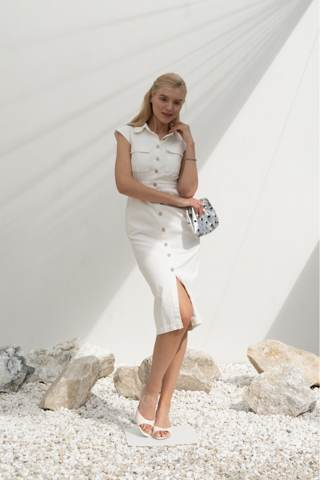

```
вид: сукня
колір: [white]
матеріал: текстиль
волокно: [{волокно: бавовна, частка: 100, де: основа}] ·к
полотно: тканина
різновид_полотна: денім
поверхня: гладка
блиск: матовий
товщина: середня
структура: напівжорстка
малюнок: немає
оздоба: немає
комір: відкладний
виріз: {форма: під_комір, глибина: шия}
застібка: [{засіб: ґудзики, де: перед, видимість: видима}]
колір_металу: білий
кишені: [{вид: з_клапаном, де: груди, скільки: кілька}]
довжина_рукава: плече
форма_рукава: крильце
деталі: [{що: розріз}]
силует: приталений
прилягання: по_фігурі
лінія_талії: на_талії
довжина: нижче_коліна
прізвисько: футляр ·код
ошатність: everyday–neat ·код
тепло: medium ·код
погода: mild ·код
розтяжність: не_тягнеться ·код
```

**Рядок** (84 ток.): футляр; до нижче коліна; силует приталений; по фігурі; талія на талії; комір відкладний; рукав плече; рукав крильце; денім; бавовна; напівжорстка; розріз чи шліца; ошатність щодня–охайно; погода помірно

Мітки нині (Sonnet, новий запис): слот="сукня"; тип="sheath_dress"; крій="sheath"; довжина="midi"; тканина="denim"; візерунок="solid"; ошатність="невідомо"; сезон_тканини="невідомо"

Поза кодом (1): сталеві ґудзики YKK — поза: бренд (фурнітури)

## 37. ж53-3f7fb6057f1407ba9b97 · Довге багатоярусне намисто з коричневими бусинами

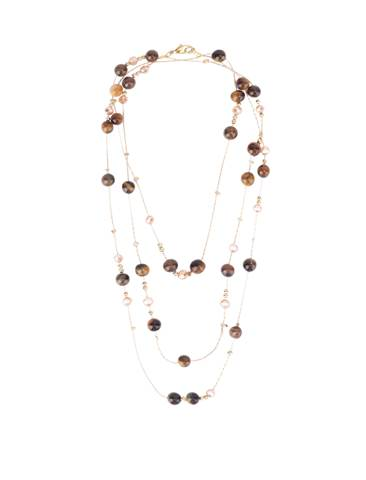

```
вид: ланцюжок
колір_металу: жовтий
матеріал: метал
метал: невідомо
вставки: [{що: кольоровий_камінь, скільки: кілька}, {що: намистини, скільки: розсип}]
деталі: [{що: яруси}]
масштаб_прикраси: дрібний
довжина_на_тілі: {не_певний: [груди, під_грудьми]}
застібка: [{засіб: карабін, де: кінці, видимість: видима}]
ошатність: everyday–smart ·код
```

**Рядок** (52 ток.): ланцюжок; до груди чи під грудьми; яруси; жовтий метал; кольоровий камінь, намистини; дрібний розмір; ошатність щодня–ошатно

Мітки нині (Sonnet, новий запис): слот="намисто"; тип="necklace"; ошатність="невідомо"; метал="невідомо"

Поза кодом (1): бусини з рисунком «тигрове око» — природний малюнок каменю; речовина каменю — поза: речовина_вставки

## 38. ж-11919 · Приталена сукня з широким пясом

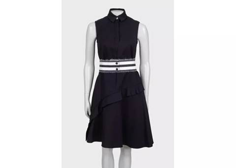

```
вид: сукня
колір: [black, white]
матеріал: текстиль
волокно: [{волокно: бавовна, частка: 94, де: основа}, {волокно: еластан, частка: 6, де: основа}, {волокно: бавовна, де: підкладка}] ·к
полотно: тканина
поверхня: гладка
блиск: матовий
товщина: середня
структура: напівжорстка
малюнок: {мотив: смуги, техніка: ткацтво, масштаб: дрібний, розміщення: частковий, контраст: контрастний}
оздоба: [{що: кант, де: талія, скільки: кілька, масштаб: дрібний}]
комір: відкладний
виріз: {форма: під_комір, глибина: шия}
застібка: [{засіб: ґудзики, де: перед, видимість: потайна}, {засіб: кнопки, де: талія, видимість: видима}]
довжина_рукава: без_рукава
деталі: [{що: волани}, {що: асиметрія}, {що: розріз}]
силует: приталений
прилягання: по_фігурі
лінія_талії: на_талії
довжина: вище_коліна
підкладка: повна ·к
ошатність: neat–smart ·код
тепло: medium ·код
погода: mild ·код
розтяжність: тягнеться ·код
```

**Рядок** (108 ток.): сукня; до вище коліна; силует приталений; по фігурі; талія на талії; комір відкладний; без рукава; бавовна; напівжорстка; смуги дрібний контрастний; кант дрібний; волани чи рюші, асиметрія, розріз чи шліца; ошатність охайно–ошатно; погода помірно; тягнеться

Мітки нині (Sonnet, новий запис): слот="сукня"; тип="dress_generic"; крій="fitted"; довжина="knee"; тканина="cotton"; візерунок="solid"; ошатність="невідомо"; сезон_тканини="невідомо"

Поза кодом (1): Kenzo — поза: бренд

## 39. ж53-2af929b7cf132b3e896f · Прозора спідниця на резинці з вишивкою

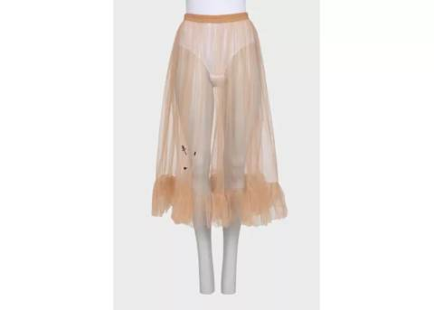

```
вид: спідниця
колір: [pale_yellowish_pink]
матеріал: текстиль
полотно: сітка
різновид_полотна: фатин
прозорість: прозора
товщина: тонка
структура: м'яка
малюнок: немає
оздоба: [{що: вишивка, де: поділ, скільки: розсип, масштаб: дрібний}]
деталі: [{що: резинка}, {що: волани}]
застібка: немає
силует: кльош
посадка: висока
прилягання: вільне
довжина: середина_литки
підкладка: немає
мірки_крамниці: [{що: довжина_виробу, число: 81}] ·к
ошатність: everyday–smart ·код
```

**Рядок** (64 ток.): спідниця; до середина литки; силует кльош; вільне; посадка висока; фатин; прозора; тонка; вишивка дрібний; резинка, волани чи рюші; ошатність щодня–ошатно

Мітки нині (Sonnet, новий запис): слот="низ"; тип="skirt"; крій="a-line"; довжина="midi"; тканина="textile"; візерунок="solid"; ошатність="невідомо"; сезон_тканини=["warm", "hot"]

Поза кодом (1): нерівний край волана — дрібниця форми

## 40. ж-11771 · Фігурні золоті сережки

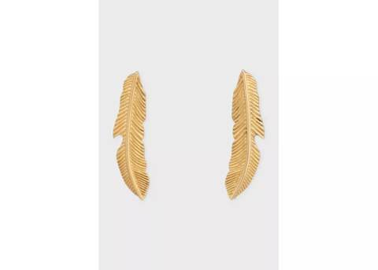

```
вид: підвіски
колір_металу: жовтий
матеріал: метал
метал: золото ·к
проба: 585 ·к
поверхня: рубчаста
блиск: глянцевий
мотив_прикраси: [тварини]
масштаб_прикраси: середній
довжина_на_тілі: щелепа
ошатність: neat–smart ·код
```

**Рядок** (50 ток.): підвіски; до лінія щелепи; рубчаста; глянцевий; золото; жовтий метал; тварини; середній розмір; ошатність охайно–ошатно

Мітки нині (Sonnet, новий запис): слот="сережки"; тип="earrings"; ошатність="невідомо"; метал="gold"

Поза кодом (1): Guzema Fine Jewelry — поза: бренд
