# 4944, крок 3 — native контраст і цілі дотику

PR #1000, заморожена голова `7224af9a5d15a3fe9316caf5301fbcd9a74ff7e1`. Код CSS — `06ed5bccdc882edf26fa3b86a50b4408991660ba`; наступний коміт додає лише знахідку 5100 на дошку. База ДО — `7c90a0093b5d7dc8587a90c541eaf11e23b9a3be`.

Наряд #960/6151544586 п.3: контраст ≥4,5:1; цілі ≥24 px, часті дії ~44 px. Змінено лише CSS і дошку. Тексти, розмітка, JavaScript і сітки екранів ті самі; висота контрольних дій збільшена.

Chromium 151.0.7922.173, axe-core 4.14.0, телефон 390×844 з touch. Сторінки зібрані штатним `зібрати_показ(повний=True)`; модульний вантаж ДО/ПІСЛЯ md5 `dd174d33fba9abe2dc7eb634179e8cf2`. Анімації та шрифти завершені перед вимірами. Нових модельних / фото API — 0. Картка: {'kind': 'synthetic IndexedDB container; archived model words copied verbatim; not an owner record', 'source': 'аудит/живі_12/Б/09_ж1_весілля_гостя/вердикти.txt', 'source_sha256': '13016ccc59428cf321f93a2b9bf615aca64683964bd738bf4bece43dc87497c0'}. Фото речей у цій фікстурі не завантажено; перевірено текст і контроли, не якість добору чи фотографії.

## Чотири обов’язкові екрани

| Екран | Видимих текстових вузлів | Контраст <4,5 ДО → ПІСЛЯ | Цілей дотику | Розмір <24 ДО → ПІСЛЯ | Автоматичних правил A/AA ДО → ПІСЛЯ |
|---|---:|---:|---:|---:|---:|
| acquaintance | 24 | 1 → 0 | 13 | 2 → 0 | 0 → 0 |
| scenario | 17 | 1 → 0 | 16 | 1 → 0 | 0 → 0 |
| palette | 42 | 0 → 0 | 32 | 0 → 0 | 0 → 0 |
| card | 41 | 2 → 0 | 25 | 1 → 0 | 1 → 0 |

Разом: 124 видимі текстові вузли, контрастних провалів 4 → 0; 86 видимих цілей, нижчих за 24 px 4 → 0. Приховані під details контроли не включено в ці числа; прозорий файловий вхід у label міряється за реальною ціллю label.

Денне золото `#8B6B2C` → `#846426`: 4,360 → 4,822:1 на полотні. Великий заголовок дозволяв axe поріг 3:1, але наряд вимагає 4,5:1. Лічба оцінених карток: 3,719 → 5,020:1 після зняття opacity .85. Placeholder — олівець без приглушення, замість кольору межі / opacity .85. Під час натискання й наведення текст більше не приглушується opacity.

У заповненому сценарії `#сц-зберегти` 117,4×21 → 117,4×44 px; axe target-size 1 → 0. Checkbox згоди 20×20 → 24×24; звичайний summary 21,7 → 24 px; тема 36×36 → 44×44. Часті текстові / тихі / малі кнопки й чипи мають висоту ≥44 px. Ширина лишилася природною; усі телефонні кадри мають layout viewport 390 і scrollWidth 390.

## Додаткові стани й межі доказу

У native прогоні перевірено заповнений сценарій, hover/active, modal нагоди, розкриття палітри, розкриту/вибрану картку, фокус її поля, темну тему й forced colors. Окремий native mouse-прогін 390×844: вкладка «Оцінити» при hover 4,10 → 5,02:1, при active з touch 3,72 → 5,02:1. Усі звичайні / темні виміряні видимі текстові вузли ПІСЛЯ ≥4,5:1; невидимі й disabled контроли не оцінюються як текст жінці.

Axe color-contrast має incomplete через pseudoContent / фактуру / форму. Тому 0 автоматичних порушень не дорівнює загальному прийняттю AA. Додатковий числовий прохід рахує sRGB від фактичного computed color і найближчих поверхонь, opacity та градієнта головної кнопки; це не попіксельний аналіз антиаліасингу чи всіх декоративних псевдоелементів. Їх видно в native PNG, які читає незалежна QA.

Forced colors: справжній Chromium малює чорний текст на білому (див. PNG); axe натомість оцінює authored нічні кольори на forced canvas і повідомляє 6 color-contrast вузлів. Це прямо збережено в JSON, без підміни результату на 0.

Окрема реальна вада: розкрите «Або додати картинку вручну» показує `#кф-0` без доступного імені; axe label 1 ДО / 1 ПІСЛЯ. Записано як ВІДКРИТО 5100, за межами CSS-кроку. Рядок 4944 загалом лишається ВІДКРИТО.

## Сумісність із #994

Source #994 — `52fc8503656b13369ad538ec30d920701cf45dfe`. `git merge-tree --write-tree` завершується без конфлікту, обидві логіки збережені. У діагностичній композиції штатний зібраний #994 отримує CSS з merged-source; його JavaScript/ARIA й модульний вантаж лишаються дослівними. Це окремий діагностичний артефакт, не нова гілка продукту чи злиття.

Chromium у цій композиції: 138 Tab-фокусів, невидимих 0; 24 реальних дотиків/станів, aria-pressed розходжень 0; 16 статусів мають DOM live-region і AX status, відсутніх 0; pageerrors 0. Тест не доводить семантичної правильності тексту кожного статусу при збоях моделі; логіка статусів #994 не змінювалася.

## Native PNG ДО / ПІСЛЯ

### acquaintance

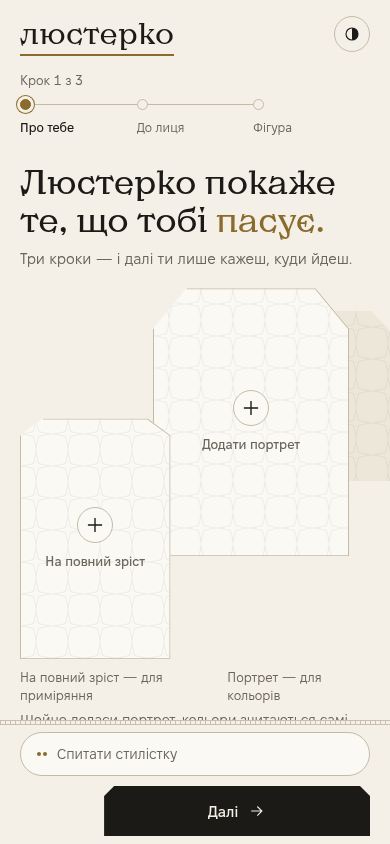

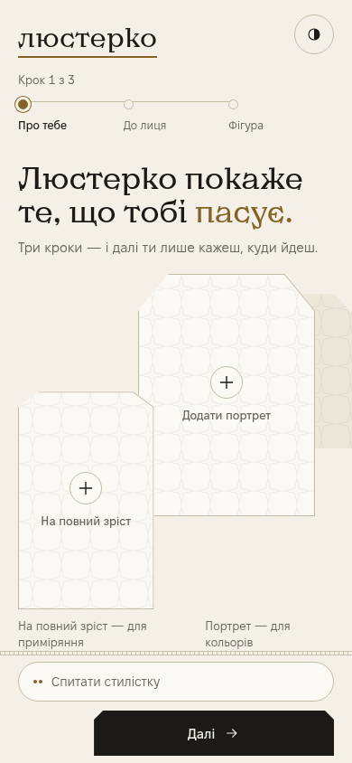

### scenario

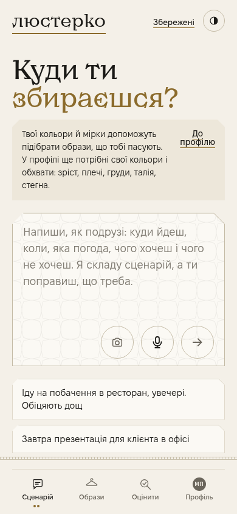

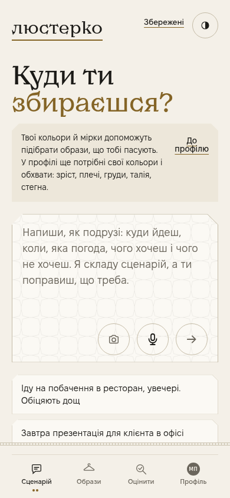

### palette

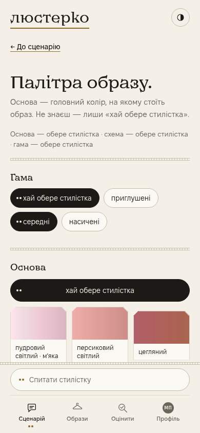

### card

### scenario-filled

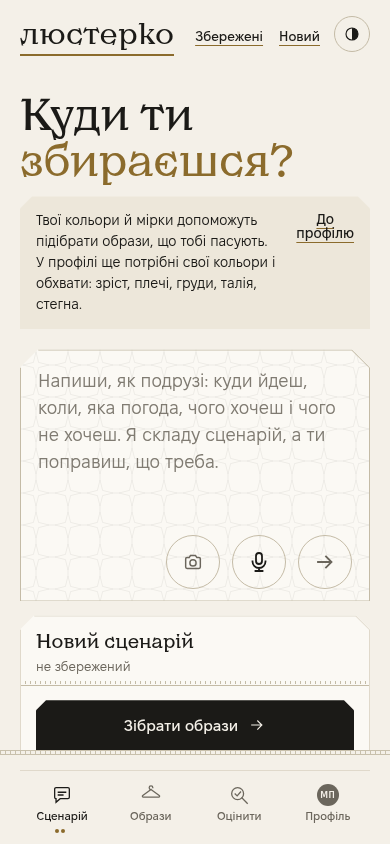

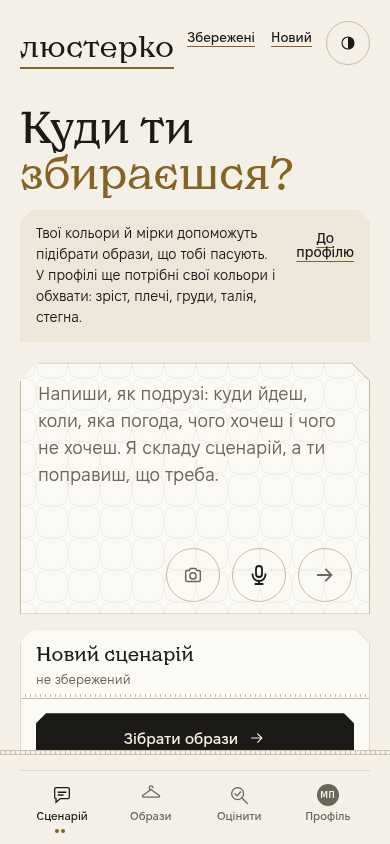

### nav-active

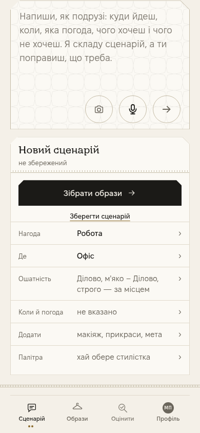

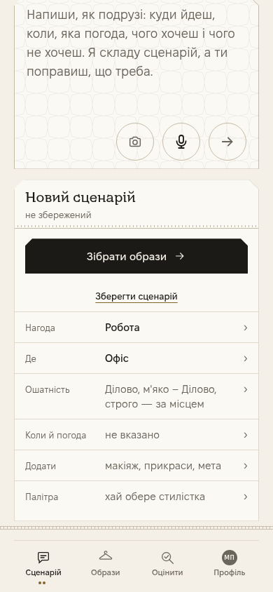

### palette-expanded

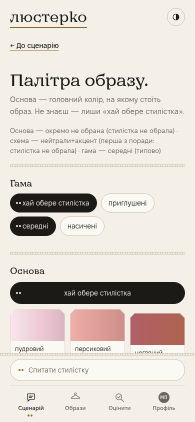

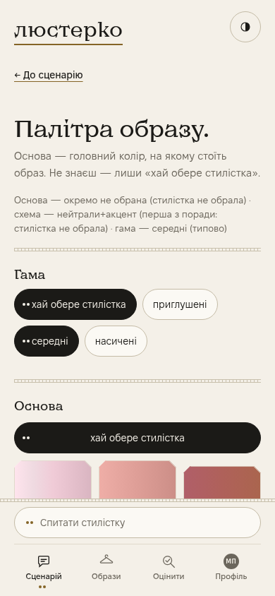

### card-expanded

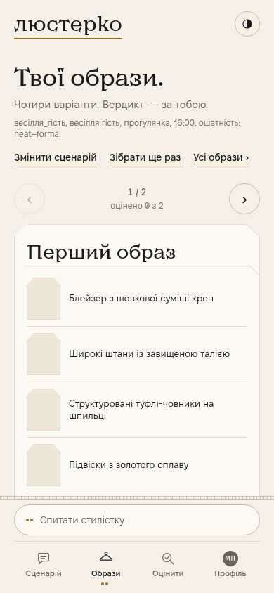

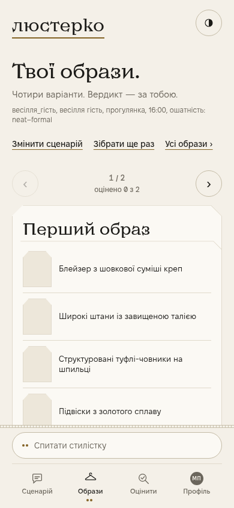

### card-selected

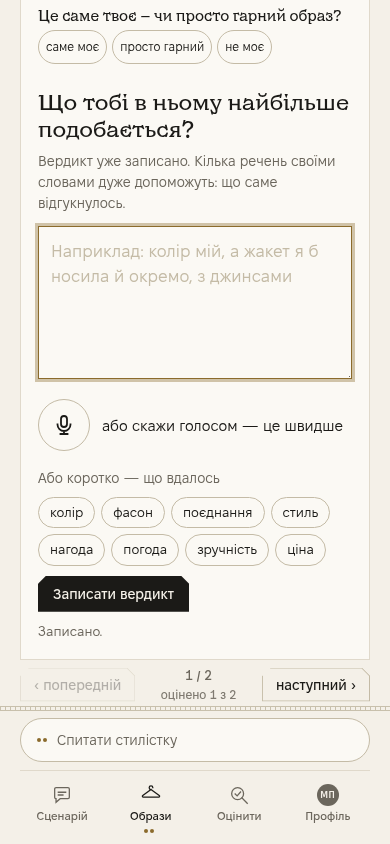

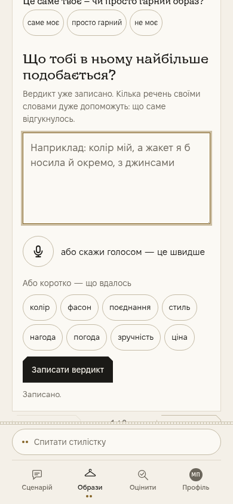

### card-keyboard-field

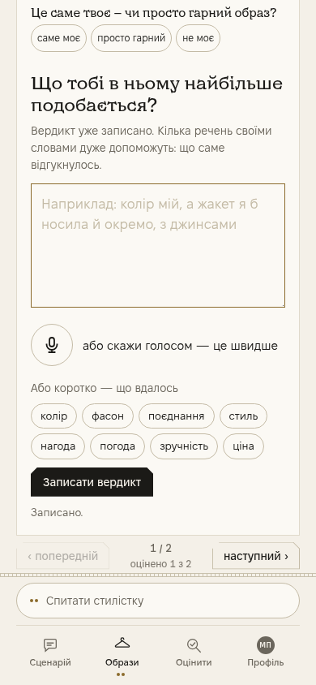

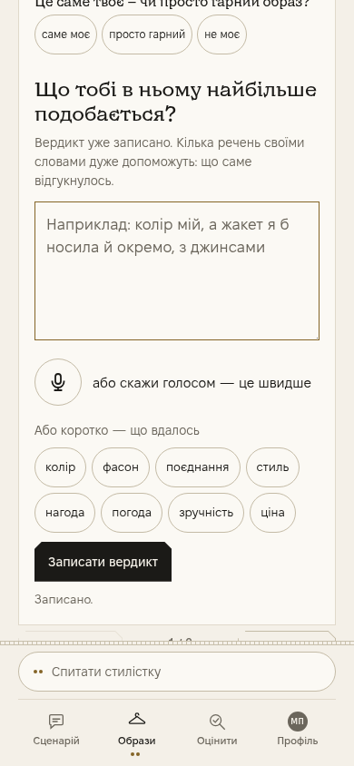

### card-dark

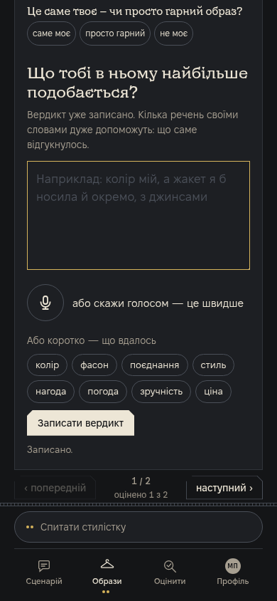

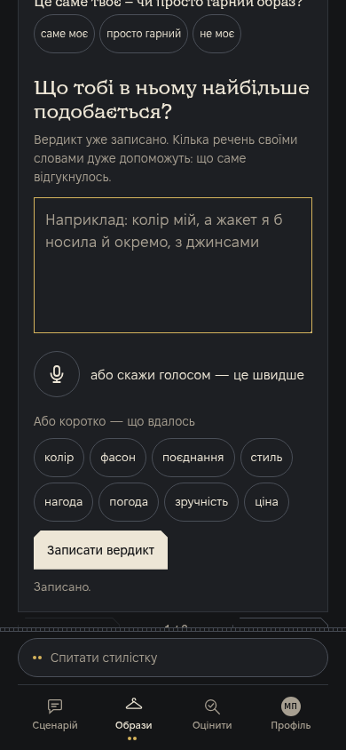

### palette-dark

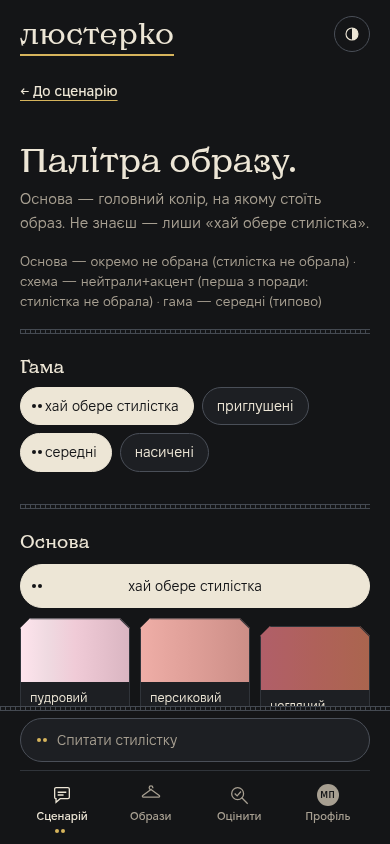

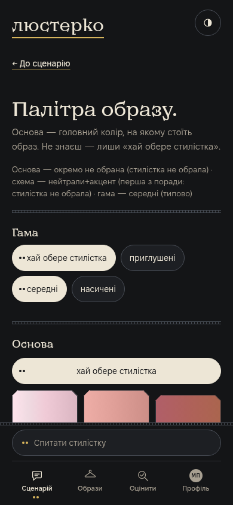

### scenario-dark

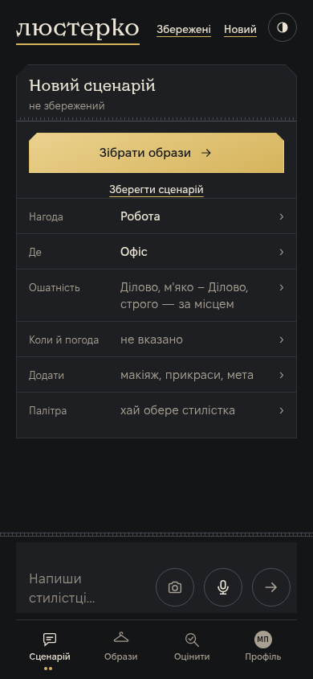

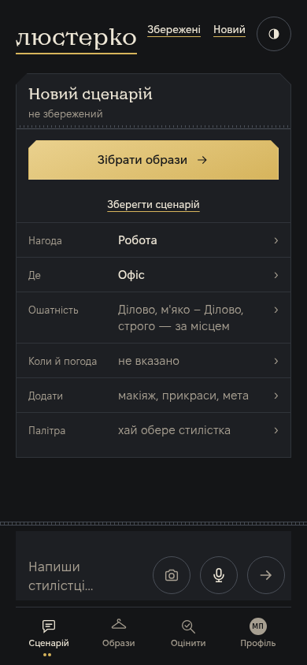

### profile-forced-colors

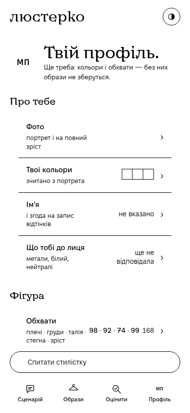

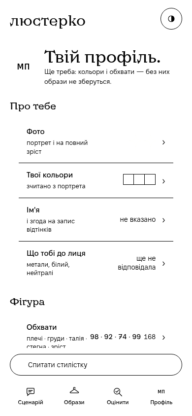
