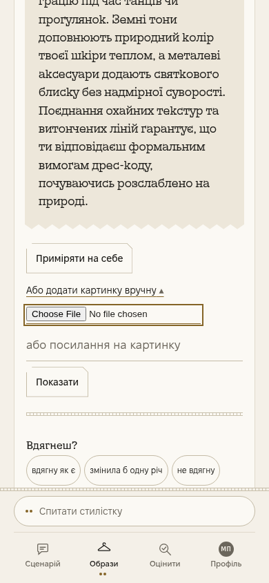

# 4944 / 5100 — одне поле ручної картинки

PR #1038. ДО: `9f3523d62319225eabb2c1a2cd382053a4651384`; ПІСЛЯ (frozen): `c1fff7d727feaa16a00eb4491d15dc46502c28be`.

Один залишковий контроль доступності: бібліотека → архівна картка → дотик «Або додати картинку вручну» → Tab → Enter на `#кф-0`. Chromium 151.0.7922.173, телефон 390×844, axe-core 4.14.0. Штатні повні збірки з відповідних джерел; усі мережеві запити перехоплено, локальні Pyodide та шрифти. Зовнішні фото заблоковано. Картка — синтетична IndexedDB-обгортка з незміненими архівними модельними словами; походження й хеш первинного тексту в metrics.json. Нових модельних, платних, фото чи ноутбучних викликів немає.

## ДО → ПІСЛЯ

12 цільових звірок одного сценарію; нових продуктових тестів або широкого аудиту немає.

| Перевірка | ДО | ПІСЛЯ |
|---|---|---|
| Авторське ім’я file input | немає | aria-label «Картинка образу з телефона» |
| axe label | 1 порушення | 0 |
| AX name | browser default Choose File | Картинка образу з телефона |
| Tab з summary | активне кф-0 | активне кф-0 |
| Видимий клавіатурний фокус | 2 px solid | 2 px solid |
| Ширина цілі | 253 px | 253 px |
| Висота цілі | 24 px | 24 px |
| Enter | single native file chooser | single native file chooser |
| Viewport | 390 px | 390 px |
| scrollWidth | 390 px | 390 px |
| pageerrors | 0 | 0 |
| Нові модельні API | 0 | 0 |

Очима переглянуто обидва `file-keyboard-focus.png`: розкритий блок ручної картинки, поле в межах екрана, золотий фокус навколо всього input, сусіднє поле посилання та кнопка «Показати» доступні. Доступне ім’я перевірено окремо CDP AX, бо невидимий aria-label не доводиться знімком.

Єдина продуктова різниця — один сталий aria-label у шаблоні поля; CSS #1000, фокус/ARIA/status #994 та вся інша логіка main побайтово збережені. На дошці змінено лише 4944 і 5100 зі збереженням історії. Рядок 5100 локально закрито #1038; 4944 і загальне AA лишаються ВІДКРИТИМИ. Contrast incomplete, forced-colors та живе приймання не заявляються закритими. Цільовий axe label не є заявою нуль усіх AA.

## Кадри

ДО:

ПІСЛЯ:

## Відтворення

`one-flow.cjs before|after` використовує локальну повну збірку відповідної голови, Chromium, локальні бібліотеки та архівну фікстуру. Скрипт збережено як доказ сценарію, а не новий продуктовий гейт. Native file chooser відкрито Enter і скасовано порожнім вибором; файл не завантажувався.

SHA256 before/index.html (збірка лише локально, не в гілці доказів): `e77945f4d26d956baeb61caccdeefc9e094b520fd0fcdff8e290c27a28404cc1`.

SHA256 after/index.html (збірка лише локально, не в гілці доказів): `c5e14ae4e5334a3d175763f0c86fa776709308dc1ea8c864d5edcf9a0d56b4a8`.

## Батарея frozen head

Один фінальний прогін на frozen head завершено: prepare, syntax, split, smoke, path, protocol, gates, contracts, display, bridge, reach — усі exit 0. Синтаксис: Python 1196 / JS 22, збоїв 0; поділ AST ВПАЛО 0; гейти 573 пройдено / 0 збоїв / 2 без входу; показ 731 звірка у 64 розділах; міст усе зелене; досяжність «НІХТО» = 0, профільований шлях 525,2 с (248075241 виклик). Два випадки без входу не зараховано пройденими. Файл battery-head.txt фіксує точний SHA; повторної батареї не було. Наявні git-об’єкти для історичних AST-проб використано через GIT_ALTERNATE_OBJECT_DIRECTORIES; нової повної історії або копій залежностей не завантажували. Згенерований звіт досяжності відновлено локально до HEAD після збереження логу, він не входить у продуктовий диф. Власних фонових процесів після завершення немає. Окрема незалежна перевірка та actual CI/root gate лишаються окремими гейтами.

## Незалежна перевірка

Окрема сесія виконала власний native ДО/ПІСЛЯ та перегляд кадрів: CONTENT PASS на тій самій голові, коментар #1038 `6186566886`. Доказ `codex/perevirka-1038-1510:аудит/знімки/1038-незалежно/звіт.md` @ `6097ae4e52de3b75dcbef26b29bbca39ada89b3d`. CI/root gate окремо; власна батарея не підміняє незалежне приймання.
