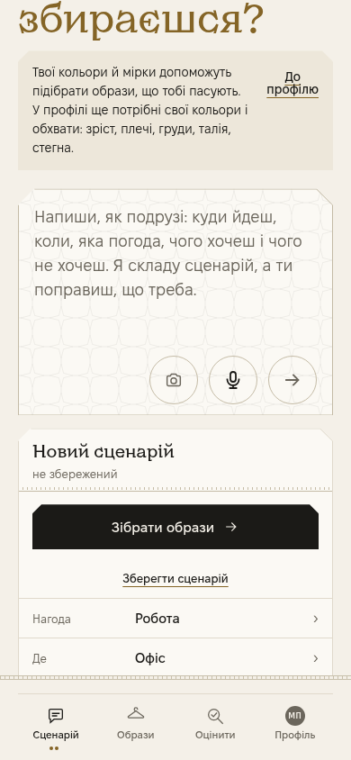
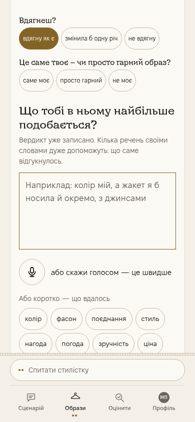
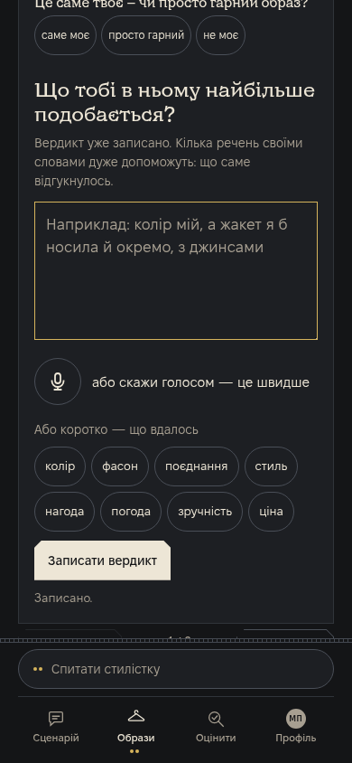
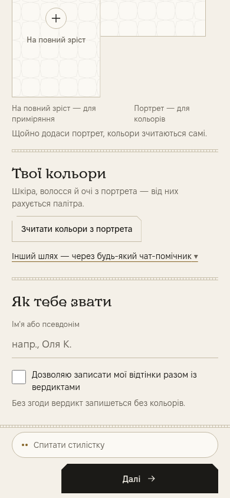

# Незалежна інтеграційна QA пачки #1005

**CONTENT PASS; єдина батарея builder і CI точної голови ще PENDING. До злиття не прийнято.**

Заморожена голова `31257c15337a12f5f08a4cd72b1548adf3afdb70`, дерево `3ba79cc445b1ea7984eae1bf4ec26ee03e532064`, актуальний remote main `7c90a0093b5d7dc8587a90c541eaf11e23b9a3be`. PR відкритий, не чернетка, mergeable=true. Наряд: #960/6151544586. Продукт, дошку й тіло PR ця перевірка не змінює.

## Склад і межі

Усі три точні голови є справжніми предками пачки: #997 `82c34d186b208167053dd6172f9b5074081b4f7a`, #998 `691c5500330cb1692610fa14f26d5eee7833a057`, #1000 `fb3bea3312ab054886e67a7125d064689f3a0c1f`.

Незалежний прилад `integration-independent.py` підтвердив рівно 6 файлів diff. П’ять файлів джерел побайтово дорівнюють відповідним прийнятим головам; чотири змінені рядки дошки 3653/4531/4944/5100 теж дослівні джерелам. Інші рядки збережені. Нових дублів ID, продуктових медіа й нової логіки читання або створення слів — 0. Увесь показ поза CSS побайтово дорівнює main; продуктивна зміна Python — один прапорець `скелет_наприкінці=True`. AGENTS, CLAUDE, ПРОДУКТ, мовний шар, actual producer і збирач промптів незмінні.

3653 лишається відкритим: source replay 15 ходів, 3 порожні, 0 знятих через чужі коди — прийнятий джерельний факт, не новий продуктовий ПІСЛЯ. 4531 закриває лише код; локальна сцена ЖИВІ-21 №13/seed3_40_ВЕРДИКТ_V1_ОБРАЗИ_V1 очікується. Історичні 14/28 не підмінено нулем витоків. Загальний 4944 і окремий file label 5100 відкриті.

#994 і пачка #999 не входять у цю голову. Перевірка не підмішує їх до артефакта. Діагностична source-композиція #1000+#994 залишається окремим історичним доказом; для майбутнього поєднання потрібні обидві логіки та обидві історії рядка 4944.

## Фактичний producer

На цій голові вузько виконано `проби/ремонт_схема_4531.py` на двох офлайн входах каталог_brief. Обидва без гейтів. Останній кореневий ключ — `answer_schema`, у `task` його немає; `input` і `statement_codes` перед ним, після декодованої схеми строго `}`. Обидва сирі виходи побайтово дорівнюють незалежно прийнятим виходам #998:

| Вхід | UTF-8 байтів | SHA256 |
|---|---:|---|
| повний | 34346 | `4309710ce7648852977f84f2d2a6b876549f776e9d04a283995b60ff07fdb566` |
| без взуття | 37907 | `ff1153c2a752e77423916c41af6a1aed59750057f1d5867d73400d3940adbc4e` |

Повторного replay #997, повної джерельної UI перевірки або повної батареї незалежний рев’юер не запускав.

## Chromium 390×844

Штатний `build_артефакт.py . index.html показ-повний`, exact frozen source; Chromium 151.0.7922.173, кешовані Pyodide й шрифти. Збірка завершилась rc0. Її необов’язковий внутрішній jsdom-крок пропущено через відсутність локального node_modules; повний display-крок виконує лише builder у своїй єдиній батареї. Зовнішні запити браузера перехоплені: дозволені тільки локальні файли, решту скасовано. Нових модельних і фото API — 0.

| Вузька перевірка | Фактичний результат |
|---|---:|
| Контрольні цілі ≥24 px | 9/9 |
| Точки реального влучання | 45/45 |
| Зберегти сценарій | 117,4375×44 px |
| Тема / згода / label фото / file input | 44×44 / 24×24 / 54×54 / 253×24 px |
| Placeholder чату | 5,423:1 |
| Золото заголовка | 4,822:1 |
| Лічба оцінених карток | 5,020:1 |
| Вибраний вердикт | 5,208:1 |
| Лічба в темній темі | 6,970:1 |
| Кнопка збереження під час натискання | opacity=1, 16,539:1 |
| Layout viewport / scrollWidth, 4 кадри | 390/390 |
| Помилки сторінки завершеного виміру | 0 |

Чотири PNG прочитані очима: текст не обрізаний формою кнопок, контрольні дії доступні, нового горизонтального переповнення немає. Вибір вердикту ставить CSS `вибр`; `aria-pressed` на actual frozen head відсутній, бо #994 не включений. Обидва поля справді одержали клавіатурний фокус; чат має `outline:none`, поле вердикту — наявну золоту рамку 1 px. Нові видимі 2 px фокуси #994 цим прогоном не приймаються, загальний 4944 відкритий.

Перші два запуски вузького приладу зупинились на `locator.evaluate: Timeout 5000ms exceeded` для `#чат-поле`. У завершеному приладі додано діагностичну фіксацію DOM до/після переходу та після очікування; поле підключене, зафіксоване штатне перенесення вузла до `сц-лист-місце`, усі перевірки пройшли. Продуктовий код та HTML артефакта між спробами не змінювались. Сам факт цих таймаутів не трактовано як встановлену продуктову причину.

Картка — синтетичний контейнер IndexedDB із дослівними архівними словами моделі, **не запис власника**. Джерело: `аудит/живі_12/Б/09_ж1_весілля_гостя/вердикти.txt`, SHA256 `13016ccc59428cf321f93a2b9bf615aca64683964bd738bf4bece43dc87497c0`. Фото речей не завантажувались і не оцінювались; нової оцінки добору чи мірила ≥38/40 немає. Загальне AA не прийняте. Джерельні обмеження axe contrast incomplete, forced-colors і відкритого file label 5100 збережені; цих великих source-прогонів повторно не виконували.

## Перед злиттям

На час контентного висновку CI exact head — run `38467783201`, job `115538896616` «перевірка джерел» in_progress/null; другий job ще відсутній. Потрібні завершені логи єдиної батареї builder та actual API success обох jobs цієї голови. Зелений CI джерел не підмінює CI пачки. Після pending-висновку довгого очікування не ведемо; фінальну звірку слід виконати окремо за сигналом готовності.

