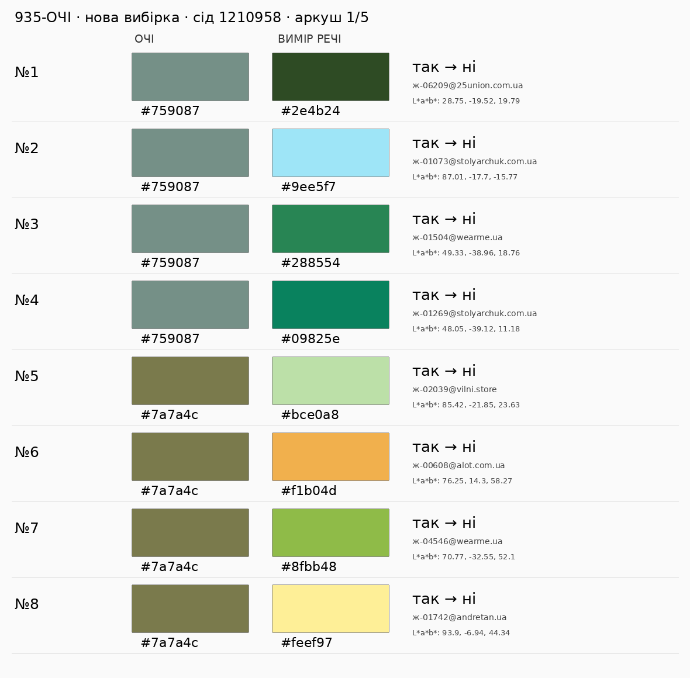
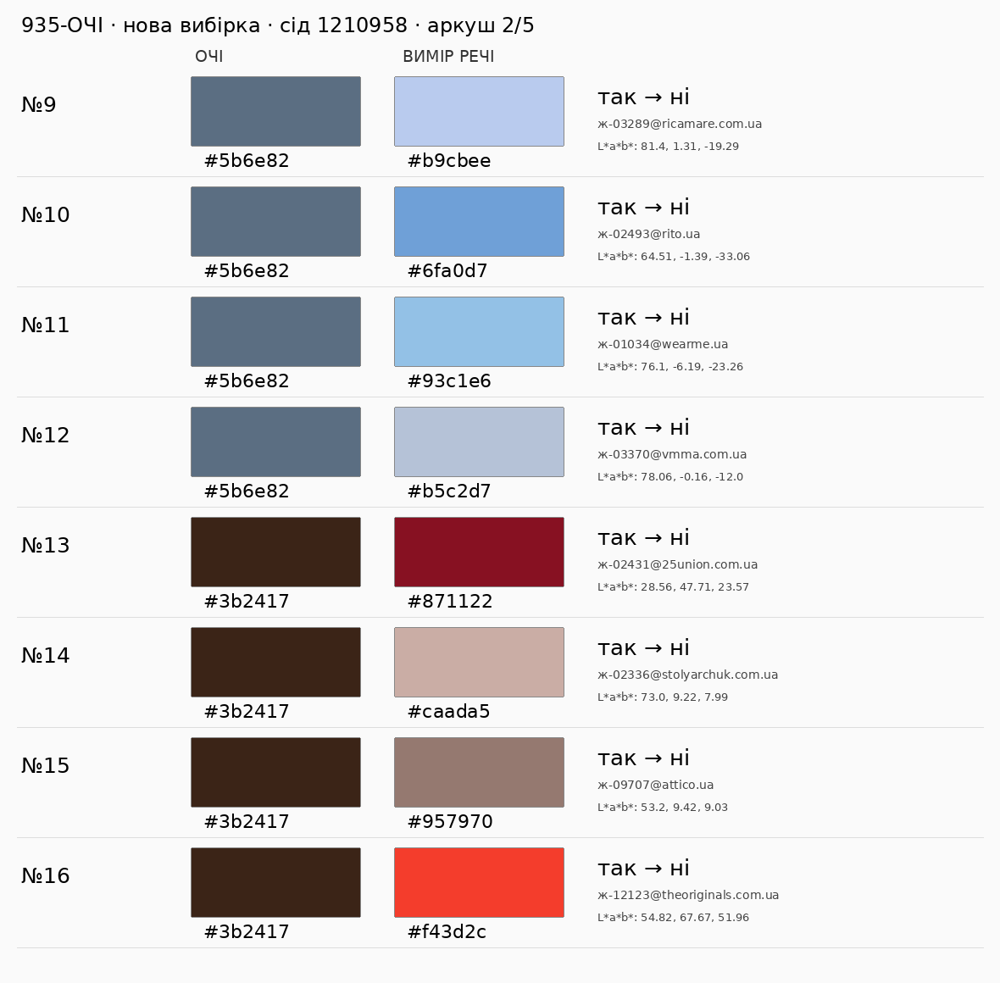
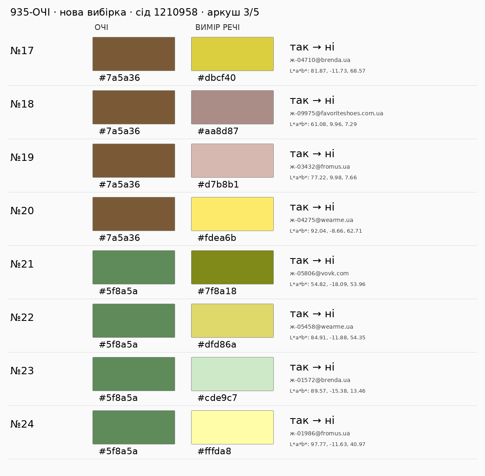
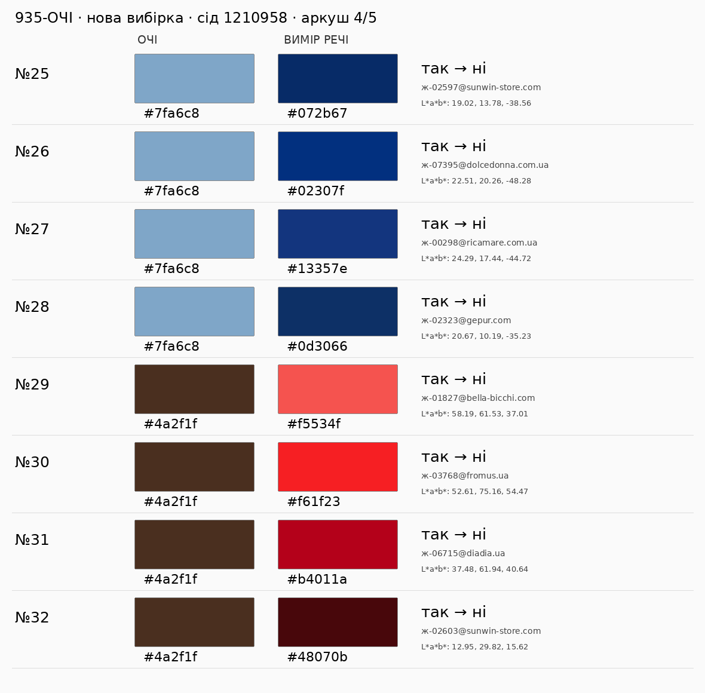
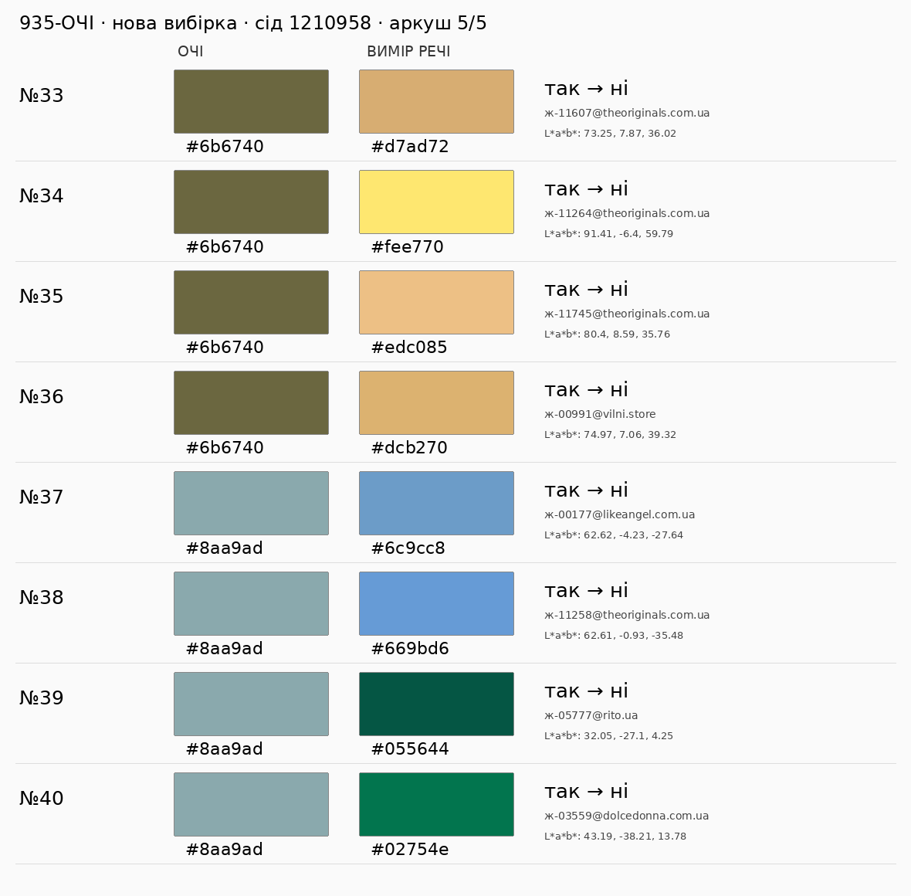

# 935-ОЧІ — нова сліпа вибірка після правки трьох сумнівних пар

**Статус: код до незалежного рев’ю. Очима ще не оцінено; ≥38/40 не доведено.** Оцінює окрема Astra max, яку запускає координатор. Виконавець не приймає свою вибірку.

Мірило: **пара справжніх кольорових квадратів очі ↔ вимір**, поруч на п’яти PNG нижче. Чи правильний ПІСЛЯ як відлуння райдужки за тоном/підтоном, насиченістю й світлотою? Фото — довідка; 403 фото не блокує це мірило. Знахідка суду — інформація (п.17).

Baseline ДО: `3dec14c5c9b5920e427293f4c10541532082de20` — початкова голова PR #958 із дугою #935: `у_дугах_кола(x, [palettes.дуга_очей(h)], palettes.ПОРІГ_ОЧЕЙ)`. ПІСЛЯ: `у_сім_ї_очей(x, запис_кольору(dict(lab=colorspace.hx(очі))))`. Для чисел ДО/ПІСЛЯ нинішньої правки додатковий baseline — `9baf2cf1b404749c20e16b9e1f89a1b04180e6e5`; у коміті є обидва виміри.

Склад: каталог продукту `feed._прочитати_каталог(feed.каталог_на_диску(), ліміт_фото=0)["каталог"]`; лише точні виміри (`не_вимір is None`) і `нейтраль_меж == "ні"`. Слова не впливають на відбір. Кандидати — різні ДО/ПІСЛЯ. Відтворення: із `джерела/` команда `python проби/сімя_очей_вибірка_958.py /tmp/очі.json`.

Сід **1210958** (попередній 958, початковий 5). По **4 на 10** кольорів. Унікальні очі стенда, далі ж1–ж9 у лексикографічному порядку дають 8 кодів; ще 2 числові контроли `#6b6740` (олива) та `#8aa9ad` (сіро-бірюзовий), без твердження про нові виміри людей. Кандидати сортуються за `id`, один `random.Random(1210958)` послідовно робить `sample(..., 4)`. Попередні 80 пар очі/hex виключені з незмінних комітів `29903122d646d8069958b142f701e3cf2715721b` і `9baf2cf1b404749c20e16b9e1f89a1b04180e6e5`. Вибірка не залежить від доступності фото, бажаних оцінок чи висновків виконавця.

Допустимих змінених пар: **2057**. Відібрано **40**. JSON з точними L*a*b*, ID, адресами та складом — `сімя_очей_2.json`; квадрат — sRGB hex того самого виміру. Код SHA-256: `1d250961b12e415ba182f4bfd9b289ea61ab43a27956ff5030b8fc0ea9c6fcb7`. Для незалежної перевірки брати повний remote SHA з результатного коментаря #958.

| очі | кандидатів | відібрано | ДО→ПІСЛЯ |
|---|---:|---:|---|
| `#759087` | 117 | 4 | так→ні: 4 |
| `#7a7a4c` | 76 | 4 | так→ні: 4 |
| `#5b6e82` | 351 | 4 | так→ні: 4 |
| `#3b2417` | 592 | 4 | так→ні: 4 |
| `#7a5a36` | 113 | 4 | так→ні: 4 |
| `#5f8a5a` | 21 | 4 | так→ні: 4 |
| `#7fa6c8` | 31 | 4 | так→ні: 4 |
| `#4a2f1f` | 444 | 4 | так→ні: 4 |
| `#6b6740` | 90 | 4 | так→ні: 4 |
| `#8aa9ad` | 222 | 4 | так→ні: 4 |

| # | очі | вимір речі та ID | ДО→ПІСЛЯ | фото (довідка) | очима |
|---|---|---|---|---|---|
| 1 | `#759087` | `#2e4b24` [СПІДНИЦЯ МІНІ З ІМІТАЦІЄЮ БАСКИ ЛЕЙМОН ЗЕЛЕНА](https://25union.com.ua/katalog/yubky/spidnytsja-mini-z-imitatsijeju-basky-lejmon-zelena/) · `ж-06209@25union.com.ua` | так→ні | [фото](https://25union.com.ua/image/cache/wp/gj/tovar/305-spidnytsja-mini-z-imitatsijeju-basky-lejmon/spidnicjaminitop25union-306719-999x999.webp) | не оцінено |
| 2 | `#759087` | `#9ee5f7` [МОДЕЛЬ №933 БЛАКИТНИЙ (КРІСТАЛ)](https://stolyarchuk.com.ua/katalog/sukni/modjel_933_blak_tn_j_kristal) · `ж-01073@stolyarchuk.com.ua` | так→ні | [фото](https://stolyarchuk.com.ua/image/cache/webp/catalog/933/1AK09308-532x798.webp) | не оцінено |
| 3 | `#759087` | `#288554` [Сукня міні з воланом по низу зі штапелю](https://wearme.ua/products/suknia-mini-z-volanom-po-nyzu-zi-shtapeliu) · `ж-01504@wearme.ua` | так→ні | [фото](https://cdn.shopify.com/s/files/1/0628/0259/1990/files/CB000003181___1_37e20ec3-da20-4a94-bbfe-56b2d7575a9e.jpg?v=1735894005) | не оцінено |
| 4 | `#759087` | `#09825e` [МОДЕЛЬ №886 ЗЕЛЕНИЙ](https://stolyarchuk.com.ua/katalog/sukni/modjel_886_zjeljen_j) · `ж-01269@stolyarchuk.com.ua` | так→ні | [фото](https://stolyarchuk.com.ua/image/cache/webp/catalog/virtuemart/product/2AK05170%20(Копировать)-532x798.webp) | не оцінено |
| 5 | `#7a7a4c` | `#bce0a8` [Блуза лляна Мессіна](https://vilni.store/sorochka-lliana-messina/) · `ж-02039@vilni.store` | так→ні | [фото](https://vilni.store/content/images/12/1200x1600l80nn0/28013177498772.jpeg) | не оцінено |
| 6 | `#7a7a4c` | `#f1b04d` [Гірчична сукня складного крою](https://alot.com.ua/gorchichnoe_plate_slozhnogo_kroya) · `ж-00608@alot.com.ua` | так→ні | [фото](https://alot.com.ua/imgs/mg2884.jpg) | не оцінено |
| 7 | `#7a7a4c` | `#8fbb48` [Футболка вкорочена](https://wearme.ua/products/futbolka-vkorochena-1) · `ж-04546@wearme.ua` | так→ні | [фото](https://cdn.shopify.com/s/files/1/0628/0259/1990/files/CB000003440_____1.jpg?v=1749112413) | не оцінено |
| 8 | `#7a7a4c` | `#feef97` [Майки, топи жовтий](https://andretan.ua/catalog/majkitopy/color-20) · `ж-01742@andretan.ua` | так→ні | [фото](https://andretan.ua/files/products/40061P_yellow_1.600x600.jpg) | не оцінено |
| 9 | `#5b6e82` | `#b9cbee` [Сорочка з квітковою аплікацією (11, S, Sky blue, блакитний)](https://ricamare.com.ua/sorochka-kvitkovoa-aplikatsiya/4015/) · `ж-03289@ricamare.com.ua` | так→ні | [фото](https://ricamare.com.ua/content/images/27/400x600l95mc0/sorochka-kvitkovoa-aplikatsiya-97551484209402.jpg) | не оцінено |
| 10 | `#5b6e82` | `#6fa0d7` [Джемпер з вовни ягнят з коротким рукавом блакитно-молочний](https://rito.ua/dzhemper-z-vovny-yagnyat-z-korotkym-rukavom-blakytno-molochnyj) · `ж-02493@rito.ua` | так→ні | [фото](https://rito.ua/image/cachewebp/catalog/FW%2026-27/7329_blue_white_7450_blue_3-824x1236.webp) | не оцінено |
| 11 | `#5b6e82` | `#93c1e6` [Сукня з льону вільного силуету і коротким рукавом](https://wearme.ua/products/suknia-z-lonu-vilnoho-syluetu-i-korotkym-rukavom) · `ж-01034@wearme.ua` | так→ні | [фото](https://cdn.shopify.com/s/files/1/0628/0259/1990/files/CB000030853_cyan_1.jpg?v=1785455546) | не оцінено |
| 12 | `#5b6e82` | `#b5c2d7` [Блакитна сорочка з акцентними манжетами](https://vmma.com.ua/sorochka-aktsentni-manzhety-blakytna-osin) · `ж-03370@vmma.com.ua` | так→ні | [фото](https://vmma.com.ua/image/catalog/Fall%202026/1%20сорочки/111/spidnytsya-shorty-skladky-burgundi-klitynka-osin3.jpg) | не оцінено |
| 13 | `#3b2417` | `#871122` [ТОП З АСИМЕТРИЧНИМ ПЛЕЧЕМ НІКОЛЬ ЧЕРВОНИЙ](https://25union.com.ua/katalog/topy/top-s-assimetrichnym-plechom-nikol-krasnyj/) · `ж-02431@25union.com.ua` | так→ні | [фото](https://25union.com.ua/image/cache/wp/gj/tovar/261-top-z-asymetrychnym-plechem-nikol/041-999x999.webp) | не оцінено |
| 14 | `#3b2417` | `#caada5` [МОДЕЛЬ №1011 БЕЖ](https://stolyarchuk.com.ua/katalog/klas_chni_kostyum/modjel_1011_bjezh) · `ж-02336@stolyarchuk.com.ua` | так→ні | [фото](https://stolyarchuk.com.ua/image/cache/webp/catalog/1011/DSC03800_resized-532x798.webp) | не оцінено |
| 15 | `#3b2417` | `#957970` [Кросівки жіночі, ATTICO, замша/текстиль, колір коричневий](https://attico.ua/product/krosivki-attico-zsh-teks-n-kh-gruba-shnur-korichnevii-1061726) · `ж-09707@attico.ua` | так→ні | [фото](https://attico.ua/wp-content/uploads/2026/07/t055-12607-13z_teks_1.jpg) | не оцінено |
| 16 | `#3b2417` | `#f43d2c` [Подовжений жакет із вовни та шовку](https://theoriginals.com.ua/ua/zhinkam/odyag/blejzery-ta-zhakety/podovzheni-zhakety/podovzhenyj-zhaket-iz-vovny-ta-shovku) · `ж-12123@theoriginals.com.ua` | так→ні | [фото](https://images.theoriginals.com.ua/cache/webp/catalog/product_photo/80972/udlinennyi-zhaket-oranzhevogo-cveta-1.webp) | не оцінено |
| 17 | `#7a5a36` | `#dbcf40` [Max Mara](https://brenda.ua/max-mara-253) · `ж-04710@brenda.ua` | так→ні | [фото](https://brenda.ua/image/cache/catalog/16.08.26/375-1200x1800.jpg) | не оцінено |
| 18 | `#7a5a36` | `#aa8d87` [LeBERDES Сандалі](https://favoriteshoes.com.ua/14809-leberdes-sandal/) · `ж-09975@favoriteshoes.com.ua` | так→ні | [фото](https://favoriteshoes.com.ua/upload/catalog/19800/19735/s_56fba15c-df4c-11ec-8e0e-04d4c4497b92_fc223f9d-e0f0-11ec-8e0e-04d4c4497b92.jpeg) | не оцінено |
| 19 | `#7a5a36` | `#d7b8b1` [Футболка](https://fromus.ua/futbolka-2260-21/) · `ж-03432@fromus.ua` | так→ні | [фото](https://fromus.ua/content/images/17/870x1160l95mc0/futbolka-2260-21-30389085679274.webp) | не оцінено |
| 20 | `#7a5a36` | `#fdea6b` [Кроп-топ з V-подібним вирізом із крепу](https://wearme.ua/products/krop-top-z-v-podibnym-vyrizom-iz-krepu) · `ж-04275@wearme.ua` | так→ні | [фото](https://cdn.shopify.com/s/files/1/0628/0259/1990/files/CB000003463_yellow__1.jpg?v=1785422755) | не оцінено |
| 21 | `#5f8a5a` | `#7f8a18` [Брюки палаццо з віскози лайм](https://vovk.com/ua/brjuki-palaco-viskoza-zhatka-lajm/) · `ж-05806@vovk.com` | так→ні | [фото](https://vovk.com/image/cache/catalog/i/017444/017444-800x1200.jpg) | не оцінено |
| 22 | `#5f8a5a` | `#dfd86a` [Куртка пуховик на кнопках](https://wearme.ua/products/kurtka-pukhovyk-na-knopkakh) · `ж-05458@wearme.ua` | так→ні | [фото](https://cdn.shopify.com/s/files/1/0628/0259/1990/files/CB000003409_____2.jpg?v=1729185218) | не оцінено |
| 23 | `#5f8a5a` | `#cde9c7` [Сукня прямого крою, без рукава, з накладними кишенями](https://brenda.ua/other-brand-31) · `ж-01572@brenda.ua` | так→ні | [фото](https://brenda.ua/image/cache/catalog/21.09.25/344-1200x1800.jpg) | не оцінено |
| 24 | `#5f8a5a` | `#fffda8` [Футболка](https://fromus.ua/ua/futbolka-2477-13/) · `ж-01986@fromus.ua` | так→ні | [фото](https://fromus.ua/content/images/37/870x1160l95mc0/futbolka-2477-13-26879293598596.webp) | не оцінено |
| 25 | `#7fa6c8` | `#072b67` [Джемпер жіночий щільний з рукавом 3/4 демісезонний](https://www.sunwin-store.com/shop/dzhemper-zhinochij-shilnij-z-rukavom-34-demisezonnij-2978bl/) · `ж-02597@sunwin-store.com` | так→ні | [фото](https://www.sunwin-store.com/wp-content/uploads/2026/07/2978_blue_3.webp) | не оцінено |
| 26 | `#7fa6c8` | `#02307f` [Розширена спідниця міді з тафти Кейсі](https://dolcedonna.com.ua/4655-raskleshennaya-yubka-midi-iz-tafty-keisi/) · `ж-07395@dolcedonna.com.ua` | так→ні | [фото](https://dolcedonna.com.ua/image/cache/catalog/SS26/models1/IMG_5992-1000x1500.webp) | не оцінено |
| 27 | `#7fa6c8` | `#13357e` [Елегантна жіноча сукня (3, XS, blue, синій)](https://ricamare.com.ua/elegantna-zhinocha-suknja/) · `ж-00298@ricamare.com.ua` | так→ні | [фото](https://ricamare.com.ua/content/images/28/400x600l95mc0/elegantna-zhinocha-suknja-55372511692698.jpg) | не оцінено |
| 28 | `#7fa6c8` | `#0d3066` [УКОРОЧЕНИЙ ЖАКЕТ ІЗ БАВОВНЯНОГО ДЕНІМУ](https://gepur.com/uk/product/pidzhak-41121) · `ж-02323@gepur.com` | так→ні | [фото](https://img.gepur.com/products/45000/41121/webp/origins/41121_3.webp?1644483362) | не оцінено |
| 29 | `#4a2f1f` | `#f5534f` [Жіночий класичний піджак без підкладки з втачними кишенями Perzoni (кораловий, 4](https://bella-bicchi.com/catalog/zhinochiy-pidzhak-perzoni-24575/) · `ж-01827@bella-bicchi.com` | так→ні | [фото](https://bella-bicchi.com/upload/iblock/c7b/coqmoii33n3wxuar4oa7enmmy5vofmd4/IMG_3341.jpg) | не оцінено |
| 30 | `#4a2f1f` | `#f61f23` [Футболка](https://fromus.ua/futbolka-2719-6/) · `ж-03768@fromus.ua` | так→ні | [фото](https://fromus.ua/content/images/34/870x1160l95mc0/futbolka-2719-6-26204843828915.webp) | не оцінено |
| 31 | `#4a2f1f` | `#b4011a` [Спідниця з тонкого трикотажу, червона](https://diadia.ua/spidnyci/spidnytsya-d10470012/) · `ж-06715@diadia.ua` | так→ні | [фото](https://diadia.ua/image/cachewebp/catalog/2026-06/30-06/D10470012_1-750x1000.webp) | не оцінено |
| 32 | `#4a2f1f` | `#48070b` [Джемпер жіночий щільний з рукавом типу реглан демісезонний](https://www.sunwin-store.com/shop/dzhemper-zhinochij-shilnij-z-rukavom-tipu-reglan-demisezonnij-2922rd/) · `ж-02603@sunwin-store.com` | так→ні | [фото](https://www.sunwin-store.com/wp-content/uploads/2026/07/2922_burgundy_6.webp) | не оцінено |
| 33 | `#6b6740` | `#d7ad72` [Сумка зі шкіри Sylvie](https://theoriginals.com.ua/ua/zhinkam/sumky/mini-sumky/sumka-zi-shkiry-sylvie) · `ж-11607@theoriginals.com.ua` | так→ні | [фото](https://images.theoriginals.com.ua/cache/webp/catalog/product_photo/48808/Sumka-yz-kozhy-Sylvie.webp) | не оцінено |
| 34 | `#6b6740` | `#fee770` [Приталена сукня жовтого кольору з довгим рукавом](https://theoriginals.com.ua/ua/zhinkam/odyag/sukni/povsyakdenni-sukni/prytalena-suknya-zhovtogo-koloru-z-dovgym-rukavom) · `ж-11264@theoriginals.com.ua` | так→ні | [фото](https://images.theoriginals.com.ua/cache/webp/catalog/product_photo/85244/pritalennoe-plate-zheltogo-cveta-s-dlinnym-rukavom-3.webp) | не оцінено |
| 35 | `#6b6740` | `#edc085` [Золоті сережки з підвіскою](https://theoriginals.com.ua/ua/zhinkam/aksesuary/prykrasy-1/bizhuteriya/serezhky/zoloti-serezhky-z-pidviskoyu) · `ж-11745@theoriginals.com.ua` | так→ні | [фото](https://images.theoriginals.com.ua/cache/webp/catalog/product_photo/65211/ukrasheniya-chanel-1.webp) | не оцінено |
| 36 | `#6b6740` | `#dcb270` [Сукня лляна Андрія](https://vilni.store/suknia-lliana-andria/) · `ж-00991@vilni.store` | так→ні | [фото](https://vilni.store/content/images/22/1200x1600l80nn0/59239969788883.jpeg) | не оцінено |
| 37 | `#8aa9ad` | `#6c9cc8` [Сукня Максі сатин джинс](https://likeangel.com.ua/product/suknya-maksi-satyn-dzhyns/) · `ж-00177@likeangel.com.ua` | так→ні | [фото](https://likeangel.com.ua/wp-content/uploads/2026/03/bez-nazvy-9-18.jpg) | не оцінено |
| 38 | `#8aa9ad` | `#669bd6` [Блакитна спідниця декорована драпіруванням](https://theoriginals.com.ua/ua/zhinkam/odyag/spidnyci/spidnyci-vilnogo-kroyu/blakytna-spidnycya-dekorovana-drapiruvannyam) · `ж-11258@theoriginals.com.ua` | так→ні | [фото](https://images.theoriginals.com.ua/cache/webp/catalog/product_photo/85155/golubaya-yubka-dekorirovana-drapirovkoi-1.webp) | не оцінено |
| 39 | `#8aa9ad` | `#055644` [Спідниця з ефектом плісе зі 100% вовни мериноса зелена](https://rito.ua/spidnycya-z-efektom-plise-zi-100-vovny-merynosa-zelena) · `ж-05777@rito.ua` | так→ні | [фото](https://rito.ua/image/cachewebp/catalog/FW%2025-26/7541_7549_green_2-824x1236.webp) | не оцінено |
| 40 | `#8aa9ad` | `#02754e` [Зелена святкова сорочка з суміші шовку та тафти з пишним рукавом Токайо](https://dolcedonna.com.ua/4553-zelenaya-prazdnichnaya-rubashka-iz-smesi-shelka-i-tafty-s-pyshnym-rukavom-tokaio/) · `ж-03559@dolcedonna.com.ua` | так→ні | [фото](https://dolcedonna.com.ua/image/cache/catalog/W25-26/fon/file_00000000080c722fb0ee012a5b7f46dc-1000x1500.webp) | не оцінено |

## Квадрати поруч

## Джерела й обмеження

Температурні сім’ї й межі хроми/світлоти — чинний `РЕЄСТР_ОЧЕЙ`, T3, не калібровані числа Perrett. Правка обмежує барвну гілку близькістю тону з наявних RELATIONS/ВІКНА_ТОНУ: аналоговий тінт, сусідній темніший на крок відтінок, усе всередині температурної сім’ї. Додатковий світлий тінт до +40 дозволений зі збереженою хромою hi_C, звичайна смуга лишається до +30; блідий кремовий контроль старого №5 не змінився. Приглушена гілка незмінна. Це має оцінити нова незалежна вибірка, а не лише 12 кодових контролів.

Попередні два пограничні збіги до сіро-зелених очей (`#84c3d7`, `#73b6c4`) лишаються відкритою інформацією в рядку 5010. Старі аркуші збережені в історії git, нові не містять їхніх пар. Самоприймання і вимога обов’язкового доступу до фото зі старої версії вилучені.

SHA-256 джерел:

- `каталог_повний.xml.gz`: `71cffbd27a4916db4676cc57cfd2174e94288a3f32458c4dda4dab0e5b877331`
- `джерела/каталог_збагачення.json.gz`: `fd084c89cad938d8b5e6bb851ee4c0eb396471057c66b4a5fd71a905ffadeb9b`
- `джерела/каталог_кадри.json.gz`: `b9f31cfa1458bfcbb7b7a862b3151ea05b5e34f39b09959b6dc8bf7412c31040`
