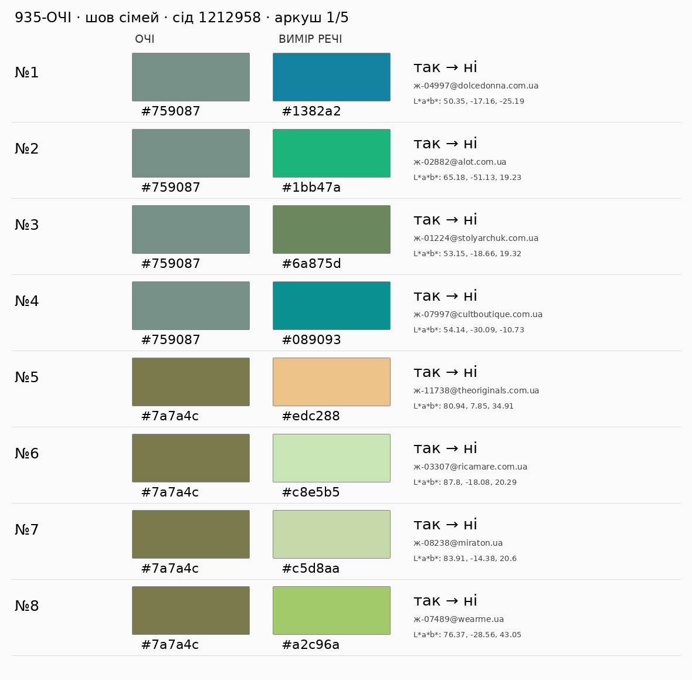
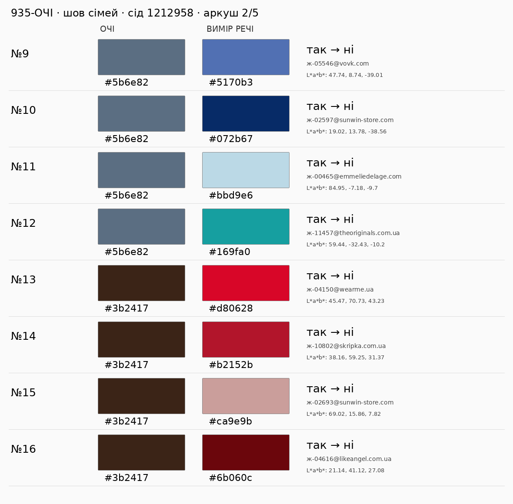
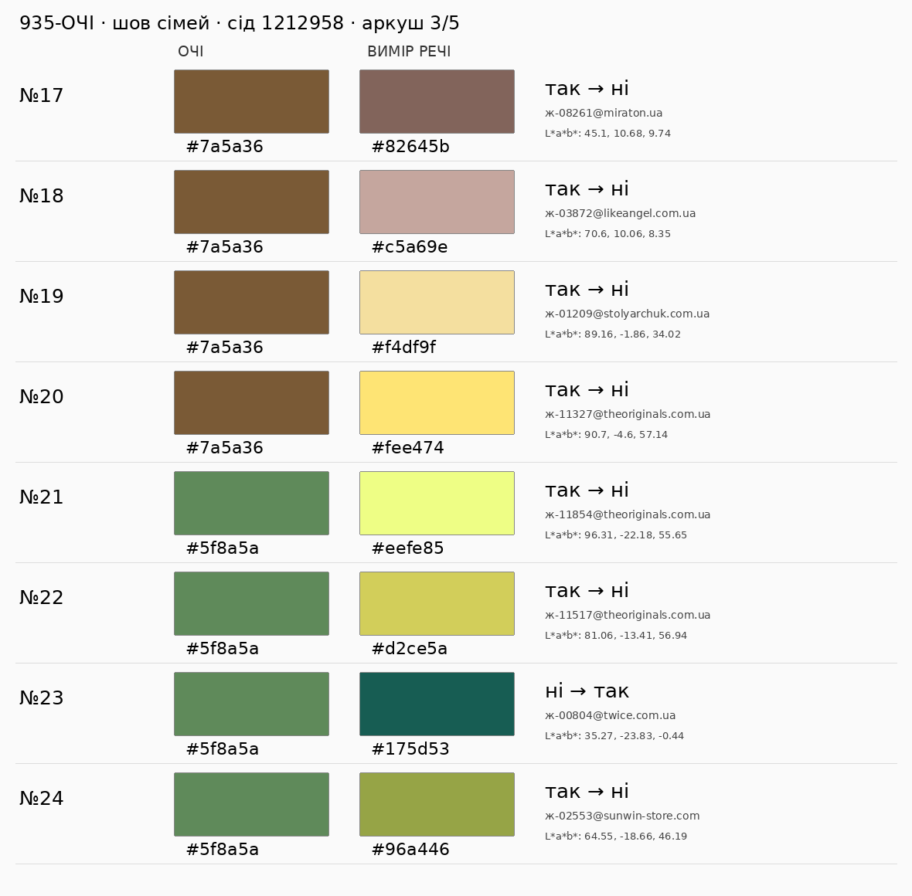
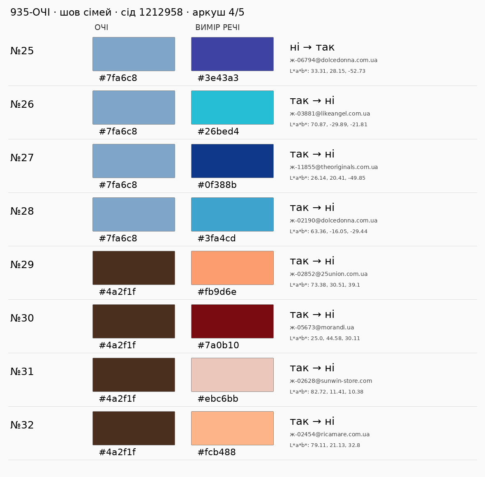

# 935-ОЧІ — нова сліпа вибірка після корекції шва сімей

**Статус: до повторної незалежної Astra max. Очима не оцінено; ≥38/40 не доведено.** На попередньому SHA `ffb681ade9578fb24d40c379fa8d5129594fa723` незалежна Astra зафіксувала **37 правильні / 1 хиба / 2 сумніви** ([висновок](https://github.com/mightyrochy/kod-shi-data/pull/958#issuecomment-6128023124)); цей висновок не змінюється.

Мірило: **справжні кольорові квадрати очі ↔ вимір**, поруч на п’яти PNG. Фото — довідка, 403 не блокер. Чи ПІСЛЯ є відлунням райдужки за видимим тоном/підтоном, чистотою й світлотою? Поріг — окрема Astra ≥38/40; виконавець не приймає свою вибірку.

Baseline відбору ДО: `3dec14c5c9b5920e427293f4c10541532082de20`, початкова дуга #935: `у_дугах_кола(x, [palettes.дуга_очей(h)], palettes.ПОРІГ_ОЧЕЙ)`. ПІСЛЯ: `у_сім_ї_очей(x, запис_кольору(dict(lab=colorspace.hx(очі))))`. Baseline цієї кодової корекції: `ffb681ade9578fb24d40c379fa8d5129594fa723`; його окреме каталогове ДО/ПІСЛЯ — у повідомленні нового коміту.

Каталог: `feed._прочитати_каталог(feed.каталог_на_диску(), ліміт_фото=0)["каталог"]`; тільки точні виміри (`не_вимір is None`) і `нейтраль_меж == "ні"`; лише різні ДО/ПІСЛЯ. Слова не беруть участі у відборі.

Сід **1212958**, інший за 5/958/1210958/1211958. Унікальні hex стенда та ж1–ж9 у лексикографічному порядку: 8 кольорів; ще 2 числові контроли `#6b6740` та `#8aa9ad`, без твердження про нові виміри людей. По **4 на 10**. Кандидати сортуються за id, один `random.Random(1212958)` послідовно виконує sample(...,4). Всі попередні **160** пар виключено з незмінних комітів `29903122d646d8069958b142f701e3cf2715721b`, `9baf2cf1b404749c20e16b9e1f89a1b04180e6e5`, `62bebbad5e2c46aadd6756537d9b0b1e699b288b`, `ffb681ade9578fb24d40c379fa8d5129594fa723`. Вибірка не залежить від бажаних оцінок чи доступності фото. Відтворення з `джерела/`: `python проби/сімя_очей_вибірка_958.py /tmp/очі.json`.

Допустимих змінених пар: **1679**. JSON з точними lab, id, адресами, seed та складом — `сімя_очей_2.json`. Код SHA-256: `c17e711646335f630557d6847f4ce73effc33e1459b15145146bf34451041bdf`. Для рев’ю брати точний remote SHA з результатного коментаря #958.

| очі | кандидатів | відібрано | ДО→ПІСЛЯ |
|---|---:|---:|---|
| `#759087` | 104 | 4 | так→ні: 4 |
| `#7a7a4c` | 66 | 4 | так→ні: 4 |
| `#5b6e82` | 139 | 4 | так→ні: 4 |
| `#3b2417` | 555 | 4 | так→ні: 4 |
| `#7a5a36` | 92 | 4 | так→ні: 4 |
| `#5f8a5a` | 8 | 4 | ні→так: 1, так→ні: 3 |
| `#7fa6c8` | 22 | 4 | ні→так: 1, так→ні: 3 |
| `#4a2f1f` | 420 | 4 | так→ні: 4 |
| `#6b6740` | 81 | 4 | так→ні: 4 |
| `#8aa9ad` | 192 | 4 | так→ні: 4 |

| # | очі | вимір речі та ID | ДО→ПІСЛЯ | фото (довідка) | очима |
|---|---|---|---|---|---|
| 1 | `#759087` | `#1382a2` [Двосторонній пуховик з авторським принтом Мінесота](https://dolcedonna.com.ua/3024-dvustoronnii-puhovik-s-avtorskim-printom-minesota/) · `ж-04997@dolcedonna.com.ua` | так→ні | [фото](https://dolcedonna.com.ua/image/cache/catalog/products/3024/6-1000x1499.webp) | не оцінено |
| 2 | `#759087` | `#1bb47a` [Костюм зелений](https://alot.com.ua/kostyum_zeleniy) · `ж-02882@alot.com.ua` | так→ні | [фото](https://alot.com.ua/imgs/m978.jpg) | не оцінено |
| 3 | `#759087` | `#6a875d` [МОДЕЛЬ №1018 ФІСТАШКА](https://stolyarchuk.com.ua/katalog/sukni/modjel_1018_fistashka) · `ж-01224@stolyarchuk.com.ua` | так→ні | [фото](https://stolyarchuk.com.ua/image/cache/webp/catalog/1018/P1784487-редакт-532x798.webp) | не оцінено |
| 4 | `#759087` | `#089093` [Пляжна сумка-шопер NY Crest](https://cultboutique.com.ua/ua/products/000033223) · `ж-07997@cultboutique.com.ua` | так→ні | [фото](https://cultboutique.com.ua/files/resized/products/img_3865-copy_1.2400x2400.jpg.webp) | не оцінено |
| 5 | `#7a7a4c` | `#edc288` [Сережки-трансформери із жовтого золота](https://theoriginals.com.ua/ua/zhinkam/aksesuary/prykrasy-1/yuvelirni-vyroby-1/serezhky-1/serezhky-transformery-iz-zhovtogo-zolota) · `ж-11738@theoriginals.com.ua` | так→ні | [фото](https://images.theoriginals.com.ua/cache/webp/catalog/product_photo/80301/ukrasheniya-guzema-fine-jewelry-1.webp) | не оцінено |
| 6 | `#7a7a4c` | `#c8e5b5` [Жіноча сорочка з батисту (7, S, Green, зелений)](https://ricamare.com.ua/zhinocha-sorochka-batist/) · `ж-03307@ricamare.com.ua` | так→ні | [фото](https://ricamare.com.ua/content/images/9/400x600l95mc0/zhinocha-sorochka-batist-44664041016684.jpg) | не оцінено |
| 7 | `#7a7a4c` | `#c5d8aa` [Жіноча сумка солом'яна зелена](https://www.miraton.ua/ua/catalog/women/sumka/_miraton_000209330/) · `ж-08238@miraton.ua` | так→ні | [фото](https://www.miraton.ua/upload/webp_cache/1740x2280q90-000209330_1_.webp) | не оцінено |
| 8 | `#7a7a4c` | `#a2c96a` [Джогери "БРІДЖИТ"](https://wearme.ua/products/dzhohery-bridzhyt) · `ж-07489@wearme.ua` | так→ні | [фото](https://cdn.shopify.com/s/files/1/0628/0259/1990/files/CB000029388_green_1_f0edb601-2af0-472f-b6ac-812fcb6080c8.jpg?v=1785425955) | не оцінено |
| 9 | `#5b6e82` | `#5170b3` [Ці штани з костюмної тканини в незвичайному кольорі деніму — справжня знахідка д](https://vovk.com/ua/brjuki-iz-kostjumnoi-tkanini-koloru-denim/) · `ж-05546@vovk.com` | так→ні | [фото](https://vovk.com/image/cache/catalog/i/016966/016966-800x1200.jpg) | не оцінено |
| 10 | `#5b6e82` | `#072b67` [Джемпер жіночий щільний з рукавом 3/4 демісезонний](https://www.sunwin-store.com/shop/dzhemper-zhinochij-shilnij-z-rukavom-34-demisezonnij-2978bl/) · `ж-02597@sunwin-store.com` | так→ні | [фото](https://www.sunwin-store.com/wp-content/uploads/2026/07/2978_blue_3.webp) | не оцінено |
| 11 | `#5b6e82` | `#bbd9e6` [Сарафан джинсовий блакитний TEYA](https://emmeliedelage.com/sarafan-dzhynsovyi-blakytnyi-teya/) · `ж-00465@emmeliedelage.com` | так→ні | [фото](https://emmeliedelage.com/content/images/2/1200x1600l95nn0/sarafan-dzhynsovyi-blakytnyi-teya-12970433814500.webp) | не оцінено |
| 12 | `#5b6e82` | `#169fa0` [Шкіряні туфлі-човники зеленого кольору](https://theoriginals.com.ua/ua/zhinkam/vzuttya-3/tufli/chovnyky/shkiryani-tufli-chovnyky-zelenogo-koloru) · `ж-11457@theoriginals.com.ua` | так→ні | [фото](https://images.theoriginals.com.ua/cache/webp/catalog/product_photo/85327/kozhanye-tufli-lodochki-zelenogo-cveta-1.webp) | не оцінено |
| 13 | `#3b2417` | `#d80628` [Топ з рубчика](https://wearme.ua/products/top-z-rubchyka) · `ж-04150@wearme.ua` | так→ні | [фото](https://cdn.shopify.com/s/files/1/0628/0259/1990/files/CB000002577_red_1.jpg?v=1745561975) | не оцінено |
| 14 | `#3b2417` | `#b2152b` [Тільник “Line” червоно-білий](https://skripka.com.ua/product/women/lonhslivy/tilnyk-line-chervono-bilyi) · `ж-10802@skripka.com.ua` | так→ні | [фото](https://skripka.com.ua/wp-content/uploads/2026/04/DT2A8575.jpg) | не оцінено |
| 15 | `#3b2417` | `#ca9e9b` [Кардиган жіночий щільний на гудзиках демісезонний](https://www.sunwin-store.com/shop/kardigan-zhinochij-shilnij-na-gudzikah-demisezonnij-999mr/) · `ж-02693@sunwin-store.com` | так→ні | [фото](https://www.sunwin-store.com/wp-content/uploads/2025/09/43875084401860.webp) | не оцінено |
| 16 | `#3b2417` | `#6b060c` [Блуза з лелітками червоний](https://likeangel.com.ua/product/bluza-z-pajyetkamy-chervonyj/) · `ж-04616@likeangel.com.ua` | так→ні | [фото](https://likeangel.com.ua/wp-content/uploads/2026/03/44.jpg) | не оцінено |
| 17 | `#7a5a36` | `#82645b` [Жіноча сумка тоут шкіряна коричнева](https://www.miraton.ua/ua/catalog/women/sumka/_miraton_000215862/) · `ж-08261@miraton.ua` | так→ні | [фото](https://www.miraton.ua/upload/webp_cache/1740x2280q90-000215862_1_.webp) | не оцінено |
| 18 | `#7a5a36` | `#c5a69e` [Сорочка з об’ємними квітами-жоржинами пудра](https://likeangel.com.ua/product/sorochka-z-obyemnymy-kvitamy-zhorzhynamy-pudra/) · `ж-03872@likeangel.com.ua` | так→ні | [фото](https://likeangel.com.ua/wp-content/uploads/2026/08/312a8729.jpg) | не оцінено |
| 19 | `#7a5a36` | `#f4df9f` [МОДЕЛЬ №1012 ЖОВТИЙ](https://stolyarchuk.com.ua/katalog/sukni/modjel_1012_zhovt_j) · `ж-01209@stolyarchuk.com.ua` | так→ні | [фото](https://stolyarchuk.com.ua/image/cache/webp/catalog/1012/DSC03655_resized-532x798.webp) | не оцінено |
| 20 | `#7a5a36` | `#fee474` [Сарафан Elio](https://theoriginals.com.ua/ua/zhinkam/odyag/sukni/sarafany/sarafan-elio) · `ж-11327@theoriginals.com.ua` | так→ні | [фото](https://images.theoriginals.com.ua/cache/webp/catalog/product_photo/85245/zheltyi-sarafan-pritalennogo-kroya-1.webp) | не оцінено |
| 21 | `#5f8a5a` | `#eefe85` [Облягаюча сукня жовтого кольору в рубчик](https://theoriginals.com.ua/ua/zhinkam/odyag/sukni/povsyakdenni-sukni/oblyagayucha-suknya-zelenogo-koloru-v-rubchyk) · `ж-11854@theoriginals.com.ua` | так→ні | [фото](https://images.theoriginals.com.ua/cache/webp/catalog/product_photo/84909/oblegayushchee-plate-zelenogo-cveta-v-rubchik-1.webp) | не оцінено |
| 22 | `#5f8a5a` | `#d2ce5a` [Шкіряна сумка яскраво-зеленого кольору](https://theoriginals.com.ua/ua/zhinkam/sumky/tout/shkiryana-sumka-yaskravo-zelenogo-koloru) · `ж-11517@theoriginals.com.ua` | так→ні | [фото](https://images.theoriginals.com.ua/cache/catalog/product_photo/84266/kozhanaya-sumka-yarko-zelenogo-cveta-1-700x500.jpg) | не оцінено |
| 23 | `#5f8a5a` | `#175d53` [СУКНЯ САТИНОВА](https://twice.com.ua/maksi/2630-12672-suknya-satinova-dr006.html?sc_content=37254_r2979v3594) · `ж-00804@twice.com.ua` | ні→так | [фото](https://twice.com.ua/27015-large_default/suknya-satinova-dr006.webp) | не оцінено |
| 24 | `#5f8a5a` | `#96a446` [Джемпер жіночий бавовняний з V-горловиною демісезонний](https://www.sunwin-store.com/shop/dzhemper-zhinochij-bavovnyanij-z-v-gorlovinoyu-demisezonnij-2912lm/) · `ж-02553@sunwin-store.com` | так→ні | [фото](https://www.sunwin-store.com/wp-content/uploads/2026/01/2912_lightgreen_4.webp) | не оцінено |
| 25 | `#7fa6c8` | `#3e43a3` [Атласна спідниця міді кольору електрик Айден](https://dolcedonna.com.ua/3836-atlasnaya-yubka-medi-cveta-elektrik-aiden/) · `ж-06794@dolcedonna.com.ua` | ні→так | [фото](https://dolcedonna.com.ua/image/cache/catalog/products/3836/1-1000x1500.webp) | не оцінено |
| 26 | `#7fa6c8` | `#26bed4` [Светр Повітря бірюза](https://likeangel.com.ua/product/svetr-povitrya-biryuza/) · `ж-03881@likeangel.com.ua` | так→ні | [фото](https://likeangel.com.ua/wp-content/uploads/2026/03/bez-nazvy-36-4.webp) | не оцінено |
| 27 | `#7fa6c8` | `#0f388b` [Синя мереживна сукня з поясом](https://theoriginals.com.ua/ua/zhinkam/odyag/sukni/koktejlni-sukni/synya-merezhyvna-suknya-z-poyasom) · `ж-11855@theoriginals.com.ua` | так→ні | [фото](https://images.theoriginals.com.ua/cache/webp/catalog/product_photo/84999/sinee-kruzhevnoe-plate-s-poyasom-1.webp) | не оцінено |
| 28 | `#7fa6c8` | `#3fa4cd` [Лазурна романтична блуза з шовком Ліон](https://dolcedonna.com.ua/3683-bluza-lion/) · `ж-02190@dolcedonna.com.ua` | так→ні | [фото](https://dolcedonna.com.ua/image/cache/catalog/products/3683/1-1000x1500.webp) | не оцінено |
| 29 | `#4a2f1f` | `#fb9d6e` [ТОП ІЗ ДЕКОРАТИВНИМИ ЗАВ'ЯЗКАМИ ANNA ТЕРАКОТ](https://25union.com.ua/katalog/topy/top-iz-dekoratyvnymy-zav-jazkamy-anna-terakot/) · `ж-02852@25union.com.ua` | так→ні | [фото](https://25union.com.ua/image/cache/wp/gj/tovar/416-komplekt-z-topa-ta-spidnytsi-anna/terakot/028-999x999.webp) | не оцінено |
| 30 | `#4a2f1f` | `#7a0b10` [Спідниця з фатину червона](https://morandi.ua/product/spidnytsia-z-fatynu-chervona/) · `ж-05673@morandi.ua` | так→ні | [фото](https://morandi.ua/wp-content/uploads/2026/05/34.webp) | не оцінено |
| 31 | `#4a2f1f` | `#ebc6bb` [Джемпер жіночий в’язаний прямого фасону з віскози демісезонний](https://www.sunwin-store.com/shop/dzhemper-zhinochij-vyazanij-pryamogo-fasonu-z-viskozi-demisezonnij-2842pd/) · `ж-02628@sunwin-store.com` | так→ні | [фото](https://www.sunwin-store.com/wp-content/uploads/2025/01/2842_powder_6.webp) | не оцінено |
| 32 | `#4a2f1f` | `#fcb488` [Футболка з V-подібним вирізом (11, S, Apricot, помаранчевий)](https://ricamare.com.ua/futbolka-v-viriz/) · `ж-02454@ricamare.com.ua` | так→ні | [фото](https://ricamare.com.ua/content/images/34/400x600l95mc0/futbolka-v-viriz-39793822739939.jpg) | не оцінено |
| 33 | `#6b6740` | `#fffc92` [Сумка CHARLOTTE лимонний](https://skripka.com.ua/product/women/sumki/sumka-charlotte-lymonnyi) · `ж-11012@skripka.com.ua` | так→ні | [фото](https://skripka.com.ua/wp-content/uploads/2026/06/15-3.jpg) | не оцінено |
| 34 | `#6b6740` | `#a77a43` [ЖІНОЧИЙ ТОП КАРАМЕЛЬ](https://25union.com.ua/katalog/topy/karamelnye-topyl/) · `ж-04682@25union.com.ua` | так→ні | [фото](https://25union.com.ua/image/cache/wp/gj/tovar/423-top-z-mjakoji-prjazhi-eira/117-999x999.webp) | не оцінено |
| 35 | `#6b6740` | `#8fbb48` [Футболка вкорочена](https://wearme.ua/products/futbolka-vkorochena-1) · `ж-04546@wearme.ua` | так→ні | [фото](https://cdn.shopify.com/s/files/1/0628/0259/1990/files/CB000003440_____1.jpg?v=1749112413) | не оцінено |
| 36 | `#6b6740` | `#e2d37a` [Футболка](https://fromus.ua/store/futbolki_1/futbolka_222/) · `ж-04221@fromus.ua` | так→ні | [фото](https://fromus.ua/content/images/16/870x1160l95mc0/storefutbolki_1futbolka_222-70834450662453.webp) | не оцінено |
| 37 | `#8aa9ad` | `#99b9e0` [Лляна сорочка блакитна](https://feelyou.com.ua/shop/lliana-sorochka-blakytna) · `ж-03623@feelyou.com.ua` | так→ні | [фото](https://feelyou.com.ua/wp-content/uploads/2025/06/img_5310-scaled.jpg) | не оцінено |
| 38 | `#8aa9ad` | `#8bb4d8` [Спідниця-шорти з костюмки](https://wearme.ua/products/spidnytsia-shorty-z-kostiumky) · `ж-07461@wearme.ua` | так→ні | [фото](https://cdn.shopify.com/s/files/1/0628/0259/1990/files/CB000030805_cyan_1.png?v=1785451719) | не оцінено |
| 39 | `#8aa9ad` | `#b5d7fa` [Сукня реглан з коротким рукавом](https://wearme.ua/products/suknia-rehlan-z-korotkym-rukavom) · `ж-01122@wearme.ua` | так→ні | [фото](https://cdn.shopify.com/s/files/1/0628/0259/1990/files/CB000003442___2.jpg?v=1729186016) | не оцінено |
| 40 | `#8aa9ad` | `#169fa0` [Шкіряні туфлі-човники зеленого кольору](https://theoriginals.com.ua/ua/zhinkam/vzuttya-3/tufli/chovnyky/shkiryani-tufli-chovnyky-zelenogo-koloru) · `ж-11457@theoriginals.com.ua` | так→ні | [фото](https://images.theoriginals.com.ua/cache/webp/catalog/product_photo/85327/kozhanye-tufli-lodochki-zelenogo-cveta-1.webp) | не оцінено |

## Квадрати поруч

## Корекція і джерела

Шов температурних сімей не має розділяти певний однаковий тон. У спільній силі сім’ї поряд із температурними вікнами береться перетин уже чинних **same_hue кола і ΔH*** та певність тону обох кольорів. Самі сім’ї, hi_C, запаси світлоти й сигми не розширювалися. Для карамельної ясної хиби різниця кола 9.15°, а ΔH*2.46: це чинний same_hue, а не новий спеціальний кут.

Практичний принцип — K-COL-11 у темі-4: MacEvoy (handprint color3/color13), Munsell/ISCC-NBS — той самий видимий тон і менша визначеність зі спадом хроми; K-COL-12 — підтон як межа. Відлуння райдужки — K-PAL-01/02/R-COL-17. Підтверджений однаковий тон не повинен ставати іншим кольором лише через внутрішню назву температурної сім’ї. Перенесення й числові межі очей — T3, не експериментальна калібровка. Нових кутів CIELAB чи SKU/hex-винятків немає.

Ясна карамельна №17 виправлена кодом; 37 зарахованих кодів останньої вибірки та попередні 34/31/7 збережені. Сумнівні №23/36 лишаються «ні», очної оцінки їм не присвоєно. Старі №17/21/33, дев’ять хиб, п’ять тінтів і кремовий контроль проходять. На справжніх активних K-PAL-02/13 (сивина, верх-акцент) для карамелі знахідки зникли, why_her_eyes None→echo; чужий лайм зберіг обидві знахідки та None. Це звірка споживачів, не приймання нових 40. Пограничні старі пари 5010 залишаються відкритими.

Джерела SHA-256:

- `каталог_повний.xml.gz`: `71cffbd27a4916db4676cc57cfd2174e94288a3f32458c4dda4dab0e5b877331`
- `джерела/каталог_збагачення.json.gz`: `fd084c89cad938d8b5e6bb851ee4c0eb396471057c66b4a5fd71a905ffadeb9b`
- `джерела/каталог_кадри.json.gz`: `b9f31cfa1458bfcbb7b7a862b3151ea05b5e34f39b09959b6dc8bf7412c31040`
