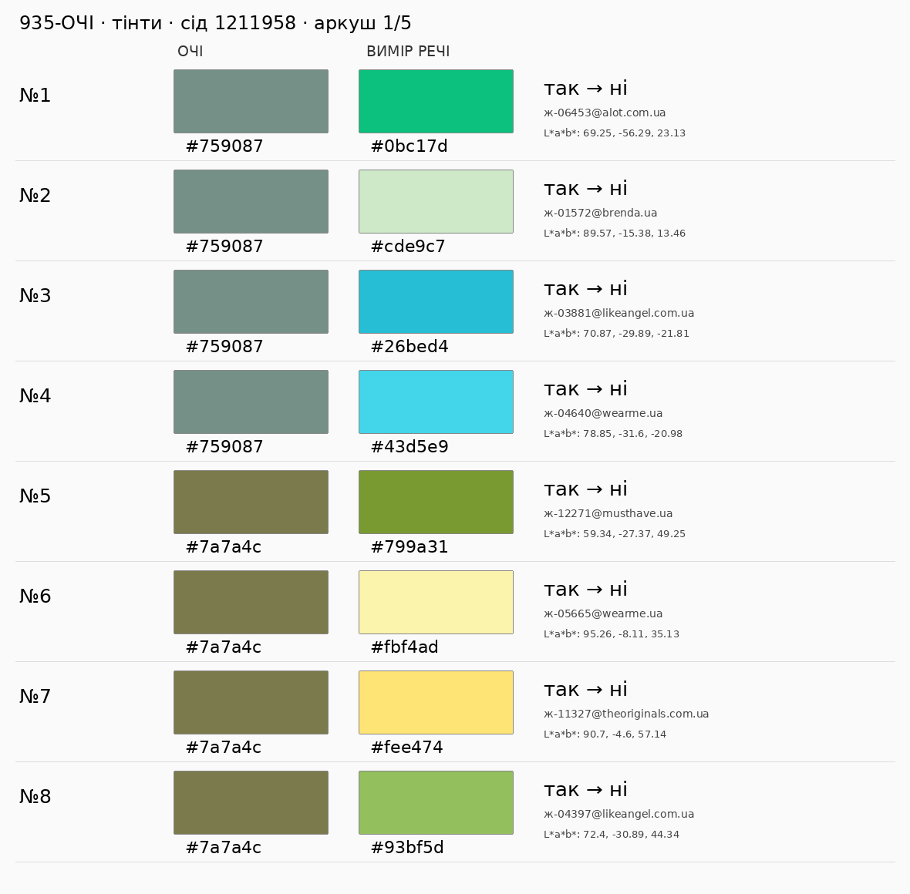
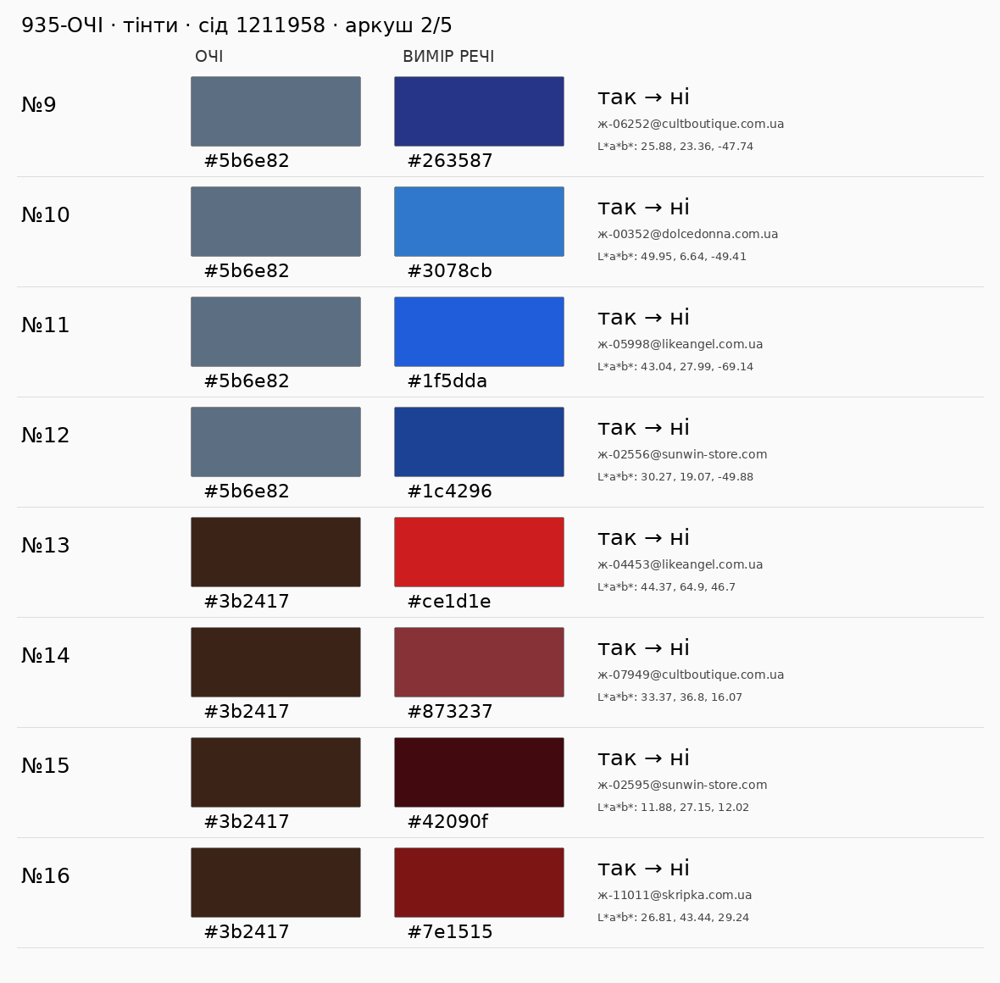
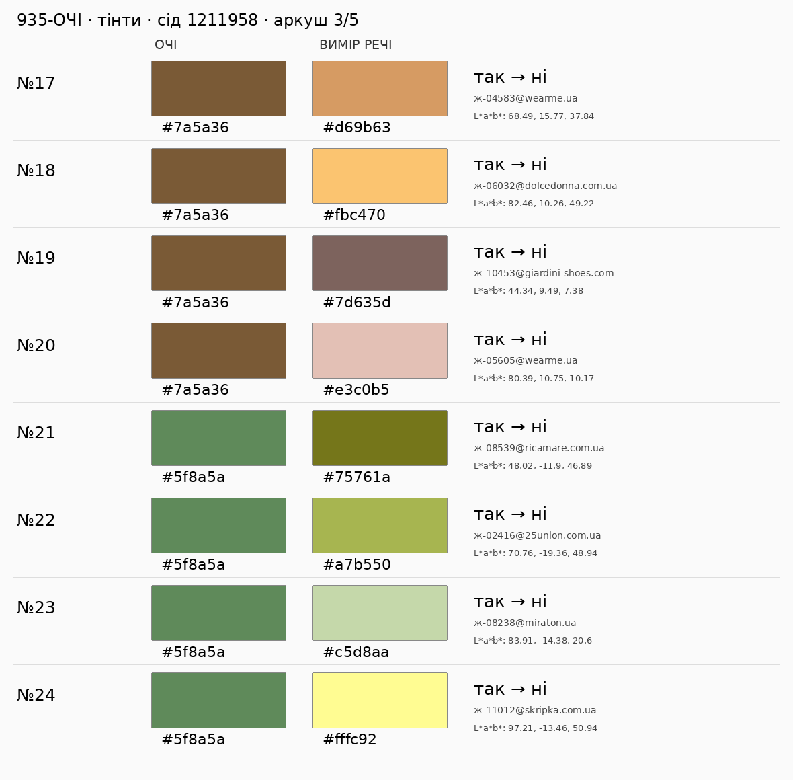
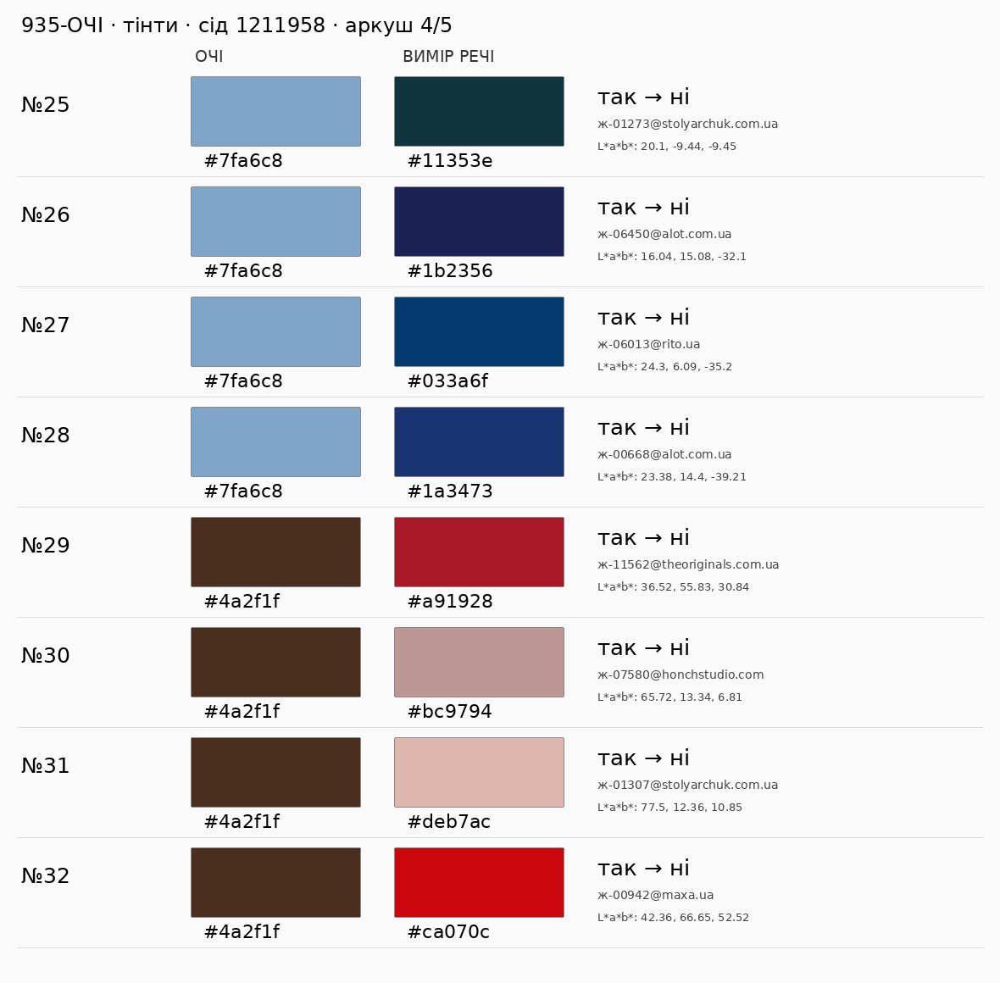
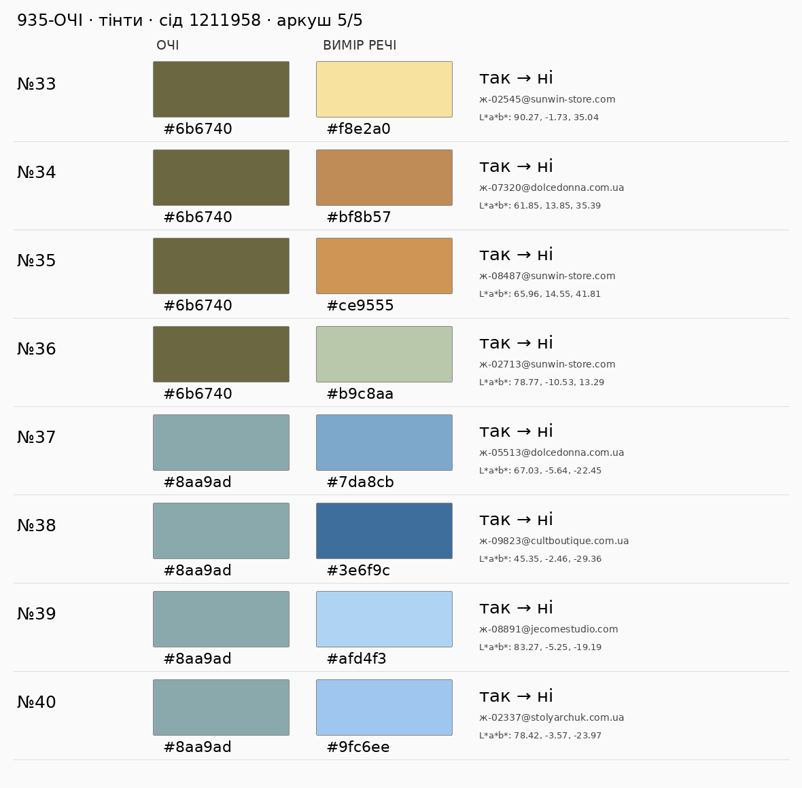

# 935-ОЧІ — нова сліпа вибірка після корекції тінтів

**Статус: до повторної незалежної Astra max. Очима не оцінено; ≥38/40 не доведено.** На попередньому SHA `62bebbad5e2c46aadd6756537d9b0b1e699b288b` незалежна Astra зафіксувала **34 правильні / 5 хиб / 1 сумнів** ([висновок](https://github.com/mightyrochy/kod-shi-data/pull/958#issuecomment-6126678780)); цей висновок не змінюється.

Мірило: **справжні кольорові квадрати очі ↔ вимір**, поруч на п’яти PNG. Фото — довідка, 403 не блокер. Чи ПІСЛЯ є відлунням райдужки за видимим тоном/підтоном, чистотою й світлотою? Поріг — окрема Astra ≥38/40; виконавець не приймає свою вибірку.

Baseline відбору ДО: `3dec14c5c9b5920e427293f4c10541532082de20`, початкова дуга #935: `у_дугах_кола(x, [palettes.дуга_очей(h)], palettes.ПОРІГ_ОЧЕЙ)`. ПІСЛЯ: `у_сім_ї_очей(x, запис_кольору(dict(lab=colorspace.hx(очі))))`. Baseline цієї кодової корекції: `62bebbad5e2c46aadd6756537d9b0b1e699b288b`; його окреме каталогове ДО/ПІСЛЯ — у повідомленні нового коміту.

Каталог: `feed._прочитати_каталог(feed.каталог_на_диску(), ліміт_фото=0)["каталог"]`; тільки точні виміри (`не_вимір is None`) і `нейтраль_меж == "ні"`; лише різні ДО/ПІСЛЯ. Слова не беруть участі у відборі.

Сід **1211958**, інший за 5/958/1210958. Унікальні hex стенда та ж1–ж9 у лексикографічному порядку: 8 кольорів; ще 2 числові контроли `#6b6740` та `#8aa9ad`, без твердження про нові виміри людей. По **4 на 10**. Кандидати сортуються за id, один `random.Random(1211958)` послідовно виконує sample(...,4). Всі попередні **120** пар виключено з незмінних комітів `29903122d646d8069958b142f701e3cf2715721b`, `9baf2cf1b404749c20e16b9e1f89a1b04180e6e5`, `62bebbad5e2c46aadd6756537d9b0b1e699b288b`. Вибірка не залежить від бажаних оцінок чи доступності фото. Відтворення з `джерела/`: `python проби/сімя_очей_вибірка_958.py /tmp/очі.json`.

Допустимих змінених пар: **1720**. JSON з точними lab, id, адресами, seed та складом — `сімя_очей_2.json`. Код SHA-256: `61877b003884712302368a8be0d8e3293cddde41145404e2ade1fc557fa8dbfd`. Для рев’ю брати точний remote SHA з результатного коментаря #958.

| очі | кандидатів | відібрано | ДО→ПІСЛЯ |
|---|---:|---:|---|
| `#759087` | 108 | 4 | так→ні: 4 |
| `#7a7a4c` | 70 | 4 | так→ні: 4 |
| `#5b6e82` | 143 | 4 | так→ні: 4 |
| `#3b2417` | 559 | 4 | так→ні: 4 |
| `#7a5a36` | 96 | 4 | так→ні: 4 |
| `#5f8a5a` | 12 | 4 | так→ні: 4 |
| `#7fa6c8` | 27 | 4 | так→ні: 4 |
| `#4a2f1f` | 424 | 4 | так→ні: 4 |
| `#6b6740` | 85 | 4 | так→ні: 4 |
| `#8aa9ad` | 196 | 4 | так→ні: 4 |

| # | очі | вимір речі та ID | ДО→ПІСЛЯ | фото (довідка) | очима |
|---|---|---|---|---|---|
| 1 | `#759087` | `#0bc17d` [Зелені костюмні штани з лямкою](https://alot.com.ua/zelenie_kostyumnie_bryuki_s_lyamkoy) · `ж-06453@alot.com.ua` | так→ні | [фото](https://alot.com.ua/imgs/mg3335.jpg) | не оцінено |
| 2 | `#759087` | `#cde9c7` [Сукня прямого крою, без рукава, з накладними кишенями](https://brenda.ua/other-brand-31) · `ж-01572@brenda.ua` | так→ні | [фото](https://brenda.ua/image/cache/catalog/21.09.25/344-1200x1800.jpg) | не оцінено |
| 3 | `#759087` | `#26bed4` [Светр Повітря бірюза](https://likeangel.com.ua/product/svetr-povitrya-biryuza/) · `ж-03881@likeangel.com.ua` | так→ні | [фото](https://likeangel.com.ua/wp-content/uploads/2026/03/bez-nazvy-36-4.webp) | не оцінено |
| 4 | `#759087` | `#43d5e9` [Худі з кишенею](https://wearme.ua/products/khudi-z-kysheneiu) · `ж-04640@wearme.ua` | так→ні | [фото](https://cdn.shopify.com/s/files/1/0628/0259/1990/files/CB000003339___2.jpg?v=1729185634) | не оцінено |
| 5 | `#7a7a4c` | `#799a31` [В’язаний зелений светр з горловиною-стійкою з вовною, артикул -, 【MustHave ❤️】ці](https://musthave.ua/ua/product/18545-vyazanii-zelenii-svetr-z-gorlovinoyu-stiikoyu-z-vovnoyu) · `ж-12271@musthave.ua` | так→ні | [фото](https://musthave.ua/uploads/products/47203/00000049262.webp?v=1789737661) | не оцінено |
| 6 | `#7a7a4c` | `#fbf4ad` [Шорти жіночі на резинці](https://wearme.ua/products/shorty-zhinochi-na-rezyntsi-1) · `ж-05665@wearme.ua` | так→ні | [фото](https://cdn.shopify.com/s/files/1/0628/0259/1990/files/CB000003309_yellow_1.jpg?v=1785420746) | не оцінено |
| 7 | `#7a7a4c` | `#fee474` [Сарафан Elio](https://theoriginals.com.ua/ua/zhinkam/odyag/sukni/sarafany/sarafan-elio) · `ж-11327@theoriginals.com.ua` | так→ні | [фото](https://images.theoriginals.com.ua/cache/webp/catalog/product_photo/85245/zheltyi-sarafan-pritalennogo-kroya-1.webp) | не оцінено |
| 8 | `#7a7a4c` | `#93bf5d` [Кардиган Хмаринка фісташка](https://likeangel.com.ua/product/kardygan-hmarynka-fistashka/) · `ж-04397@likeangel.com.ua` | так→ні | [фото](https://likeangel.com.ua/wp-content/uploads/2026/03/bez-nazvy-43-2-1.webp) | не оцінено |
| 9 | `#5b6e82` | `#263587` [Джинси жіночі](https://cultboutique.com.ua/ua/products/000032072) · `ж-06252@cultboutique.com.ua` | так→ні | [фото](https://cultboutique.com.ua/files/resized/products/img_7137-copy.2400x2400.jpg.webp) | не оцінено |
| 10 | `#5b6e82` | `#3078cb` [Бавовняна блакитна сукня сафарі Мірабель](https://dolcedonna.com.ua/4572-hlopkovoe-gorchichnoe-plate-safari-mirabel/) · `ж-00352@dolcedonna.com.ua` | так→ні | [фото](https://dolcedonna.com.ua/image/cache/catalog/SS26/models1/IMG_1035-1000x1500.webp) | не оцінено |
| 11 | `#5b6e82` | `#1f5dda` [Спідниця сатинова електрик](https://likeangel.com.ua/product/spidnyczya-satynova-elektryk/) · `ж-05998@likeangel.com.ua` | так→ні | [фото](https://likeangel.com.ua/wp-content/uploads/2026/03/bez-nazvy-11-10-2.webp) | не оцінено |
| 12 | `#5b6e82` | `#1c4296` [Джемпер жіночий із акцентною горловиною “човник” демісезонний](https://www.sunwin-store.com/shop/dzhemper-zhinochij-iz-akcentnoyu-gorlovinoyu-chovnik-demisezonnij-2892bl/) · `ж-02556@sunwin-store.com` | так→ні | [фото](https://www.sunwin-store.com/wp-content/uploads/2026/02/2892_navi_2.webp) | не оцінено |
| 13 | `#3b2417` | `#ce1d1e` [Светр Хмаринка червоний](https://likeangel.com.ua/product/svetr-hmarynka-chervonyj/) · `ж-04453@likeangel.com.ua` | так→ні | [фото](https://likeangel.com.ua/wp-content/uploads/2026/03/bez-nazvy-17-4.jpg) | не оцінено |
| 14 | `#3b2417` | `#873237` [Сумка жіноча Salon](https://cultboutique.com.ua/ua/products/000032531) · `ж-07949@cultboutique.com.ua` | так→ні | [фото](https://cultboutique.com.ua/files/resized/products/img_3405-copy_1.600x600.jpg.webp) | не оцінено |
| 15 | `#3b2417` | `#42090f` [Джемпер жіночий щільний із орнаментом попереду демісезонний](https://www.sunwin-store.com/shop/dzhemper-zhinochij-shilnij-iz-ornamentom-poperedu-demisezonnij-2911rd/) · `ж-02595@sunwin-store.com` | так→ні | [фото](https://www.sunwin-store.com/wp-content/uploads/2026/07/2911_burgundy_5.webp) | не оцінено |
| 16 | `#3b2417` | `#7e1515` [Спідниця «Flame» червона](https://skripka.com.ua/product/women/sale/spidnytsia-flame-chervona) · `ж-11011@skripka.com.ua` | так→ні | [фото](https://skripka.com.ua/wp-content/uploads/2025/03/IMG_4754.jpg) | не оцінено |
| 17 | `#7a5a36` | `#d69b63` [Светр зі спущеним плечем](https://wearme.ua/products/svetr-zi-spushchenym-plechem) · `ж-04583@wearme.ua` | так→ні | [фото](https://cdn.shopify.com/s/files/1/0628/0259/1990/files/CB000030283_camel_2.jpg?v=1729182214) | не оцінено |
| 18 | `#7a5a36` | `#fbc470` [Бавовняна сонячна спідниця Лайл](https://dolcedonna.com.ua/3560-hlopkovaya-yubka-lail/) · `ж-06032@dolcedonna.com.ua` | так→ні | [фото](https://dolcedonna.com.ua/image/cache/catalog/products/3560/6-1000x1780.webp) | не оцінено |
| 19 | `#7a5a36` | `#7d635d` [Лофери замшеві коричневі](https://giardini-shoes.com/lofery-cholovichi-zamshevi-korychnevi/12622/) · `ж-10453@giardini-shoes.com` | так→ні | [фото](https://giardini-shoes.com/content/images/23/1200x1800l95mc0/32964113680114.jpg) | не оцінено |
| 20 | `#7a5a36` | `#e3c0b5` [Брюки з імітацією запаху](https://wearme.ua/products/briuky-z-imitatsiieiu-zapakhu) · `ж-05605@wearme.ua` | так→ні | [фото](https://cdn.shopify.com/s/files/1/0628/0259/1990/files/CB000030183_beige_zebra_1.jpg?v=1785496989) | не оцінено |
| 21 | `#5f8a5a` | `#75761a` [Літня сукня з поясом (12, S, Lime, хакі)](https://ricamare.com.ua/litnja-suknja-pojas/) · `ж-08539@ricamare.com.ua` | так→ні | [фото](https://ricamare.com.ua/content/images/31/1200x1800l95mc0/litnja-suknja-pojas-25760406852681.jpg) | не оцінено |
| 22 | `#5f8a5a` | `#a7b550` [ТОП БАНДО НА ТОНКИХ БРЕТЕЛЯХ ЛЕЙМОН САЛАТОВИЙ](https://25union.com.ua/katalog/topy/top-bando-na-tonkyh-breteljah-lejmon-salatovyj/) · `ж-02416@25union.com.ua` | так→ні | [фото](https://25union.com.ua/image/cache/wp/gj/tovar/304-top-bando-na-tonkyh-breteljah-lejmon/spidnicjaminitop25union-306678-999x999.webp) | не оцінено |
| 23 | `#5f8a5a` | `#c5d8aa` [Жіноча сумка солом'яна зелена](https://www.miraton.ua/ua/catalog/women/sumka/_miraton_000209330/) · `ж-08238@miraton.ua` | так→ні | [фото](https://www.miraton.ua/upload/webp_cache/1740x2280q90-000209330_1_.webp) | не оцінено |
| 24 | `#5f8a5a` | `#fffc92` [Сумка CHARLOTTE лимонний](https://skripka.com.ua/product/women/sumki/sumka-charlotte-lymonnyi) · `ж-11012@skripka.com.ua` | так→ні | [фото](https://skripka.com.ua/wp-content/uploads/2026/06/15-3.jpg) | не оцінено |
| 25 | `#7fa6c8` | `#11353e` [МОДЕЛЬ №887 ЗЕЛЕНИЙ](https://stolyarchuk.com.ua/katalog/sukni/modjel_887_zjeljen_j) · `ж-01273@stolyarchuk.com.ua` | так→ні | [фото](https://stolyarchuk.com.ua/image/cache/webp/catalog/887/%20кадр8135_resized-532x798.webp) | не оцінено |
| 26 | `#7fa6c8` | `#1b2356` [Спідниця максі з клоке](https://alot.com.ua/yubka_maksi_iz_siney_paltovki) · `ж-06450@alot.com.ua` | так→ні | [фото](https://alot.com.ua/imgs/m1032.jpg) | не оцінено |
| 27 | `#7fa6c8` | `#033a6f` [А-подібна спідниця максі з віскози темно-блакитна](https://rito.ua/a-podibna-spidnycya-maksi-z-viskozy-temno-blakytna) · `ж-06013@rito.ua` | так→ні | [фото](https://rito.ua/image/cachewebp/catalog/SS%202026/7554b_7587_blue_2007sh_white_2-824x1236.webp) | не оцінено |
| 28 | `#7fa6c8` | `#1a3473` [Синя лляна сукня А-силуету](https://alot.com.ua/sinee_lnyanoe_plate_a-silueta) · `ж-00668@alot.com.ua` | так→ні | [фото](https://alot.com.ua/imgs/mg3094.jpg) | не оцінено |
| 29 | `#4a2f1f` | `#a91928` [Сумка Soho зі шкіри](https://theoriginals.com.ua/ua/zhinkam/sumky/krosbodi/sumka-soho-zi-shkiry) · `ж-11562@theoriginals.com.ua` | так→ні | [фото](https://images.theoriginals.com.ua/cache/webp/catalog/product_photo/85022/sumka-soho-iz-kozhi-1.webp) | не оцінено |
| 30 | `#4a2f1f` | `#bc9794` [Обруч Белла зі стразами лавандовий](https://honchstudio.com/products/headband_bella_lavander) · `ж-07580@honchstudio.com` | так→ні | [фото](https://cdn.shopify.com/s/files/1/0635/3138/5029/files/101_11zon_30fa4b21-7729-42bf-b593-879694ca69f7.webp?v=1750768155) | не оцінено |
| 31 | `#4a2f1f` | `#deb7ac` [МОДЕЛЬ №961 БЕЖ](https://stolyarchuk.com.ua/katalog/sukni/modjel_961_bjezh) · `ж-01307@stolyarchuk.com.ua` | так→ні | [фото](https://stolyarchuk.com.ua/image/cache/webp/catalog/961/AW3A1172-1667x2500.webp) | не оцінено |
| 32 | `#4a2f1f` | `#ca070c` [Трикотажні штани з контрастними лампасами](https://maxa.ua/trykotazhni-shtany-z-kontrastnymy-lampasamy/) · `ж-00942@maxa.ua` | так→ні | [фото](https://maxa.ua/wp-content/uploads/2025/08/08697-7.jpg) | не оцінено |
| 33 | `#6b6740` | `#f8e2a0` [Джемпер в’язаний жіночий з V-горловиною з бавовни демісезонний](https://www.sunwin-store.com/shop/dzhemper-vyazanij-zhinochij-z-v-gorlovinoyu-z-bavovni-demisezonnij-2943yl/) · `ж-02545@sunwin-store.com` | так→ні | [фото](https://www.sunwin-store.com/wp-content/uploads/2026/01/2943_lemon_5.webp) | не оцінено |
| 34 | `#6b6740` | `#bf8b57` [Асиметрична бавовняна спідниця на запах бежевого кольору Емі](https://dolcedonna.com.ua/4029-assimetrichnaya-yubka-na-zapah-emi/) · `ж-07320@dolcedonna.com.ua` | так→ні | [фото](https://dolcedonna.com.ua/image/cache/catalog/products/4029/5-1000x1503.webp) | не оцінено |
| 35 | `#6b6740` | `#ce9555` [Кардиган жіночий на запах тоненький вовняний з поясом демісезонний](https://www.sunwin-store.com/shop/kardigan-zhinochij-na-zapah-tonenkij-vovnyanij-z-poyasom-demisezonnij-2981yl/) · `ж-08487@sunwin-store.com` | так→ні | [фото](https://www.sunwin-store.com/wp-content/uploads/2026/07/2981_ocher_12.webp) | не оцінено |
| 36 | `#6b6740` | `#b9c8aa` [Кардиган жіночий з коротким руквом із віскози весняний](https://www.sunwin-store.com/shop/kardigan-zhinochij-z-korotkim-rukvom-iz-viskozi-vesnyanij-2952gn/) · `ж-02713@sunwin-store.com` | так→ні | [фото](https://www.sunwin-store.com/wp-content/uploads/2026/03/2952_pistachio_4.webp) | не оцінено |
| 37 | `#8aa9ad` | `#7da8cb` [Блакитна куртка з капюшоном Катама](https://dolcedonna.com.ua/3793-golubaya-kurtka-s-kapyushonom-katama/) · `ж-05513@dolcedonna.com.ua` | так→ні | [фото](https://dolcedonna.com.ua/image/cache/catalog/products/3793/1-1000x1500.webp) | не оцінено |
| 38 | `#8aa9ad` | `#3e6f9c` [Лофери жіночі](https://cultboutique.com.ua/ua/products/000032028) · `ж-09823@cultboutique.com.ua` | так→ні | [фото](https://cultboutique.com.ua/files/resized/products/img_2533-copy_2.600x600.jpg.webp) | не оцінено |
| 39 | `#8aa9ad` | `#afd4f3` [Балетки Tay блакитний замш](https://jecomestudio.com/products/ballerians_tay_blue_suede) · `ж-08891@jecomestudio.com` | так→ні | [фото](https://cdn.shopify.com/s/files/1/0722/6841/5207/files/photo_2026-03-1316.45.46.jpg?v=1784672412) | не оцінено |
| 40 | `#8aa9ad` | `#9fc6ee` [МОДЕЛЬ №1011 БЛАКИТНИЙ](https://stolyarchuk.com.ua/katalog/klas_chni_kostyum/modjel_1011_blak_tn_j) · `ж-02337@stolyarchuk.com.ua` | так→ні | [фото](https://stolyarchuk.com.ua/image/cache/webp/catalog/1011/%20кадр3083-532x798.webp) | не оцінено |

## Квадрати поруч

## Корекція і джерела

У м’якого світлого тінту може змінитись абсолютна хрома: K-COL-11 у `тема-4_композиція-і-когерентність-EN.md`, MacEvoy (handprint color3/color13), Munsell/ISCC-NBS, приклад блідого й чистого тону з різними хромами. Відлуння очей — K-PAL-02/R-COL-17; межа — підтон і світлота (K-COL-12). Нова умова — **перетин** вже чинної аналогової дуги RELATIONS та її ΔH*-вікна (`30 × 3/15`, не новий кут CIELAB), позитивна світлотна смуга до чинного +40, плавний верх хроми hi_C та певність тону. Сигми й функції згасання спільні. Це принципи практиків; перенесення на відлуння очей і конкретні межі +40/hi_C — T3, не доведені експериментом на одязі.

П’ять названих хиб Astra виправлені кодом; 34 зараховані коди тієї вибірки не змінилися. Сумнівна №15 змінила код на «так», але виконавець не присвоює їй очної оцінки. Старі 17/21/33, дев’ять контрольних хиб і кремовий контроль проходять; 31 код початкових зарахованих пар не змінився відносно 62beb. Пограничні дві пари старого аркуша лишаються відкритою інформацією у 5010. Це контроль попередніх оцінок, не приймання нових 40.

Джерела SHA-256:

- `каталог_повний.xml.gz`: `71cffbd27a4916db4676cc57cfd2174e94288a3f32458c4dda4dab0e5b877331`
- `джерела/каталог_збагачення.json.gz`: `fd084c89cad938d8b5e6bb851ee4c0eb396471057c66b4a5fd71a905ffadeb9b`
- `джерела/каталог_кадри.json.gz`: `b9f31cfa1458bfcbb7b7a862b3151ea05b5e34f39b09959b6dc8bf7412c31040`
