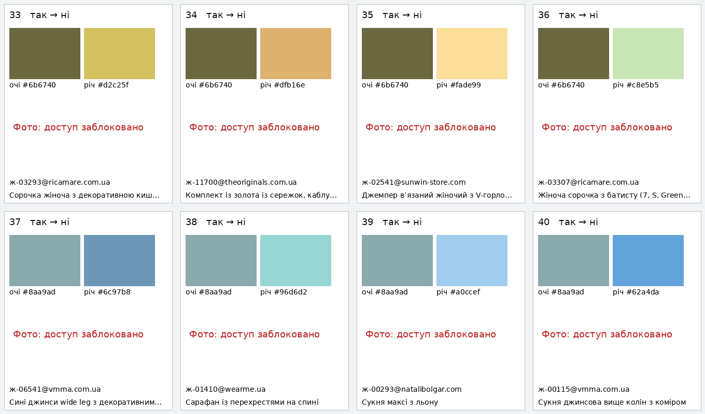

# 935-ОЧІ — нова вибірка для незалежної перевірки

Implementation SHA: `73bcab076aa64c5370bfea85978b7ee8b43f25f7` (код незмінний у наступному коміті вибірки). Baseline PR #958: `3dec14c5c9b5920e427293f4c10541532082de20`.

**Статус: implementation / review. Візуальних вердиктів ще немає; ≥38/40 не доведено.** Незалежну Work Cloud-сесію Astra max запускає координатор. Виконавець не оцінює свою нову вибірку й не приймає роботу.

Метод: каталог продукту `feed._прочитати_каталог(feed.каталог_на_диску(), ліміт_фото=0)`, тільки виміри (`колір_річ.не_вимір(x) is None`) і `нейтраль_меж(x) == "ні"`. ДО — функція baseline: `у_дугах_кола(x, [palettes.дуга_очей(h)], palettes.ПОРІГ_ОЧЕЙ)`; ПІСЛЯ — `у_сім_ї_очей(x, запис_кольору(dict(lab=colorspace.hx(очі))))`. Вибираються лише різні вердикти. Пара (hex очей, hex речі) зі старого аркуша виключається. Слова речі не впливають на відбір.

Порядок очей: унікальні hex зі `стенд_вх.json`, далі `аудит/проби/жінки/ж*.json` у лексикографічному порядку; це 8 різних кольорів, тому для рівно 10 × 4 додано дві контрольні райдужки: оливкову `#6b6740` та сіро-бірюзову `#8aa9ad`. Це кольорові контролі, без твердження про нові виміри людей. Для кожних очей кандидати сортуються за `id`; один `random.Random(958)` послідовно робить `sample(candidates, 4)`. Сід старого аркуша — 5. Вибірка не пересортувалась за доступністю фото чи бажаними вердиктами.

Змінених допустимих пар після виключення старого аркуша: **2189**. Фото: `фото_опису` (кадр виміру/опису) або перше фото продуктового каталогу. У цій Cloud-сесії проксі не дозволив отримати фото: `Tunnel connection failed: 403 Forbidden`; дві адреси на річ перевірено без подальших повторів. На локальних аркушах чесні заглушки, у таблиці — точні зовнішні фото для незалежного рев’юера. **Оцінювати за квадратами замість фото не можна.** Якщо в сесії рев’юера фото також недоступні, результат — блокер, а не приймання.

Критерій: чи правильний ПІСЛЯ як сім’я райдужки за тоном/підтоном, насиченістю й світлотою. Квадрати: зліва очі, справа вимір речі. Фото може містити принт чи другий колір: звірити саме виміряний домінантний колір. Знахідка суду — інформація, не заборона носити річ (п.17). Числові межі implementation — T3, корпусні джерела й обмеження — у `колір_відношення.РЕЄСТР_ОЧЕЙ`.

| очі | кандидатів | відібрано |
|---|---:|---:|
| `#759087` | 121 | 4 |
| `#7a7a4c` | 84 | 4 |
| `#5b6e82` | 355 | 4 |
| `#3b2417` | 597 | 4 |
| `#7a5a36` | 158 | 4 |
| `#5f8a5a` | 28 | 4 |
| `#7fa6c8` | 35 | 4 |
| `#4a2f1f` | 471 | 4 |
| `#6b6740` | 114 | 4 |
| `#8aa9ad` | 226 | 4 |

| # | очі | річ (hex речі) | ДО→ПІСЛЯ | фото | очима |
|---|---|---|---|---|---|
| 1 | `#759087` | `#065242` [Жакет зі 100% вовни мериноса зелений](https://rito.ua/zhaket-zi-100-vovny-merynosa-zelenyi) · `ж-01713@rito.ua` | так→ні |  | не оцінено |
| 2 | `#759087` | `#c5e8dd` [Зелена сукня без рукавів у квітковий принт](https://theoriginals.com.ua/ua/zhinkam/odyag/sukni/povsyakdenni-sukni/zelena-suknya-bez-rukaviv-u-kvitkovyj-prynt) · `ж-11862@theoriginals.com.ua` | так→ні |  | не оцінено |
| 3 | `#759087` | `#10d579` [Hermes](https://brenda.ua/hermes-64) · `ж-10398@brenda.ua` | так→ні |  | не оцінено |
| 4 | `#759087` | `#295249` [КОСТЮМ ТОП З АСИМЕТРИЧНОЮ ГОРЛОВИНОЮ ТА СПІДНИЦЕЮ НА ЗАПАХ ТЕМНО ЗЕЛЕНИЙ](https://25union.com.ua/katalog/kostyumy/kostyum-top-s-assymetrychnoj-gorlovynoj-y-yubkoj-na-zapah-temno-zelenyj/) · `ж-05562@25union.com.ua` | так→ні |  | не оцінено |
| 5 | `#7a7a4c` | `#e7d493` [Модель має широку V-подібну перемичку, що м’яко фіксує стопу без за](https://emmeliedelage.com/sabo-zhovti-yumy/) · `ж-08689@emmeliedelage.com` | так→ні |  | не оцінено |
| 6 | `#7a7a4c` | `#f7cc7a` [Джемпер жіночий щільний із орнаментом попереду демісезонний](https://www.sunwin-store.com/shop/dzhemper-zhinochij-shilnij-iz-ornamentom-poperedu-demisezonnij-2911yl/) · `ж-02596@sunwin-store.com` | так→ні |  | не оцінено |
| 7 | `#7a7a4c` | `#89a962` [Штани лляні жіночі Сакавен](https://vilni.store/shtany-lliani-zhinochi-sacaven/) · `ж-06687@vilni.store` | так→ні |  | не оцінено |
| 8 | `#7a7a4c` | `#a2c380` [Штани лляні Ньюрі](https://vilni.store/shtany-lliani-newry-2022/) · `ж-05966@vilni.store` | так→ні |  | не оцінено |
| 9 | `#5b6e82` | `#bfdefc` [Брюки блакитний](https://andretan.ua/catalog/bryuki/color-13) · `ж-06158@andretan.ua` | так→ні |  | не оцінено |
| 10 | `#5b6e82` | `#62b0ec` [Джинсова вільна сукня з коміром](https://vmma.com.ua/dzhynsova-vilna-suknia-z-komirom) · `ж-00114@vmma.com.ua` | так→ні |  | не оцінено |
| 11 | `#5b6e82` | `#7da6ce` [Пасок з пірʼям джинс](https://likeangel.com.ua/product/pasok-z-pir-iam-dzhyns/) · `ж-08650@likeangel.com.ua` | так→ні |  | не оцінено |
| 12 | `#5b6e82` | `#124b9d` [Сукня в'язана](https://wearme.ua/products/suknia-viazana) · `ж-01428@wearme.ua` | так→ні |  | не оцінено |
| 13 | `#3b2417` | `#6e1420` [Спідниця міді винного кольору MH STUDIO, артикул -, 【MustHave ❤️】ціна](https://musthave.ua/ua/product/18458-spidnicya-midi-vinnogo-kolyoru-mh-studio) · `ж-12302@musthave.ua` | так→ні |  | не оцінено |
| 14 | `#3b2417` | `#e9b7b3` [Рожеві кеди із текстилю та шкіри в принт](https://theoriginals.com.ua/ua/zhinkam/vzuttya-3/krosivky-ta-kedy/kedy/rozhevi-kedy-iz-tekstylyu-ta-shkiry-v-prynt) · `ж-11450@theoriginals.com.ua` | так→ні |  | не оцінено |
| 15 | `#3b2417` | `#5c2727` [LeBERDES Туфлі](https://favoriteshoes.com.ua/18597-leberdes-tufl/) · `ж-08795@favoriteshoes.com.ua` | так→ні |  | не оцінено |
| 16 | `#3b2417` | `#dc1c33` [Костюм жіночий з прямою спідницею демісезонний](https://www.sunwin-store.com/shop/kostyum-zhinochij-z-pryamoyu-spidniceyu-demisezonnij-941rd/) · `ж-05529@sunwin-store.com` | так→ні |  | не оцінено |
| 17 | `#7a5a36` | `#a7b550` [ТОП БАНДО НА ТОНКИХ БРЕТЕЛЯХ ЛЕЙМОН САЛАТОВИЙ](https://25union.com.ua/katalog/topy/top-bando-na-tonkyh-breteljah-lejmon-salatovyj/) · `ж-02416@25union.com.ua` | ні→так |  | не оцінено |
| 18 | `#7a5a36` | `#a68980` [Жилет жіночий вільного фасону з V-горловиною демісезонний](https://www.sunwin-store.com/shop/zhilet-zhinochij-vilnogo-fasonu-z-v-gorlovinoyu-demisezonnij-1902pd/) · `ж-02836@sunwin-store.com` | так→ні |  | не оцінено |
| 19 | `#7a5a36` | `#fade99` [Джемпер в’язаний жіночий з V-горловиною бавовняний демісезонний](https://www.sunwin-store.com/shop/dzhemper-vyazanij-zhinochij-z-v-gorlovinoyu-bavovnyanij-demisezonnij-2852yl/) · `ж-02541@sunwin-store.com` | так→ні |  | не оцінено |
| 20 | `#7a5a36` | `#fee770` [Приталена сукня жовтого кольору з довгим рукавом](https://theoriginals.com.ua/ua/zhinkam/odyag/sukni/povsyakdenni-sukni/prytalena-suknya-zhovtogo-koloru-z-dovgym-rukavom) · `ж-11264@theoriginals.com.ua` | так→ні |  | не оцінено |
| 21 | `#5f8a5a` | `#1eaf9c` [Лонгслів мохеровий зелений](https://likeangel.com.ua/product/longsliv-moherovyj-zelenyj/) · `ж-03843@likeangel.com.ua` | ні→так |  | не оцінено |
| 22 | `#5f8a5a` | `#c9df9d` [Котонова сорочка з акцентним ґудзиком світло-зелена](https://honchstudio.com/products/cotton-shirt-green) · `ж-02143@honchstudio.com` | так→ні |  | не оцінено |
| 23 | `#5f8a5a` | `#c6dcc5` [Сукня з принтом](https://maxa.ua/suknya-z-pryntom-3/) · `ж-00928@maxa.ua` | так→ні |  | не оцінено |
| 24 | `#5f8a5a` | `#70811d` [Блуза в стилі бохо з шифону креш Джун](https://dolcedonna.com.ua/4722-yubka-maksi-s-zhatoi-tkani-lima/) · `ж-04371@dolcedonna.com.ua` | так→ні |  | не оцінено |
| 25 | `#7fa6c8` | `#15514f` [Сукня Максі сатин смарагд](https://likeangel.com.ua/product/suknya-maksi-satyn-smaragd/) · `ж-00689@likeangel.com.ua` | так→ні |  | не оцінено |
| 26 | `#7fa6c8` | `#1382a2` [Двосторонній пуховик з авторським принтом Мінесота](https://dolcedonna.com.ua/3024-dvustoronnii-puhovik-s-avtorskim-printom-minesota/) · `ж-04997@dolcedonna.com.ua` | так→ні |  | не оцінено |
| 27 | `#7fa6c8` | `#9690b9` [Кардиган Хмаринка лаванда](https://likeangel.com.ua/product/kardygan-hmarynka-lavanda/) · `ж-04399@likeangel.com.ua` | ні→так |  | не оцінено |
| 28 | `#7fa6c8` | `#093890` [Боді з сітки, Electric Blue](https://solmar.com.ua/ua/catalog/bodi/bodi_c_setochkoy_electric_blue/) · `ж-02028@solmar.com.ua` | так→ні |  | не оцінено |
| 29 | `#4a2f1f` | `#ea9885` [Жіноче вовняне пальто casual з англійським коміром і поясом Bella Bicchi (персиковий, 48)](https://bella-bicchi.com/catalog/zhinoche-palto-bella-bicchi-47838/) · `ж-08379@bella-bicchi.com` | так→ні |  | не оцінено |
| 30 | `#4a2f1f` | `#ddbbb1` [Костюм світло-персиковий](https://alot.com.ua/kostyum_svetlo-persikoviy) · `ж-01644@alot.com.ua` | так→ні |  | не оцінено |
| 31 | `#4a2f1f` | `#be1c11` [Костюм з червоної екошкіри](https://alot.com.ua/kostyum_iz_krasnoy_ekokozhi) · `ж-01717@alot.com.ua` | так→ні |  | не оцінено |
| 32 | `#4a2f1f` | `#d5b5b5` [Боді з сітки, Powder Pink](https://solmar.com.ua/ua/catalog/bodi/bodi_c_setochkoy_pink/) · `ж-02029@solmar.com.ua` | так→ні |  | не оцінено |
| 33 | `#6b6740` | `#d2c25f` [Сорочка жіноча з декоративною кишенею (7, S, Fresh shoots, хаки)](https://ricamare.com.ua/sorochka-zhinocha-dekorativna-kishenia/) · `ж-03293@ricamare.com.ua` | так→ні |  | не оцінено |
| 34 | `#6b6740` | `#dfb16e` [Комплект із золота із сережок, каблучки та підвіски](https://theoriginals.com.ua/ua/zhinkam/aksesuary/prykrasy-1/yuvelirni-vyroby-1/pidvisky-ta-kulony/komplekt-iz-zolota-iz-serezhok-kabluchky-ta-pidvisky) · `ж-11700@theoriginals.com.ua` | так→ні |  | не оцінено |
| 35 | `#6b6740` | `#fade99` [Джемпер в’язаний жіночий з V-горловиною бавовняний демісезонний](https://www.sunwin-store.com/shop/dzhemper-vyazanij-zhinochij-z-v-gorlovinoyu-bavovnyanij-demisezonnij-2852yl/) · `ж-02541@sunwin-store.com` | так→ні |  | не оцінено |
| 36 | `#6b6740` | `#c8e5b5` [Жіноча сорочка з батисту (7, S, Green, зелений)](https://ricamare.com.ua/zhinocha-sorochka-batist/) · `ж-03307@ricamare.com.ua` | так→ні |  | не оцінено |
| 37 | `#8aa9ad` | `#6c97b8` [Сині джинси wide leg з декоративним лазерним малюнком](https://vmma.com.ua/4516.20) · `ж-06541@vmma.com.ua` | так→ні | -900x1350.webp) | не оцінено |
| 38 | `#8aa9ad` | `#96d6d2` [Сарафан із перехрестями на спині](https://wearme.ua/products/sarafan-iz-perekhrestiamy-na-spyni) · `ж-01410@wearme.ua` | так→ні |  | не оцінено |
| 39 | `#8aa9ad` | `#a0ccef` [Сукня максі з льону](https://natalibolgar.com/ua/catalog/platya/plate_maksi_iz_lna-25151-lo-162.html) · `ж-00293@natalibolgar.com` | так→ні |  | не оцінено |
| 40 | `#8aa9ad` | `#62a4da` [Сукня джинсова вище колін з коміром](https://vmma.com.ua/suknia-dzhynsova-vyshche-kolin-z-komirom) · `ж-00115@vmma.com.ua` | так→ні |  | не оцінено |

Аркуші для порядку й квадратів (фото заблоковані у середовищі виконавця):

Окремо для уваги рев’юера: на старому аркуші дев’ять хиб збігаються з очікуванням; дві пограничні ✔ (#21 `#84c3d7` і #26 `#73b6c4` до `#759087`) тепер «ні». Це не оцінка нових 40 пар. Дошка: 4980, 4981.

Відбитки джерел відбору (SHA-256):

- `каталог_повний.xml.gz`: `71cffbd27a4916db4676cc57cfd2174e94288a3f32458c4dda4dab0e5b877331`
- `джерела/каталог_збагачення.json.gz`: `fd084c89cad938d8b5e6bb851ee4c0eb396471057c66b4a5fd71a905ffadeb9b`
- `джерела/каталог_кадри.json.gz`: `b9f31cfa1458bfcbb7b7a862b3151ea05b5e34f39b09959b6dc8bf7412c31040`
