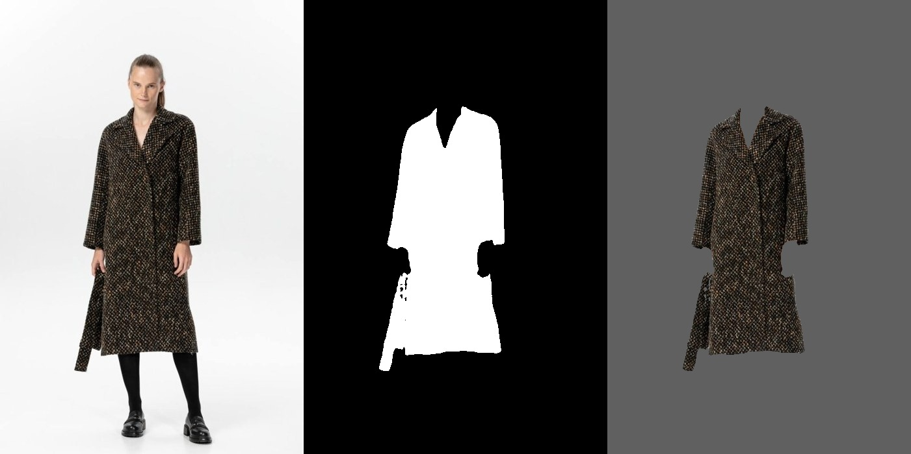

# SAM без адміністратора

2026-10-28 UTC. Виконавець, ризик Р2. Обліковий запис `desktop-6n11sa4\gemini`, Windows, запуск під обгорткою.
Реалізація: `2674aa073ea57f3dfd81bf8793bb221e32932f9e`; зовнішні контракти — `66ed20fca624970e3d07eb1728d86f8c1ed1ba25`. Незалежної перевірки цей звіт не підміняє.

## Що змінено

Власне середовище `%USERPROFILE%\.cache\liusterko\sam\venv` виконує GroundingDINO Tiny + SAM ViT-B на CPU.
Жнива автоматично знаходять його після створення позначки `sam\готово`. Кожна маска рахується окремим
процесом; процес завершується перед поверненням результату. Сервер і CUDA не потрібні, відеопам'ять SAM
не займає. `ЖНИВА_SAM_PYTHON` дозволяє явно вказати інший інтерпретатор. Якщо власного середовища немає,
лишається наявний HTTP-шлях ComfyUI/SAM 3.1.

`маска_sam` зберігає контракт `(uint8-маска або None, частка кадру, чому)`, розмір вихідного фото,
віднімання шкіри ATR та чинний поріг порожньої маски. `маска_речі` зберігає порядок ATR → SAM → запасна
та джерело `SAM`. Ваги під час виміру читаються лише з локального кешу; завантаження робить окрема команда.

Пакет ATR типово береться з `open-source-stylist` цього репозиторію, Leffa — зі встановленого середовища
поточного користувача. Явні `OSS_PATH` і `LEFFA_PATH` зберігають пріоритет. Перевірка `поверхня_фото` без
обох змінних пройшла: [контракт.json](sam_без_адміна/контракт.json) містить `маска.джерело = SAM`, частку
0.169 та чинні кластери виміру поверхні для `ж-05239@alot.com.ua`.

Під час виміру виявлено причину падіння на Windows: `cv2.imread` не відкриває кириличні шляхи.
Єдиний читач `жнива_фото.читати_bgr` відкриває файл стандартним Python і передає байти в `cv2.imdecode`.
Прямих файлових читань OpenCV у модулях маски й кольору **6 → 0**; замінено всі шість місць шляху мірила.

## Вибір шляху та ресурси

- На старті: диск C — **57.58 ГіБ вільно**; RTX 4090 Laptop — **16376 МіБ**, зайнято **10 МіБ**,
  вільно **16039 МіБ**. Порти :8000 і :1234 не слухали; MamayLM не займав карту. `lms` відсутній у PATH.
- `GET http://127.0.0.1:8000/system_stats` → `URLError [WinError 10061]`, з'єднання відхилено.
  У доступному переліку планувальника завдання ComfyUI немає. За договором ноутбука сервер запускає сама сесія.
  Читання `C:\Users\Admin\ComfyUI-Installs\ComfyUI` → `Access is denied`; запуск під Admin не робився.
- Обрано власний CPU-шлях: wheel torch **216 МБ** замість **3273 МБ** CUDA-варіанта, відеопам'ять не потрібна
  навіть поруч із MamayLM. Спробу завантаження CUDA-wheel зупинено, встановлено лише CPU torch.
  Повторне `nvidia-smi` під час справжньої сегментації: ті самі **10 МіБ / 16039 МіБ**.
- Власна тека `sam` після встановлення — **2.26 ГіБ**; окремо кеш Hugging Face з вагами й кеш pip.
  Після встановлення на C лишалося **45.11 ГіБ**. Інші процеси ноутбука не зупинялися.

## Відтворення середовища

У PowerShell, з кореня репозиторію; прав адміністратора, токенів і платних API немає:

```powershell
$env:PYTHONUTF8 = '1'
$env:PYTHONIOENCODING = 'utf-8'
$samEnv = "$env:USERPROFILE\.cache\liusterko\sam\venv"
python -m venv $samEnv
& "$samEnv\Scripts\python.exe" -m pip install torch==2.7.1 torchvision==0.22.1 --index-url https://download.pytorch.org/whl/cpu
& "$samEnv\Scripts\python.exe" -m pip install -r 'аудит/перевірка/sam_без_адміна/середовище.txt'
& "$samEnv\Scripts\python.exe" -u 'аудит/перевірка/sam_без_адміна/підготувати.py'
& "$samEnv\Scripts\python.exe" -u 'аудит/перевірка/sam_без_адміна/вимір.py'
python -u 'аудит/перевірка/sam_без_адміна/батарея.py'
```

Підготовка використовує системне сховище сертифікатів Windows через `truststore`: початковий запит
`requests` з окремим certifi повертав `CERTIFICATE_VERIFY_FAILED`. Перевірка TLS залишається увімкненою.
Завантаження йде з `token=False`, без неявного токена Hugging Face.

| відкриті ваги | байтів | ревізія |
|---|---:|---|
| [GroundingDINO Tiny](https://huggingface.co/IDEA-Research/grounding-dino-tiny) | 689359096 | `a2bb814dd30d776dcf7e30523b00659f4f141c71` |
| [SAM ViT-B](https://huggingface.co/facebook/sam-vit-base) | 374979480 | `70c1a07f894ebb5b307fd9eaaee97b9dfc16068f` |
| [Leffa ATR](https://huggingface.co/franciszzj/Leffa/tree/main/humanparsing) | 266859305 | `61d3390f444506f052feedb0b243cd5369c29c89` |
| Leffa LIP | 266863411 | та сама |

Ваги GroundingDINO/SAM — `%USERPROFILE%\.cache\huggingface\hub`; ATR/LIP додатково копіюються в
`%USERPROFILE%\.cache\liusterko\sam\Leffa\ckpts\humanparsing`.
Код Leffa: [franciszzj/Leffa](https://github.com/franciszzj/Leffa/tree/05a259104b6927607776c7edb3e86b75406f20aa),
лише Python-файли `preprocess/humanparsing`, ревізія `05a259104b6927607776c7edb3e86b75406f20aa`.
Повні SHA-256 усіх ваг і конфігурацій — [ваги.json](sam_без_адміна/ваги.json);
точні версії пакетів — [середовище.txt](sam_без_адміна/середовище.txt). `pip check` — код 0.

## Вимір ДО → ПІСЛЯ

Джерело: `джерела/аудит/збагачення_v2_вибірка.json`, seed 17, 60 речей, 58 збережених фото;
дві речі без фото пропущено однаково в обох проходах. SHA-256 вибірки:
`ad2ea5125246de17be8571c18b66886b199ab61110953b8ea3646c81e22c7fea`.
Порівняння цих файлів із `main` наряду `366461f0bf27787aac337dea6c7b09ed9a2723db` через `git diff --quiet` — код 0. Фото й обрані кадри не змінювалися; SHA-256 кожного кадру є в [вимір.json](sam_без_адміна/вимір.json).
Вимір повторює лише ланку маски на цих самих кадрах, без нового вибору кадру мовною моделлю.
ДО: локальний Python вимкнено явним шляхом до відсутнього файла, порт ComfyUI вільний.
ПІСЛЯ: автоматично знайдене власне середовище.

| джерело маски | ДО | ПІСЛЯ |
|---|---:|---:|
| ATR | 19 | 19 |
| SAM | 0 | 36 |
| запасна | 39 | 0 |
| нема (SAM подивився, річ не знайдена) | 0 | 3 |
| немає вихідного фото | 2 | 2 |

**SAM: 0/60 (0%) → 36/60 (60%)**; серед 58 доступних кадрів — **62.07%**.
Збоїв виконання локального SAM немає; три порожні відповіді є результатами моделі, а не відмовами запуску.
ATR зберіг ті самі 19 речей. Команда виміру завершилася кодом **0**.


Приклад: **ж-05239@alot.com.ua**, слот `верхній_шар`: маска ATR для слота — **0 пікселів**, SAM — **0.169 кадру**.
Оком на знімку видно пальто без обличчя, рук і тла. Ліворуч вихідне фото, посередині бінарна маска,
праворуч вирізана річ. [Бінарна маска](sam_без_адміна/маска.png).



## Перевірено та межі

Обов'язкова батарея `КОД.md`: **6/6 — код 0** на фінальній реалізації.

| команда | результат |
|---|---|
| `python стенд_знімок.py --дим` | 0 |
| `python тест_живого_шляху.py` | 0 |
| `python тест_протоколу.py` | 0 |
| `python прилади/розділи_гейтів.py` | 0 |
| `python audit_contracts.py` | 0 після опису зовнішніх полів Transformers |
| `NODE_PATH=… node тест_показу.js` | 0 |

Журнали нормалізовано до LF без кінцевих пробілів; текст результатів збережено. Суцільний перший прохід усіх десяти команд виконано до кінця: [команди й коди](sam_без_адміна/батарея.json),
[повний журнал](sam_без_адміна/батарея.log). Він виявив три неописані зовнішні поля нового модуля
(`boxes`, `original_sizes`, `reshaped_input_sizes`). Виправлення — коміт
`66ed20fca624970e3d07eb1728d86f8c1ed1ba25`; повторено саме цей аудит:
[результат 0](sam_без_адміна/контракти_після.json), [журнал «КОНТРАКТИ ЦІЛІ»](sam_без_адміна/контракти_після.log).
Успішні довгі перевірки повторно не запускалися: декларація зовнішніх полів не змінює виконання моделі.

Додатково: `поділ_жнива_ast.py` — 0 (25 очікуваних розбіжностей, жодної втрати функції чи реекспорту),
`zhnyva_нові_магазини.py` — 0, перевірка двох рядків дошки — 0.
`поділ_жнива_офлайн.py` — **1**, та сама історична помилка на початкових модулях; подробиці нижче, рядок 10725.
Тому повний запуск допоміжного `батарея.py` повертає 1, хоча всі шість обов'язкових перевірок зелені.


Вимір доводить доступність SAM і контракт запису. Це GroundingDINO + SAM, дозволений нарядом альтернативний
шлях; історичні числа якості SAM 3.1 на нього не переносяться. Вимір на CPU займає приблизно 30–45 с на звернення до SAM; це повільніше за попередній GPU-шлях. Точні тривалості кожної речі записано у `вимір.json`;
відеокарту не займає. Якість усіх масок потребує незалежної перевірки; власне очне підтвердження тут —
наведене пальто. Рядок 10724 залишено ЧАСТКОВО до незалежного приймання; 10725 — ВІДКРИТО, давня вада історичної проби.

Файли `.github/` і `аудит/адаптери/gemini/` не змінено. Серверів і фонових служб сесія не запускала.
Публікацію гілки й створення PR виконує обгортка. Вад поза шляхом мірила виявлено **1**: **10725**, зламана історична офлайн-проба. Початкові модулі `156c90a0d7d9fc5781fe7e6ae56aaa6e9e79995b` дають ту саму помилку `verify._у_дузі`; [відтворення](sam_без_адміна/офлайн_база.py), [факт](sam_без_адміна/офлайн_база.json), [журнал](sam_без_адміна/офлайн_база.log). Зміна цієї проби не входить у шлях доступності SAM; її не підмінено успішним пропуском.
