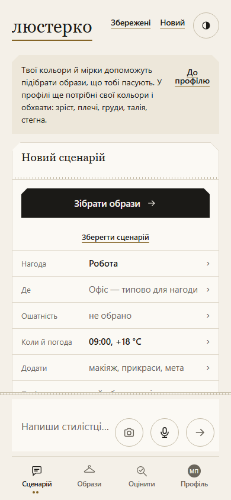

Перевіряв Codex (GPT-6, родина GPT; модель у позначці не названа); автор PR — Claude (родина Claude, Claude Sonnet 5.5 за комітами PR).

КОЛО Е2-межі-прилад #2287: прилад пропускає гілки ремонту й порівняння слів та плутає промпт із відповіддю і читача з власником повтору — доробок 2; вад знайдено: 4 (рядок 11316). Третьої доробки не призначати: рішення про подальший крок — диспетчерові за договором перевірки.

## Предмет і походження

Перевірено [PR #2287](https://github.com/mightyrochy/kod-shi-data/pull/2287) на призначеній голові
`614903041593c38aa70cba2041a611773feff0e5`. API підтвердив автора `mightyrochy`, обидва репозиторії
`mightyrochy/kod-shi-data`, базу `main` і відповідність голови позначці. База API та merge-base:
`046465f3703a9d15cb47a2690164358814a1ba8a`.

```text
git fetch origin refs/pull/2287/head:refs/review/2287
git rev-parse refs/review/2287
614903041593c38aa70cba2041a611773feff0e5
git merge-base 046465f3703a9d15cb47a2690164358814a1ba8a refs/review/2287
046465f3703a9d15cb47a2690164358814a1ba8a
git worktree add --detach ../tmp/review-2287 refs/review/2287
```

Диф оглянуто цілком: новий прилад, паспорт Е2-межі, фрагмент дошки 11315, видалений наряд джерела.
Прочитано наряд із бази, клас і рішення паспорта; виду «код (прилад)» відповідає ризик Р1, автоперевірка — процес Р2.
Реалізацію не змінено. Латок для окремого застосування немає.

Попередня незалежна перевірка `0bf9ad5f6` дала «ДОРОБИТИ» на голові `32e061f0e6524bdbddf846e88429b4b27a56eed8`.
Тому повторне непройдене мірило тут означає «КОЛО», а не третій запит виправлень.
Вхід зауважень Codex із позначки — `[]`; пропущених зауважень цього входу немає.

## Вимір і приймання

На окремому дереві голови виконано:

```text
python джерела/прилади/корінь_е2_межі.py
п.1 (схеми нема в реєстрі / поле повз перевірку нею): 38
п.2 (розбіжність не повертається моделі словами): 2
п.3 (нема запасного ходу чи рядка звіту / відхилене йде далі): 2
п.4 (гілка ремонту формату): 44
п.5 (вхід моделі — не дані коду): 9
п.6 (вид поля не з одного джерела): 11
п.7 (код читає її слова): 4
модулів Python в області: 186 · ендпойнтів моста: 18 · клієнтів сервера моделі: 2 · JS-функцій: 539
місць: 107
exit_code=0
```

Повний запуск завершено. Це відтворення числа приладу, а не підтвердження повноти класу.
Код кореня однаковий із названою базою:

```text
git diff --quiet 046465f3703a9d15cb47a2690164358814a1ba8a refs/review/2287 -- джерела :!джерела/прилади/корінь_е2_межі.py
КОД_КОРЕНЯ_DIFF: 0
```

Окремого другого повного запуску на базі не робили; висновок про ті самі вхідні файли спирається на цей diff.

| Мірило джерела | Результат |
|---|---|
| (а) місця обох шляхів і пояснені розбіжності | Перелік тепер містить 110 записів `(файл, рядок, пункт)`: А+Б — 91, лише А — 9, лише Б — 10. Усі 19 одношляхових записів надруковано з поясненнями. Попередній недолік відсутності такого переліку виправлено; точність конкретного JS-місця не пройшла, див. В2. |
| (б) звірка з чинними приладами | Усі 10 різних Python-місць поза реєстром знайдено; JS-звірка: 0 → 0 ознак власного читача. |
| (в) 20 випадкових місць і 20 файлів без місць, помилок класу 0 | Не пройшло: у вибірці є хибний п.2 `каталог_розбір.py:1107`, див. В3. Поза вибіркою доведено ще пропуски та хибне місце. |
| (г) число ДО за пунктами й SHA в паспорті | Є, 107. Окремо в «Стані» лишилось застаріле 147 (`аудит/корені/Е2-межі.md:88`). |

Попередні хибні п.4 `міст_відповіді.py:828/843` і `протокол.py:932` у новому переліку відсутні.
Проба `"…" in слова` тепер дає подію п.7; порівняння `==` досі пропускається (В4).

## Доведені зауваження

### В1 · Р2. Ремонт через повернене значення не лічиться

Місце: `джерела/прилади/корінь_е2_межі.py:581` (`Структура.нотатки`). Для ремонту вимагається прямий
`Assign`, `AugAssign` чи `Delete` у тому самому блоці. `Return` із перетворенням даних не враховано.

На цій голові `протокол._нормалізувати` має щонайменше дві такі гілки:
`протокол.py:464–467` перетворює число на рядок enum; `:468–472` склеює список рядків у рядок.
Обидві пишуть у `нотатки`, обидві міняють форму відповіді, обидві відсутні в повному переліку приладу.
Застосовний клас — п.4 паспорта: кожна гілка ремонту, а не лише гілка з присвоєнням.

Відтворення — додана проба, яка імпортує незмінений прилад голови й викликає незмінений нормалізатор:

```text
python -X utf8 аудит/перевірки/е2_2287_61490304_проба.py <дерево голови>
actual_protocol_conversion 42 -> '42' ['number_read_as_enum_word: корінь']
actual_protocol_conversion ['a', 'b'] -> 'a\nb' ['корінь: список рядків замість рядка — склеєно по рядку']
```

`actual_protocol_notes` містить для `_нормалізувати` лише рядки 452, 425, 439, 455: 466/471 немає.
Додаткова синтетична гілка `obj = {"items": obj}` теж не дає п.4 без `нотатки`, хоча ремонт лишається.
Наслідок: нова гілка такого класу не збільшить число храповика; число 44 не є повним числом ремонтів.
Повний виправлений підсумок не виміряно, додавання двох місць не видається за остаточне число класу.

### В2 · Р2. JS-змінні різних вкладених функцій змішано

Місце: `джерела/прилади/корінь_е2_межі.py:947–955` (`ПоказJS.читачі`). Множина змінних відповіді збирається
для цілого текстового діапазону верхньої функції; області видимості вкладених функцій не розділено.

Повний прилад додає п.1 `показ/збирання_руки.js:35`. Насправді це вкладена `порядокЗапиту(промпт)`:
рядок 33 присвоює `т = String(промпт...)`, а рядок 35 шукає початок промпта у ключах `порядкиЗапитів`.
Це власний запит коду, жодної відповіді моделі тут немає. Інша змінна `т` у тому самому великому діапазоні
приймає результат моделі й забруднює це місце.

```text
python -X utf8 аудит/перевірки/е2_2287_61490304_проба.py <дерево голови>
actual_js_readers [('створитиКонтекстРуки', 'джерела/показ/збирання_руки.js', 35, 'т', 'т.startsWith(')]
```

Наслідок: число п.1 має хибне місце; зміна імені локальної змінної чи пошук у промпті може змінити храповик
без зміни межі відповіді моделі. Це також хибне пояснення «читач відповіді поза конусом» для одношляхового місця.

### В3 · Р2. Повтор у викликачі читача не видно

Місце: `джерела/прилади/корінь_е2_межі.py:1036–1040`. Для читача поза конусами клієнтів/ендпойнтів
перевіряється тільки власна функція. Клієнт `надіслати` є нижче за `_спитати` в графі викликів,
тому конус від клієнта не містить `_спитати` й викликаного ним читача.

У вибірці `каталог_розбір.py:1107` має п.2 «нема повтору». Але `каталог_розбір_прогін.py:294–311`
викликає `КР.з_відповіді`, після невдалої перевірки складає `СВ.СХЕМИ_ВІДПОВІДІ["КАТАЛОГ_РІЧ"].промпт_повтору(повід, причини[-1])`
і передає його наступному виклику моделі. Це Python-власник запиту зі словами розбіжності, саме межа п.2 паспорта.

Проба виконує AST незміненої `_спитати` з підміною моделі, читача й форматування повтору; мережі немає:

```text
python -X utf8 аудит/перевірки/е2_2287_61490304_проба.py <дерево голови>
actual_catalog_retry ('good', 0.0, None, 1) ['original', 'original | missing required field']
```

Наслідок: одна з двох названих відсутностей повтору хибна; мірило (в) «помилок класу 0» не виконано.
Ця проба доводить передачу причини у повтор, а не якість реальної відповіді моделі.

### В4 · Р2. Вибір коду через рівність слів не дає події

Місце: `джерела/прилади/корінь_е2_межі.py:526–532` (`Аналіз.порівняння`). Попри опис про порівняння
метод обробляє лише `In/NotIn`; `Eq/NotEq` над позначеними словами не обробляє.

```python
def f(уривок):
    return "night" if уривок.lower() == "вечір" else "day"
```

У пробі незмінений аналізатор повертає `equality []`; контрольна форма з `"вечір" in уривок` повертає
`in [(2, 'слова', 'in')]`. Так само немає події для `дані.get("уривок", "").lower() == "вечір"`.
Це не дозволена звірка походження цитати: за її змістом тут обирається код `night/day`.

Наслідок: новий читач слів такого класу п.7 не збільшить число порушень. Це доведена прогалина детектора
на синтетичній пробі; наявне місце такого точного виду в продукті цим зауваженням не стверджується.

## Випадкова вибірка

Використано `random.Random(2287)`: 20 елементів із відсортованих унікальних `(файл, рядок)` повного виводу;
після цього тим самим генератором — 20 відсортованих назв Python-модулів області без жодного місця.
Оглянуто контексти місць, призначення негативних файлів та потенційні читачі/дроти/маркери.
Це вибірка, а не доказ повноти всіх 186 модулів; розширений пошук поза нею дав В1, В2 і пробу В4.

| Місце (всі шляхи від `джерела/`) | Оцінка |
|---|---|
| протокол.py:1175 | п.4: зріз до ремонту JSON |
| руки_без_коду.py:186 | п.1: розбір мітки сирої прози |
| протокол.py:1159 | накопичення наслідків зняття обгортки; точність розміщення місця окремо не доведено |
| каталог_розбір.py:1107 | пп.1/4 застосовні; п.2 хибний (В3) |
| мовний_шар.py:504 | п.1: перевірка форми поза реєстром |
| паспорт_нагоди.py:1415 | п.1: форма без схеми протоколу |
| руки_без_коду.py:415 | п.1: json.loads поза реєстром |
| міст_відповіді.py:1206 | п.1: форма без схеми протоколу |
| протокол.py:2262 | підсумок зняття ехо; належність саме до ремонту формату не доведено |
| дріт_моделі.py:1398 | назва вузла в дроті; чи це назва крамниці, не доведено |
| протокол.py:439 | п.4: піднято вкладене поле |
| оцінка_образу.py:1699 | п.1: форма без схеми протоколу |
| міст_відповіді.py:834 | п.4: обрізано відповідь до квоти |
| руки_без_коду.py:203 | п.1: розбір поза реєстром |
| протокол.py:1251 | п.4: обрив JSON, узято закриті значення |
| оцінка_образу.py:1704 | п.1: власна перевірка сирої прози |
| протокол.py:1058 | п.4: зріз і ремонт JSON |
| протокол.py:296 | п.4: зріз до першої JSON-обгортки |
| протокол.py:1074 | п.4: новий об'єкт зі знайдених образів |
| оцінка_образу.py:1333 | п.5: назва речі в дроті |

20 негативних файлів: `реєстр_константи.py`, `profile.py`, `pipeline.py`, `верхнє_догляд.py`,
`спільні_вимоги.py`, `колір_відношення.py`, `суд_інтерес.py`, `areas.py`, `суд_від_моделі.py`,
`language_contract.py`, `fit.py`, `композитор_оцінка.py`, `повнота_образу.py`, `пакет_моделі.py`,
`збирач_промптів.py`, `колір_річ.py`, `сценарій.py`, `семплер.py`, `trace.py`, `дистанція.py`.
Нових доведених пропусків у цій негативній вибірці не встановлено. Переліки кодів, обчислювані поля,
імпорти/реекспорти й складання даних самі собою порушення не доводять.

## Звірка приладів

```text
python джерела/прилади/межі_моделі.py --json
код 0
```

Із `межі_поза_реєстром` взято унікальні `файл:рядок` і звірено з повним виводом нового приладу:
`мовний_шар.py:544/546/2951/2956`, `міст_відповіді.py:1573`, `міст_помічниця.py:198`,
`руки_без_коду.py:186/201/208`, `річ_з_фото.py:2075` — усі 10 є.

```text
python джерела/проби/межі_показу_лічба.py 046465f3703a9d15cb47a2690164358814a1ba8a
ДО: ознак власного читача відповіді моделі — 0; решта JSON.parse — 7
ПІСЛЯ: ознак власного читача відповіді моделі — 0; решта JSON.parse — 7
```

Перший запуск другої команди без UTF-8 впав на декодуванні Unicode-шляхів `git show` у Windows;
повтор із `PYTHONUTF8=1` успішний. Це обмеження запуску, не вада PR.

## Батарея, очі й межі

На голові виконано єдиний послідовний запуск батареї з `аудит/КОД.md`:

```text
python стенд_знімок.py --дим
дим пройдено — жодного винятку на живому шляху
КОД: 0
python тест_живого_шляху.py
ПРОЙДЕНО 6, ВПАЛО 0 із 6
КОД: 0
python тест_протоколу.py
тест_протоколу: усе зелене
КОД: 0
```

```text
python audit_contracts.py
КОД: 0
node тест_показу.js
ВИКОНАНО ЗВІРОК: 826 у 70 розділах
ПОКАЗ: усе зелене
NODE_КОД: 0
```

Для Node в ізольованому дереві встановлено залежності `npm ci --ignore-scripts --no-audit --no-fund`
(41 пакет, код 0). Перший `python прилади/розділи_гейтів.py` завершився кодом 1 у §120:
потік `subprocess` декодував UTF-8 як `cp1251`, отримав `UnicodeDecodeError`, а подальший пошук по `stdout=None` —
`TypeError`. Повторюється лише ця команда з `PYTHONUTF8=1` і `PYTHONIOENCODING=utf-8`:

```text
python -u прилади/розділи_гейтів.py
ПРОЙДЕНО 575, ВПАЛО 0, БЕЗ ВХОДУ 0
ГЕЙТИ_UTF8_КОД: 0
```

Повтор завершено успішно. Усі шість команд батареї мають успішний завершений результат;
перший невдалий запуск гейтів вище збережено як факт запуску. Локальне середовище — Windows, Python 3.12;
це не підміна перевірки храповика в CI на Python 3.11.

Знімок 390×844 отримано офлайн на шаблоні саме цієї голови, з довідником із `експорт_показу`, без Pyodide й моделей:

```text
python -X utf8 аудит/перевірки/е2_2287_61490304_знімок.py <дерево голови> <тимчасова тека>
viewport=390x844; pageerrors= []
```



Очима: картка «Новий сценарій», «Робота», типовий офіс, 09:00, +18 °C, кнопки й чат читаються;
накладень і виходу тексту за ширину не видно. Це перевірка картки сценарію, не образів із каталогу.
Показ і код продукту однакові з базою; каталог, фото речей і живий прогін моделі для цього приладу не є мірилом.
`NODE_OPTIONS` і `PYTHONPATH` обгортки збережено, Chromium запущено з `--disable-gpu`.

Одним запитом API голови отримано: «храповик кореня» й «що змінилось у push чи PR» — success;
«перевірка джерел» — in_progress; «розділи й контракти» й «звіт правил» — queued.
CI не очікували; остаточний стан саме цієї голови перед злиттям звіряє диспетчер.

Рядок 11316 продовжує знахідку попередньої перевірки; нового номера не вигадано.
Файл `аудит/дошка/gemini/автоперевірка-2287.md` — нова версія того самого фрагмента з `0bf9ad5f6`, а не другий рядок 11316.
В1–В4 стосуються мірила приладу; застаріле 147 у паспорті — документальна неузгодженість, не п'ята вада коду.
Паспорт і реалізацію перевірка не править. Вади поза мірилом цього наряду не встановлено.
