# Б.1 ДО-2610 — 30 образів для оцінки людьми

Оцінювач отримує лише цей файл і вихідні картки. Для кожного образу: «доречно: так/ні» та причина одним реченням. Доречність — можливість вдягнути комплект на дослівно задану подію, з урахуванням погоди, руху, формальності, кольору та відповідності опису переліку речей. Порожні заглушки не включені. Вердиктів попереднього оцінювача тут немає.

## 01. ж7_театр / повтор 1 / рука 4

Слова жінки: «вечір у театрі, вистава о 19:00».

[Відкрити знімок](ДО-2610/ж7_театр/повтор1/знімки/kartka_poz1_ruka4_seed3.png) · [вихідний текст усіх карток прогону](ДО-2610/ж7_театр/повтор1/знімки/картки.txt)

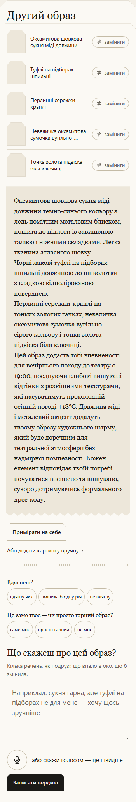

Перелік речей і текст саме цієї картки

Другий образ
Оксамитова шовкова сукня міді довжини
Туфлі на підборах шпильці
Перлинні сережки-краплі
Невеличка оксамитова сумочка вугільно-сірого кольору
Тонка золота підвіска біля ключиці
Оксамитова шовкова сукня міді довжини темно-синього кольору з ледь помітним металевим блиском, пошита до підлоги із завищеною талією і ніжними складками. Легка тканина атласного шовку.
Чорні лакові туфлі на підборах шпильці довжиною до щиколотки з гладкою відполірованою поверхнею.
Перлинні сережки-краплі на тонких золотих гачках, невеличка оксамитова сумочка вугільно-сірого кольору і тонка золота підвіска біля ключиці.
Цей образ додасть тобі впевненості для вечірнього походу до театру о 19:00, поєднуючи глибокі вишукані відтінки з розкішними текстурами, які пасуватимуть прохолодній осінній погоді +18°C. Довжина міді і металевий акцент додадуть твоєму образу художнього шарму, який буде доречним для театральної атмосфери без надмірної помпезності. Кожен елемент відповідає твоїй потребі почуватися впевнено та вишукано, суворо дотримуючись формального дрес-коду.

Доречно: ____ · Причина: ____

## 02. ж7_театр / повтор 2 / рука 2

Слова жінки: «вечір у театрі, вистава о 19:00».

[Відкрити знімок](ДО-2610/ж7_театр/повтор2/знімки/kartka_poz3_ruka2_seed4.png) · [вихідний текст усіх карток прогону](ДО-2610/ж7_театр/повтор2/знімки/картки.txt)

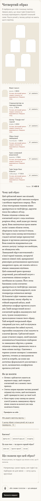

Перелік речей і текст саме цієї картки

Четвертий образ
Я підібрала для тебе тональну палітру. Зверни увагу, що лише туфлі блакитного кольору відповідають обраній тональній схемі. Решта речей у твоєму доборі не мають цього відтінку.
Жакет-пальто
sezone · 3 900 ₴
На жаль, фотографії деяких товарів з каталогу не відкриваються. Невідомо чому.
Спідниця футляр на підкладці рожева
vmma · 2 790 ₴
На жаль, фотографії деяких товарів з каталогу не відкриваються. Невідомо чому.
Шопер “Triangle mini” чорний
skripka · 2 200 ₴
На жаль, фотографії деяких товарів з каталогу не відкриваються. Невідомо чому.
Обруч Аннет лавандовий
honchstudio · 1 260 ₴
На жаль, фотографії деяких товарів з каталогу не відкриваються. Невідомо чому.
Тренч оливковий вкорочений
kasandra · 3 700 ₴
На жаль, фотографії деяких товарів з каталогу не відкриваються. Невідомо чому.
Туфлі Sergio Rossi блакитні
cultboutique · 17 550 ₴
На жаль, фотографії деяких товарів з каталогу не відкриваються. Невідомо чому.
Разом
31 400 ₴
Чому цей образ
Цей сріблястий жакет має вільний, структурований крій з високим коміром і застібкою-перев'язом спереду. Його м’яка текстурована тканина ніжно драпірується по твоїй фігурі, даруючи тепло без зайвого об’єму.
Рожева спідниця-олівець має елегантний силует з ледь помітним розрізом збоку, який додає рух твоєму кроці. Вона закінчується трохи нижче колін і плавно облягає стегна, зберігаючи талію чистою й чіткою.
Ця чорна сумка-шопер виготовлена з гладкої матової шкіри прямокутної форми зі зручними довгими ручками. Вона повністю відкривається для легкого доступу і вміщує все необхідне, не обтяжуючи тебе.
Лавандовий обруч виготовлений з м’якої чорної тканини, загорнутої навколо ніжної лінії, прикрашеної рівномірно розташованими кристалами квадратного крою, які ловлять світло в ніжних лавандових відтінках.
Цей оливковий тренч пропонує укорочений, розслаблений силует з класичними лініями коміра та застібками на ґудзики. Його легка бавовняна суміш елегантно драпірується по твоїй фігурі, ідеально підходить для багатошаровості, коли температура змінюється ввечері.
Ці блакитні туфлі-човники мають відполіровану лакову обробку та стійкий широкий каблук, який забезпечує комфорт протягом усього дня. Їхній заокруглений носок і елегантний профіль видовжують твої ноги, чудово поєднуючись з прохолодними тонами твого образу.
Твій вечірній театральний образ створений для того, щоб ти відчувала себе вишукано без зайвої скутості, гармонійно поєднуючи м’які силуети та класичні фасони. Сріблястий жакет додає сучасного шарму, який ідеально доповнюється блакитними підборами та лавандовим обручем, а рожева спідниця-олівець привносить тепло в твою осінню палітру. Одягнена з чорною сумкою-шопером і оливковим тренчем, готовим до накидання на плечі за потреби, ця сукня має достатньо формальності для вистави о 19:00, залишаючись комфортною протягом усієї ночі.
Як це носити
Почни з сріблястого жакета як верхнього шару, щоб створити елегантний тон з моменту твого приходу.
Злегка заправ передню частину рожевої спідниці під стегно, щоб пом’якшити крій і привернути увагу до твоєї талії.
Носи чорну сумку-шопер на одному плечі й дозволь лавандовому обручу ніжно лежати на волоссі для ледь помітного блиску.

Доречно: ____ · Причина: ____

## 03. ж8_концерт_рок / повтор 1 / рука 1

Слова жінки: «рок-концерт у клубі, п'ятниця ввечері, стоятиму в натовпі».

[Відкрити знімок](ДО-2610/ж8_концерт_рок/повтор1/знімки/kartka_poz2_ruka1_seed3.png) · [вихідний текст усіх карток прогону](ДО-2610/ж8_концерт_рок/повтор1/знімки/картки.txt)

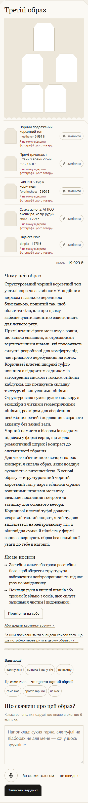

Перелік речей і текст саме цієї картки

Третій образ
Чорний подовжений корсетний топ
musthave · 6 999 ₴
Прямі трикотажні штани з вовни сірий меланж
rito · 3 600 ₴
LeBERDES Туфлі коричневі
favoriteshoes · 5 950 ₴
Сумка жіноча, ATTICO, екошкіра, колір рудий
attico · 1 799 ₴
Підвіска Noir
skripka · 1 575 ₴
Разом
19 923 ₴
Чому цей образ
Структурований чорний корсетний топ у стилі корсета з глибоким V-подібним вирізом і гладкою передньою блискавкою, пошитий так, щоб облягати тіло, але при цьому забезпечувати достатню еластичність для легкого руху.
Прямі штани сірого меланжу з вовни, що вільно спадають, зі стриманими вертикальними швами, які подовжують силует і розроблені для комфорту під час тривалого перебування на ногах.
Коричневі плетені шкіряні туфлі-човники з відкритим задником із загостреним миском і тонким стійким каблуком, що поєднують складну текстуру зі вишуканими лініями.
Структурована сумка рудого кольору з екошкіри з чіткими геометричними лініями, розміром для зберігання необхідних речей і додавання яскравого акценту без зайвої ваги.
Чорний намисто з бісером із гладким підвісом у формі серця, що додає романтичний штрих і контраст до елегантності вбрання.
Для твого п'ятничного вечора на рок-концерті я склала образ, який поєднує зухвалість з витонченістю. В основі образу — структурований чорний корсетний топ у парі з м'якими сірими вовняними штанами меланжу — ідеальне поєднання гостроти та затишку для осіннього вечора. Коричневі плетені туфлі додають яскравий теплий акцент, який чудово виділяється на нейтральному тлі, а відповідна сумка й підвіска у формі серця завершують образ без надмірної уваги до тебе в натовпі.
Як це носити
Застебни жакет або трохи розстебни його, щоб зберегти структуру та забезпечити повітропроникність під час руху по майданчику.
Поклади руки в кишені штанів або тримай їх вільно з боків, щоб силует залишався чистим і видовженим.

Доречно: ____ · Причина: ____

## 04. ж8_концерт_рок / повтор 2 / рука 2

Слова жінки: «рок-концерт у клубі, п'ятниця ввечері, стоятиму в натовпі».

[Відкрити знімок](ДО-2610/ж8_концерт_рок/повтор2/знімки/kartka_poz3_ruka2_seed4.png) · [вихідний текст усіх карток прогону](ДО-2610/ж8_концерт_рок/повтор2/знімки/картки.txt)

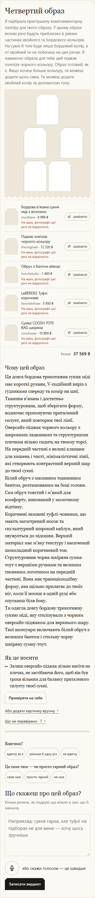

Перелік речей і текст саме цієї картки

Четвертий образ
Я підібрала приглушену комплементарну палітру для твого образу. У цьому образі великі речі будуть приблизно в рівних частинах хвойного та бордового кольорів. На сукні й топі буде лише бордовий колір, а от хвойний ти не побачиш на цих речах. Я навмисно обрала для тебе цей піджак oversize чорного кольору. Образ готовий, як є. Якщо хочеш більше кольору, ти можеш додати щось сама. Ти можеш додати хвойний колір за допомогою топу.
Бордова в'язана сукня міді з віскозою
musthave · 6 999 ₴
На жаль, фотографії цієї речі не відкрилися.
Піджак oversize чорного кольору
theoriginals · 12 320 ₴
На жаль, фотографії цієї речі не відкрилися.
Обруч з бантом айворі
honchstudio · 1 400 ₴
На жаль, фотографії цієї речі не відкрилися.
LeBERDES Туфлі коричневі
favoriteshoes · 5 950 ₴
На жаль, фотографії цієї речі не відкрилися.
Сумка COOSH TOTE BAG шкіряна
cooshwear · 10 900 ₴
На жаль, фотографії цієї речі не відкрилися.
Разом
37 569 ₴
Чому цей образ
Ця довга бордова трикотажна сукня міді має короткі рукави, V-подібний виріз з ґудзиками спереду та комір на шиї. Тканина в’язана і достатньо структурована, щоб зберігати форму, водночас пропонуючи приталений силует, який повторює твої лінії.
Оверсайз-піджак чорного кольору з широкими лацканами та структурними плечима вільно сидить на твоєму торсі. На передній частині є великі клапани для кишень і чисті, мінімалістичні лінії, які створюють контрастний верхній шар до твоєї сукні.
Білий обруч з масивним тканинним бантом, розташованим на боці голови. Сам обруч товстий і м’який для комфорту, виконаний у молочному відтінку.
Коричневі замшеві туфлі-човники, що мають загострений носок та скульптурний широкий каблук, який звужується до підошви. Верхній матеріал має м’яку текстуру і насичений шоколадний коричневий тон.
Структурована чорна шкіряна сумка-тоут з верхніми ручками та великим тисненим логотипом на передній частині. Вона має трапецієподібну форму, яка щільно прилягає до твоїх ніг, коли її носиш в одній руці або опускаєш біля боку.
Ти одягла довгу бордову трикотажну сукню міді, яку стилізували з чорним оверсайз-піджаком для верхнього шару. Твої аксесуари включають білий обруч з великим бантом і стильну чорну шкіряну сумку-тоут.
Як це носити
Залиш оверсайз-піджак вільно висіти на плечах, не застібаючи його, щоб він був трохи вільним для балансу приталеного силуету твоєї сукні.

Доречно: ____ · Причина: ____

## 05. ж1_робота / повтор 1 / рука 3

Слова жінки: «робочий день в офісі».

[Відкрити знімок](ДО-2610/ж1_робота/повтор1/знімки/kartka_poz0_ruka3_seed3.png) · [вихідний текст усіх карток прогону](ДО-2610/ж1_робота/повтор1/знімки/картки.txt)

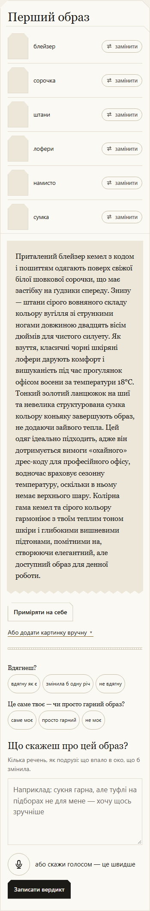

Перелік речей і текст саме цієї картки

Перший образ
блейзер
сорочка
штани
лофери
намисто
сумка
Приталений блейзер кемел з кодом і пошиттям одягають поверх свіжої білої шовкової сорочки, що має застібку на ґудзики спереду. Знизу — штани сірого вовняного складу кольору вугілля зі стрункими ногами довжиною двадцять вісім дюймів для чистого силуету. Як взуття, класичні чорні шкіряні лофери дарують комфорт і вишуканість під час прогулянок офісом восени за температури 18°C. Тонкий золотий ланцюжок на шиї та невелика структурована сумка кольору коньяку завершують образ, не додаючи зайвого тепла. Цей одяг ідеально підходить, адже він дотримується вимоги «охайного» дрес-коду для професійного офісу, водночас враховує сезонну температуру, оскільки в ньому немає верхнього шару. Колірна гама кемел та сірого кольору гармоніює з твоїм теплим тоном шкіри і глибокими вишневими підтонами, помітними на, створюючи елегантний, але доступний образ для денної роботи.

Доречно: ____ · Причина: ____

## 06. ж1_робота / повтор 1 / рука 2

Слова жінки: «робочий день в офісі».

[Відкрити знімок](ДО-2610/ж1_робота/повтор1/знімки/kartka_poz3_ruka2_seed3.png) · [вихідний текст усіх карток прогону](ДО-2610/ж1_робота/повтор1/знімки/картки.txt)

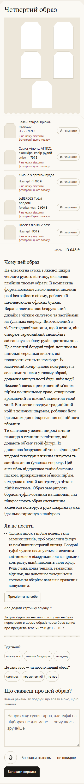

Перелік речей і текст саме цієї картки

Четвертий образ
Зелені твідові брюки-палаццо
alot · 2 999 ₴
Сумка жіноча, ATTICO, екошкіра, колір рудий
attico · 1 799 ₴
Кімоно з органзи пудра
likeangel · 1 400 ₴
LeBERDES Туфлі бордові
favoriteshoes · 5 950 ₴
Пасок з пір’ям 2 беж
likeangel · 900 ₴
Разом
13 048 ₴
Чому цей образ
Це елегантна сумка з якісної шкіри теплого рудого відтінку, яка додає глибини твоєму образу. Її компактна форма дозволяє легко носити щоденні речі без зайвого об’єму, роблячи її ідеальною для офісних буднів.
Верхня частина має безрукавний дизайн з чітким силуетом та застібками на ґудзиках спереду. Виготовлений з тієї ж твідової тканини, що й штани, він створює гармонійний ансамбль і забезпечує свободу рухів протягом дня.
Це елегантні бордові туфлі-човники на шпильці середньої висоти, які поєднують стиль та комфорт. Їх насичений колір чудово контрастує із зеленими тонами у твоєму образі, додаючи вишуканості будь-якій події.
Бежевий пасок прикрашений м’яким пір’ям по нижньому краю, створюючи вражаючий та ніжний акцент на твоїй талії. Він легко поєднує традиційний крій з жіночим шармом, роблячи його ідеальним для підкреслення офіційного вбрання.
Ти одягнена у зелені широкі штани-палаццо з тканини в клітинку, які додають об’єму твоїй фігурі. Їх доповнює безрукавний топ з відповідної твідової текстури з чітким силуетом та застібками на ґудзиках спереду. Цей ансамбль підкреслює талію бежевим паском, прикрашеним м’яким пір’ям, яке додає ніжний контраст до чітких ліній костюма. Образ завершують бордові туфлі-човники на шпильці, які підкреслюють образ елегантним акцентом кольору, а руда шкіряна сумка ідеально гармонує з палітрою.
Як це носити
Одягни пасок з пір’ям поверх талії зелених штанів, щоб окреслити фігуру та пом’якшити строгий вигляд. Бордові туфлі чудово поєднуються із зеленим клітинковим візерунком для вечірнього контрасту, який підходить і для офісу. Руда сумка додає теплий, землистий відтінок, що доповнює холодні тони костюма та зберігає загальне враження вишуканим.

Доречно: ____ · Причина: ____

## 07. ж3_церква / повтор 2 / рука 2

Слова жінки: «неділя, служба в церкві, потім обід з батьками».

[Відкрити знімок](ДО-2610/ж3_церква/повтор2/знімки/kartka_poz3_ruka2_seed4.png) · [вихідний текст усіх карток прогону](ДО-2610/ж3_церква/повтор2/знімки/картки.txt)

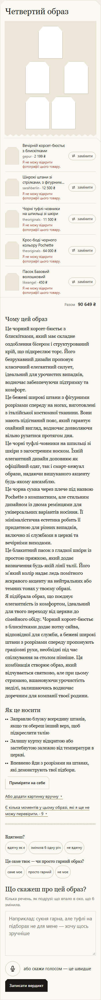

Перелік речей і текст саме цієї картки

Четвертий образ
Вечірній корсет-бюстьє з блискітками
gepur · 2 199 ₴
Широкі штани зі стрілками, з фігурним поясом, з італійської костюмної тканини.
sarahberlin · 12 500 ₴
Чорні туфлі-човники на шпильці зі шкіри
theoriginals · 11 500 ₴
Крос-боді чорного кольору Pochette
theoriginals · 64 000 ₴
Пасок Базовий волошковий
likeangel · 450 ₴
Разом
90 649 ₴
Чому цей образ
Це чорний корсет-бюстьє з блискітками, який має складне оздоблення бісером і структурований крій, що підкреслює торс. Його безрукавний дизайн пропонує класичний елегантний силует, ідеальний для урочистих випадків, водночас забезпечуючи підтримку та комфорт.
Це бежеві широкі штани з фігурними розрізами спереду на ногах, виготовлені з італійської костюмної тканини. Вони мають підігнаний пояс, який гарантує охайний вигляд, водночас дозволяючи вільно рухатися протягом дня.
Це чорні туфлі-човники на шпильці зі шкіри з загостреним носком. Їхній елегантний дизайн доповнює як офіційний одяг, так і смарт-кежуал образи, надаючи вишуканого акценту будь-якому ансамблю.
Це чорна сумка через плече під назвою Pochette з компактним, але стильним дизайном із двома ремінцями для універсальних варіантів носіння. Її мінімалістична естетика робить її придатною для різних випадків, включно зі службами в церкві та вечірніми виходами.
Це блакитний пасок з гладкої шкіри із простою пряжкою, який додає визначення будь-якій лінії талії. Його м’який колір надає ледь помітного яскравого акценту на нейтральних або темних тонах у твоєму образі.
Я підібрала образ, що поєднує елегантність із комфортом, ідеальний для твого переходу від церкви до сімейного обіду. Чорний корсет-бюстьє з блискітками додає нотку сяйва, відповідної для служби, а бежеві широкі штани з розрізами спереду пропонують граціозні рухи, необхідні під час спілкування за столом пізніше. Ця комбінація створює образ, який відчувається святково, але при цьому стримано, вшановуючи урочистість неділі, залишаючись водночас доречним для компанії твоєї родини.
Як це носити
Заправлю блузку всередину штанів, якщо ти обереш інший верх, щоб підкреслити талію
Залишу куртку відкритою або застебнутою залежно від температури в церкві.
Впевнено йди з розрізами на штанах, які демонструють твої підбори.

Доречно: ____ · Причина: ____

## 08. ж7_театр / повтор 2 / рука 1

Слова жінки: «вечір у театрі, вистава о 19:00».

[Відкрити знімок](ДО-2610/ж7_театр/повтор2/знімки/kartka_poz2_ruka1_seed4.png) · [вихідний текст усіх карток прогону](ДО-2610/ж7_театр/повтор2/знімки/картки.txt)

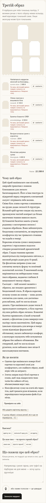

Перелік речей і текст саме цієї картки

Третій образ
Я підібрала для тебе тональну палітру. У великих речах з твого образу немає кольору, який відповідає тональній схемі. Лише аксесуар може бути тональним.
Напівпальто-кардиган жіночий на блискавці демісезонний
sunwin-store · 2 688 ₴
На жаль, фотографії деяких товарів з каталогу не відкриваються. Невідомо чому.
Лляна сорочка з вишивкою біла
morandi · 6 100 ₴
На жаль, фотографії деяких товарів з каталогу не відкриваються. Невідомо чому.
Балетки блакитні ORBY
emmeliedelage · 6 500 ₴
На жаль, фотографії деяких товарів з каталогу не відкриваються. Невідомо чому.
Вечірня атласна сукня з корсетом
ricamare · 200 ₴
На жаль, фотографії деяких товарів з каталогу не відкриваються. Невідомо чому.
Фіолетова шкіряна сумка
theoriginals · 6 800 ₴
На жаль, фотографії деяких товарів з каталогу не відкриваються. Невідомо чому.
Разом
22 288 ₴
Чому цей образ
Цей сірий напівпальто має вільний, оверсайз трикотаж з повною блискавкою для легкого багатошаровості. Його м'яка текстура та відкритий перед створюють елегантний силует і зігрівають тебе восени.
Свіжа біла лляна сорочка з вишивкою на грудях додає легкості й структури. Вільний крій зручно спадає під пальто, пропонуючи чистий контраст до більш насичених тканин навколо нього.
Ці блакитні балетки мають сучасну родзинку з загостреним носком і гладкою обробкою. Вони забезпечують бездоганну елегантність, не жертвуючи комфортом під час тривалого стояння чи ходьби в театрі.
Коралова атласна сукня з вишуканим корсетом і струмливим подолом створює романтичний драматичний образ. Гладка тканина красиво відсвічується під театральним світлом, а високий розріз додає руху й грації.
Ця фіолетова шкіряна сумка має елегантну вигнуту форму та помітний золотистий логотип. Її насичений колір вирізняється на нейтральних тонах твого вбрання, надаючи глибини й вишуканості твоєму образу.
Сьогодні — твій момент засяяти з образом, що поєднує драматизм і бездоганний стиль. Я обрала коралову атласну сукню як основу — вона досить елегантна для сцени, але достатньо розслаблена, щоб ти могла вільно дихати. Сіре напівпальто додає тепла й прохолодного контрасту, а біла сорочка під ним робить образ легшим. Блакитні балетки привносять м’який сучасний акцент, а фіолетова сумка завершує всю палітру своєю насиченістю. Цей наряд ідеально підходить для вечора в театрі: сукня відповідає формальній обстановці, пальто забезпечує комфорт, а аксесуари змушують тебе почуватися зібрано без зайвого обтяження. Він створений, щоб ти могла вільно рухатися, коли займаєш своє місце й насолоджуєшся виставою.
Як це носити
Одягни сіре напівпальто поверх білої сорочки та коралової сукні для комфортного, але охайного образу, який зігріє тебе до антракту.
Злегка заправ поділ білої сорочки в сукню, щоб ледь підкреслити твою талію без зайвого об’єму, збалансувавши верх і низ.
Носи фіолетову сумку на плечі або через тіло, щоб тримати руки вільними, коли переміщуєшся театральним фойє й до місць.

Доречно: ____ · Причина: ____

## 09. ж4_весілля_гостя / повтор 1 / рука 1

Слова жінки: «я гостя на весіллі сестри в серпні, церемонія надворі о 16:00, потім ресторан».

[Відкрити знімок](ДО-2610/ж4_весілля_гостя/повтор1/знімки/kartka_poz2_ruka1_seed3.png) · [вихідний текст усіх карток прогону](ДО-2610/ж4_весілля_гостя/повтор1/знімки/картки.txt)

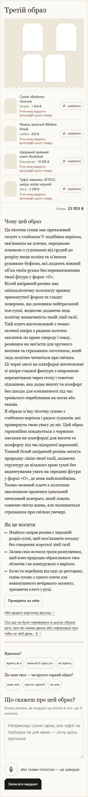

Перелік речей і текст саме цієї картки

Третій образ
Сукня «Buttons» пісочна
skripka · 1 434 ₴
Ремінь жіночий Welfare білий
welfare · 620 ₴
Шкіряний зелений клатч Rockstud
theoriginals · 18 500 ₴
Туфлі човники, ATTICO, шкіра, колір чорний
attico · 3 299 ₴
Разом
23 853 ₴
Чому цей образ
Ця пісочна сукня має приталений силует з глибоким V-подібним вирізом, зав’язаним на плечах, передньою планкою з ґудзиками від грудей до розрізу вище коліна та м’якими рукавами-буфами, які додають ніжний об’єм твоїм рукам без перевантаження твоєї фігури у формі «О».
Білий шкіряний ремінь має мінімалістичну золотисту пряжку прямокутної форми та гладку поверхню, що доповнює нейтральний тон сукні, водночас додаючи ледь помітну визначеність твоїй лінії талії.
Твій клатч виготовлений з темно-зеленої шкіри з рядами золотих заклепок по краях спереду і ззаду, ремінцем на зап’ястя для зручного носіння та стриманим логотипом, який ледь помітно читається при свічках.
Ці чорні мюлі на платформі виготовлені зі шкіри гладкої фактури з широкими перемичками через стопу і товстою підошвою, яка додає висоту та комфорт без шкоди для елегантності під час тривалого перебування на ногах або танців.
Я обрала м’яку пісочну сукню з глибоким вирізом і рядом ґудзиків, які привернуть твою увагу до ніг. Цей образ гармонійно поєднується з чорними мюлями на платформі для висоти та комфорту під час відкритої церемонії. Тонкий білий шкіряний ремінь затягує природну лінію твоєї талії, додаючи структуру до вільного крою сукні без акцентування уваги на середині фігури у формі «О», де вона найспокійніша. Темно-зелений клатч з золотими заклепками пропонує ідеальний металевий контраст, який ловить сонячне світло вдень, але залишається стриманим при свічках увечері.
Як це носити
Недбало заправ ремінь у передній розріз сукні, щоб пом’якшити посадку без створення жорсткої лінії талії
Залиш своє волосся трохи розпущеним, щоб воно природно обрамлювало твоє обличчя і не конкурувало з вирізом.
Коли ти перейдеш від саду до ресторану, скинь сукню з одного плеча для невимушеного вечірнього моменту, тримаючи клатч у руці.

Доречно: ____ · Причина: ____

## 10. ж5_похорон / повтор 2 / рука 1

Слова жінки: «похорон дідуся в четвер зранку».

[Відкрити знімок](ДО-2610/ж5_похорон/повтор2/знімки/kartka_poz2_ruka1_seed4.png) · [вихідний текст усіх карток прогону](ДО-2610/ж5_похорон/повтор2/знімки/картки.txt)

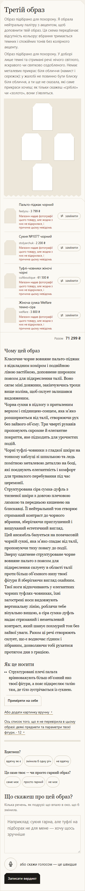

Перелік речей і текст саме цієї картки

Третій образ
Образ підібрано для похорону. Я обрала нейтральну палітру з акцентом, щоб доповнити твій образ. Ця схема передбачає відсутність кольору: вбрання тримається темних і спокійних тонів без колірного акценту.
Образ підібрано для похорону. У доборі лише темні та стримані речі: нічого світлого, яскравого чи святково оздобленого. Немає металевих прикрас біля обличчя (намист і сережок): у жалобі не повинно бути блиску біля обличчя, а ти ще не сказала, які саме прикраси хочеш; як тільки скажеш «срібло» чи «золото», вони з'являться.
Пальто-піджак чорний
feelyou · 3 799 ₴
Магазин надав фотографії цього товару, але жодна з них не відкрилася, і причина цьому невідома.
Сукня №1077 чорний
stolyarchuk · 2 200 ₴
Магазин надав фотографії цього товару, але жодна з них не відкрилася, і причина цьому невідома.
Туфлі-човники жіночі чорні
cultboutique · 61 500 ₴
Магазин надав фотографії цього товару, але жодна з них не відкрилася, і причина цьому невідома.
Жіноча сумка Welfare темно-сіра
welfare · 3 800 ₴
Магазин надав фотографії цього товару, але жодна з них не відкрилася, і причина цьому невідома.
Разом
71 299 ₴
Чому цей образ
Класичне чорне вовняне пальто-піджак з відкладним коміром і подвійною лівою застібкою, доповнене широким поясом для підкреслення талії. Воно сягає міні довжини, закінчуючись трохи вище коліна, щоб силует залишався видовженим.
Чорна сукня в підлогу з приталеним верхом і спідницею-сонцем, яка м’яко розширюється від талії, створюючи рух без зайвого об’єму. Три чверті рукавів пропонують скромне й елегантне покриття, яке підходить для урочистих подій.
Чорні туфлі-човники з гладкої шкіри на тонкому каблуці зі шпилькою та ледь помітною металевою деталлю на боці, які поєднують елегантність і комфорт для тривалого перебування під час церемонії.
Структурована сіра сумка-дуфль з тисненої шкіри з довгою плечовою лямкою та передньою кишенею на блискавці. Її нейтральний тон створює стриманий контраст до чорного вбрання, зберігаючи приглушений і вишуканий естетичний вигляд.
Цей ансамбль базується на позачасовій чорній сукні, яка м’яко спадає від талії, пропонуючи тиху повагу до події. Зверху одягнене структуроване чорне вовняне пальто з поясом для підкреслення силуету в області талії проти більш об’ємного низу твоєї фігури й зберігаючи вигляд охайним. Твої ноги відпочивають у елегантних чорних туфлях-човниках, їхні загострені носи видовжують вертикальну лінію, роблячи тебе візуально вищою, а сіра сумка-дуфль надає стриманий і неметалевий контраст, який шанує похмурий тон без зайвої уваги. Разом ці речі створюють силует, що є водночас гідним і зібраним, дозволяючи тобі рухатися протягом дня з грацією.
Як це носити
Структуровані плечі пальта врівноважують більш об’ємний низ твоєї фігури, а пояс підкреслює талію там, де тіло зустрічається із сукнею.

Доречно: ____ · Причина: ____

## 11. ж4_весілля_гостя / повтор 1 / рука 3

Слова жінки: «я гостя на весіллі сестри в серпні, церемонія надворі о 16:00, потім ресторан».

[Відкрити знімок](ДО-2610/ж4_весілля_гостя/повтор1/знімки/kartka_poz0_ruka3_seed3.png) · [вихідний текст усіх карток прогону](ДО-2610/ж4_весілля_гостя/повтор1/знімки/картки.txt)

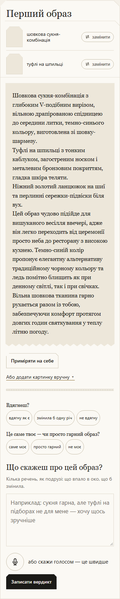

Перелік речей і текст саме цієї картки

Перший образ
шовкова сукня-комбінація
туфлі на шпильці
Шовкова сукня-комбінація з глибоким V-подібним вирізом, вільною драпірованою спідницею до середини литки, темно-синього кольору, виготовлена зі шовку-шармезу.
Туфлі на шпильці з тонким каблуком, загостреним носком і металевим бронзовим покриттям, гладка шкіра теляти.
Ніжний золотий ланцюжок на шиї та перлинні сережки-підвіски біля вух.
Цей образ чудово підійде для вишуканого весілля ввечері, адже він легко переходить від церемонії просто неба до ресторану з високою кухнею. Темно-синій колір пропонує елегантну альтернативу традиційному чорному кольору та ледь помітно блищить як при денному світлі, так і при свічках. Вільна шовкова тканина гарно рухається разом із тобою, забезпечуючи комфорт протягом довгих годин святкування у теплу літню погоду.

Доречно: ____ · Причина: ____

## 12. ж2_побачення_вечір / повтор 1 / рука 1

Слова жінки: «побачення в ресторані ввечері, о 19:30».

[Відкрити знімок](ДО-2610/ж2_побачення_вечір/повтор1/знімки/kartka_poz2_ruka1_seed3.png) · [вихідний текст усіх карток прогону](ДО-2610/ж2_побачення_вечір/повтор1/знімки/картки.txt)

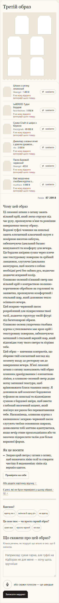

Перелік речей і текст саме цієї картки

Третій образ
Штани з сатину лимонний
likeangel · 1 400 ₴
LeBERDES Туфлі бордові
favoriteshoes · 5 950 ₴
Сумка Crush зі шкіри з биркою
theoriginals · 69 000 ₴
Джемпер з вовни ягнят з довгим рукавом полин-кориця
rito · 3 600 ₴
Пасок Базовий червоний
likeangel · 450 ₴
Хакі вкорочена стьобана куртка з утеплювачем
musthave · 6 999 ₴
Разом
87 399 ₴
Чому цей образ
Ці лимонні штани з сатину мають вільний крій, який легко струмує під час руху, пропонуючи м’яке та розкішне завершення твоєму образу.
Бордові туфлі-човники на шпильці мають елегантний класичний силует з помірною висотою каблука, забезпечуючи ідеальний баланс вишуканості та комфорту для вечора.
Ця бордова шкіряна сумка через плече має текстуровану поверхню та срібний ланцюжок, слугуючи ідеальним аксесуаром, щоб носити з собою необхідні речі без зайвих рук, водночас додаючи яскравий колір.
Оливково-зелений в’язаний светр має вільний крій з контрастною полинно-коричневою обробкою на горловині та манжетах, пропонуючи комфортний і стильний шар, який доповнює тепло осіннього вечора.
Цей яскраво-червоний пасок розроблений для підкреслення твоєї талії, додаючи структуру твоїй фігурі під багатошарові образи.
Оливково-зелена укорочена стьобана куртка з утеплювачем має кроп-крій і текстуровану поверхню, забезпечуючи затишний і стильний верхній шар, який відповідає тону твого светра та зігріває тебе.
Цей образ — вивчення контрастів, що збереже твій елегантний вигляд від моменту входу до ресторану аж до завершення вечора. М’які лимонні штани з сатину заземлюють твій образ плинним драпіруванням і елегантною лінією, а оливково-зелений светр додає нотку затишної текстури, щоб врівноважити блиск тканини знизу. Я доповнила цей комплект бордовими туфлями на шпильці та відповідною сумкою з бордової шкіри, щоб ввести глибокий насичений акцент, який пов’язує все разом без перевантаження тебе. Насамкінець, оливкова куртка з капюшоном і яскраво-червоний пасок слугують твоїми основними шарами, дозволяючи тобі миттєво адаптуватися, якщо вечір стане прохолоднішим або ти захочеш підкреслити талію для більш виразної форми.
Як це носити
Заправ край светра у штани з сатину, щоб визначити лінію талії та створити чистішу й видовженішу лінію під верхнім одягом.

Доречно: ____ · Причина: ____

## 13. ж3_зима / повтор 2 / рука 2

Слова жінки: «на вулиці мінус десять і сніг, йду на роботу пішки 20 хвилин».

[Відкрити знімок](ДО-2610/ж3_зима/повтор2/знімки/kartka_poz3_ruka2_seed4.png) · [вихідний текст усіх карток прогону](ДО-2610/ж3_зима/повтор2/знімки/картки.txt)

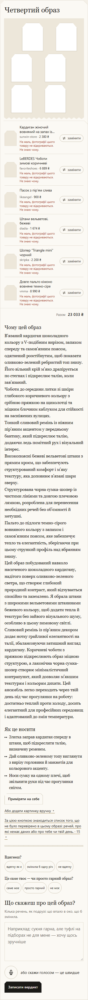

Перелік речей і текст саме цієї картки

Четвертий образ
Кардиган жіночий вовняний на запах із поясом демісезонний
sunwin-store · 2 380 ₴
На жаль, фотографії цього товару не відкриваються. Не знаю чому.
LeBERDES Чоботи зимові коричневі
favoriteshoes · 6 889 ₴
На жаль, фотографії цього товару не відкриваються. Не знаю чому.
Пасок з пірʼям слива
likeangel · 900 ₴
На жаль, фотографії цього товару не відкриваються. Не знаю чому.
Штани вельветові, бежеві
diadia · 1 674 ₴
На жаль, фотографії цього товару не відкриваються. Не знаю чому.
Шопер “Triangle mini” чорний
skripka · 2 200 ₴
На жаль, фотографії цього товару не відкриваються. Не знаю чому.
Довге пальто кімоно вовняне темно-сіре
vmma · 8 990 ₴
На жаль, фотографії цього товару не відкриваються. Не знаю чому.
Разом
23 033 ₴
Чому цей образ
В'язаний кардиган шоколадного кольору з V-подібним вирізом, запахом спереду та самов'язним поясом, одягнений розстібнутим, щоб показати оливково-зелений ребристий топ знизу. Його вільний крій м'яко драпірується по стегнах і підкреслює талію, коли зав'язаний.
Чоботи до середини литки зі шкіри глибокого коричневого кольору з срібною пряжкою на щиколотці та міцним блочним каблуком для стійкості на засніжених вулицях.
Тонкий сливовий ремінь із ніжним пір'яним акцентом у передньому бантику, який підкреслює талію, додаючи ледь помітний рух і візуальний інтерес.
Високопоясні бежеві вельветові штани з прямим кроєм, що забезпечують структурований комфорт і м'яку текстуру, яка доповнює в'язані шари зверху.
Структурована чорна сумка-шопер із чистими лініями та довгою плечовою лямкою, розроблена для перенесення необхідних речей без об’ємності й метушні.
Пальто до підлоги темно-сірого вовняного кольору з запахом і самов'язним поясом, яке забезпечує тепло та елегантність, зберігаючи при цьому стрункий профіль над вбранням знизу.
Цей образ побудований навколо насиченого шоколадного кардигану, надітого поверх оливково-зеленого светра, що створює глибокий природний контраст, який відчувається спокійно та заземлено. Я обрала штани з широкими вельветовими штанинами бежевого кольору, щоб додати тепла й текстури без зайвого візуального шуму, особливо в цьому зимовому світлі. Сливовий ремінь із пір’яним декором додає нотку грайливої елегантності на талії, збалансовуючи затишний вигляд кардигану. Коричневі чоботи з пряжкою підкреслюють образ міцною структурою, а лаконічна чорна сумка-шопер створює мінімалістичний контрапункт, який дозволяє м’якшим текстурам і кольорам дихати. Цей ансамбль легко переходить через твій день під час прогулянки на роботу: достатньо теплий проти холоду, досить елегантний для професійних середовищ і адаптований до змін температури.
Як це носити
Злегка заправ кардиган спереду в штани, щоб підкреслити талію, визначену ременем.
Дай оливково-зеленому топу виглянути з вирізу горловини й манжетів для кольорового акценту.
Носи сумку на одному плечі, щоб звільнити руки під час прогулянки снігом.

Доречно: ____ · Причина: ____

## 14. ж5_похорон / повтор 1 / рука 2

Слова жінки: «похорон дідуся в четвер зранку».

[Відкрити знімок](ДО-2610/ж5_похорон/повтор1/знімки/kartka_poz3_ruka2_seed3.png) · [вихідний текст усіх карток прогону](ДО-2610/ж5_похорон/повтор1/знімки/картки.txt)

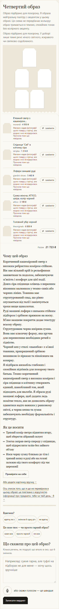

Перелік речей і текст саме цієї картки

Четвертий образ
Образ підібрано для похорону. Я обрала нейтральну палітру з акцентом у цьому образі. Ця схема не передбачає кольору: образ тримається в темних, спокійних тонах без колірного акценту.
Образ підібрано для похорону. У доборі лише темні речі: нічого світлого, яскравого чи святково оздобленого.
В’язаний светр з кашеміром коричневий
morandi · 4 950 ₴
Магазин надав фотографії цього товару у стрічці, але жодна з них не відкрилася. Причина поки що невідома.
Спідниця “Cell” в клітинку сіра
skripka · 1 314 ₴
Магазин надав фотографії цього товару у стрічці, але жодна з них не відкрилася. Причина поки що невідома.
Лофери замшеві руді
giardini-shoes · 5 460 ₴
Магазин надав фотографії цього товару у стрічці, але жодна з них не відкрилася. Причина поки що невідома.
Сумка жіноча, ATTICO, шкіра, колір чорний
attico · 3 199 ₴
Магазин надав фотографії цього товару у стрічці, але жодна з них не відкрилася. Причина поки що невідома.
Головний убір чорний
theoriginals · 6 800 ₴
Магазин надав фотографії цього товару у стрічці, але жодна з них не відкрилася. Причина поки що невідома.
Разом
21 723 ₴
Чому цей образ
Коричневий кашеміровий светр з високим ребристим коміром-стійкою. Він має вільний крій із рельєфними манжетами та подолом, забезпечуючи м’якість і комфорт для цієї події.
Довга сіра спідниця-олівець з виразним віконним малюнком у темно-синіх або чорних лініях. Тканина має структурований спад, що рівно опускається від талії і закінчується трохи вище щиколотки.
Руді замшеві лофери з низьким стійким підбором і срібною пряжкою на носку. М’яке замшеве покриття додає текстуру всьому образу.
Структурована чорна шкіряна сумка. Вона має класичну форму, яка зручна для перенесення необхідних речей з гідністю.
Чорний кеп у стилі «ньюзбоя» з м’якої тканини, прикрашений срібною вишивкою із зірками та півмісяцем на козирку.
Я підібрала ансамбль глибоких і спокійних відтінків для похорону твого батька. Темно-коричневий кашеміровий светр з високим коміром і сіра спідниця в клітинку створюють єдиний, шанобливий тон, який підходить для жалоби. Я обрала руді замшеві лофери, щоб додати ледь помітне тепло, яке не дозволить образу здаватися надто важким у ранковому світлі, а чорна кепка та сумка забезпечують необхідну формальність і структуру.
Як це носити
Тримай комір светра піднятим вгору, щоб зберегти зібраний силует
Злегка заправ светр спереду у спідницю, щоб підкреслити талію без зайвого об’єму
Носи чорну сумку близько до тіла і тримай кепку в руці або на голові залежно від твого комфорту під час церемонії

Доречно: ____ · Причина: ____

## 15. ж2_спорт_коментар / повтор 2 / рука 1

Слова жінки: «йога зранку, потім кава з подругою».

[Відкрити знімок](ДО-2610/ж2_спорт_коментар/повтор2/знімки/kartka_poz2_ruka1_seed4.png) · [вихідний текст усіх карток прогону](ДО-2610/ж2_спорт_коментар/повтор2/знімки/картки.txt)

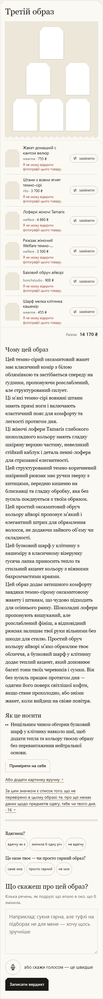

Перелік речей і текст саме цієї картки

Третій образ
Жакет домашній с кантом велюр
wearme · 755 ₴
Штани з вовни ягнят темно-сірі
rito · 3 700 ₴
Лофери жіночі Tamaris
welfare · 4 860 ₴
Рюкзак жіночий Welfare темно-коричневий
welfare · 3 500 ₴
Базовий обруч айворі
honchstudio · 900 ₴
Шарф мелка клітинка кашемір
wearme · 455 ₴
Разом
14 170 ₴
Чому цей образ
Цей темно-сірий оксамитовий жакет має класичний комір з білою облямівкою та застібається спереду на ґудзики, пропонуючи розслаблений, але структурований силует.
Ці м'які темно-сірі вовняні штани мають прямі ноги і включають еластичний пояс для комфорту та легкості протягом дня.
Ці жіночі лофери Tamaris глибокого шоколадного кольору мають гладку шкіряну верхню частину, невеликий стійкий каблук і деталь пенні-лофера для стриманої елегантності.
Цей структурований темно-коричневий шкіряний рюкзак має ручки зверху з китицями, передню кишеню на блискавці та гладку обробку, яка без зусиль поєднується з твоїм образом.
Цей простий оксамитовий обруч кольору айворі пропонує м’який і елегантний штрих для обрамлення волосся, не додаючи зайвого об'єму чи складності.
Цей бузковий шарф у клітинку з кашеміру в класичному візерунку гусяча лапка приносить тепло та стильний акцент кольору з ніжними бахромчастими краями.
Цей образ додає затишного комфорту завдяки темно-сірому оксамитовому жакету і штанам, що чудово підходить для осіннього ранку. Шоколадні лофери пропонують вишуканий, але розслаблений фініш, а відповідний рюкзак залишає твої руки вільними без шкоди для стилю. Простий обруч кольору айворі м’яко обрамлює твоє обличчя, а бузковий шарф у клітинку додає теплий акцент, який доповнює багаті тони твоїх черевиків і сумки. Він без зусиль працює протягом дня — одягни його поверх світлішої кофти, якщо стане прохолодно, або зніми жакет, коли вийдеш на свіже повітря.
Як це носити
Нещільним чином обгорни бузковий шарф у клітинку навколо шиї, щоб додати тепла та кольору твоєму образу без перевантаження нейтральної основи.

Доречно: ____ · Причина: ____

## 16. ж2_побачення_вечір / повтор 3 / рука 3

Слова жінки: «побачення в ресторані ввечері, о 19:30».

[Відкрити знімок](ДО-2610/ж2_побачення_вечір/повтор3/знімки/kartka_poz2_ruka3_seed5.png) · [вихідний текст усіх карток прогону](ДО-2610/ж2_побачення_вечір/повтор3/знімки/картки.txt)

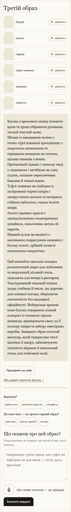

Перелік речей і текст саме цієї картки

Третій образ
блузка
штани
піджак
туфлі-човники
сережки
намисто
Блузка з кремового шовку вільного крою та трохи зібраними рукавами, легкий текучий шовк.
Штани із завищеною талією з темно-сірої вовняної крепдешину з широкими штанинами та середньою посадкою на стегнах, щільна тканина з вовни.
Приталений піджак у синьому твіді з лацканами і застібкою на одну ґудзик, змішане переплетення бавовни й тонкої вовни.
Туфлі-човники на підборах із полірованої чорної шкіри з заокругленим носком та помірним стійким каблуком, гладка теляча шкіра.
Золоті сережки-краплі з мінімалістичним геометричним дизайном, позолочена латунь 18 каратів.
Ніжний кулон на намисті з маленьким смарагдовим каменем у білому золоті, срібний сплав із платиновим покриттям.
Цей ансамбль ідеально поєднує романтичний шарм для побачення та вишуканий діловий стиль, підходячи для вечері в ресторані. Текстурований твідовий піджак додає глибини й тепла, що доречно для осінньої погоди, зберігаючи елегантність без надмірної офіційності. Нейтральні кремові тони блузки створюють м’який контраст із темними сірими штанами, привертаючи увагу до її кольору шкіри та вибору ювелірних виробів. Завершує образ золотий аксесуар, який підкреслює теплі відтінки її шкіри, забезпечуючи цілісність вбрання й навмисний стиль для особливої події.

Доречно: ____ · Причина: ____

## 17. ж8_концерт_рок / повтор 2 / рука 4

Слова жінки: «рок-концерт у клубі, п'ятниця ввечері, стоятиму в натовпі».

[Відкрити знімок](ДО-2610/ж8_концерт_рок/повтор2/знімки/kartka_poz1_ruka4_seed4.png) · [вихідний текст усіх карток прогону](ДО-2610/ж8_концерт_рок/повтор2/знімки/картки.txt)

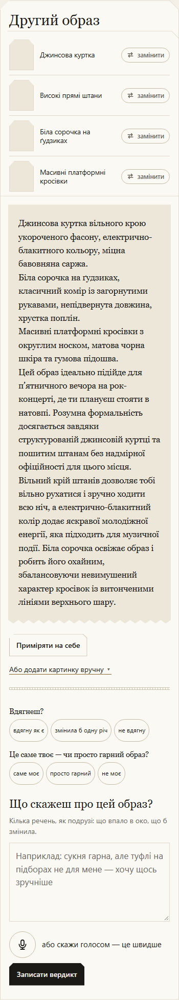

Перелік речей і текст саме цієї картки

Другий образ
Джинсова куртка
Високі прямі штани
Біла сорочка на ґудзиках
Масивні платформні кросівки
Джинсова куртка вільного крою укороченого фасону, електрично-блакитного кольору, міцна бавовняна саржа.
Біла сорочка на ґудзиках, класичний комір із загорнутими рукавами, непідвернута довжина, хрустка поплін.
Масивні платформні кросівки з округлим носком, матова чорна шкіра та гумова підошва.
Цей образ ідеально підійде для п’ятничного вечора на рок-концерті, де ти плануєш стояти в натовпі. Розумна формальність досягається завдяки структурованій джинсовій куртці та пошитим штанам без надмірної офіційності для цього місця. Вільний крій штанів дозволяє тобі вільно рухатися і зручно ходити всю ніч, а електрично-блакитний колір додає яскравої молодіжної енергії, яка підходить для музичної події. Біла сорочка освіжає образ і робить його охайним, збалансовуючи невимушений характер кросівок із витонченими лініями верхнього шару.

Доречно: ____ · Причина: ____

## 18. ж2_спорт_коментар / повтор 1 / рука 4

Слова жінки: «йога зранку, потім кава з подругою».

[Відкрити знімок](ДО-2610/ж2_спорт_коментар/повтор1/знімки/kartka_poz1_ruka4_seed3.png) · [вихідний текст усіх карток прогону](ДО-2610/ж2_спорт_коментар/повтор1/знімки/картки.txt)

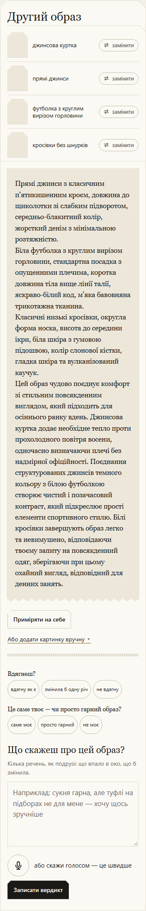

Перелік речей і текст саме цієї картки

Другий образ
джинси
кросівки
блейзер
Темно-сині прямі джинси з високою талією, що зручно сидять на природній лінії талії, пошиті з міцної тканини твілу зі стрейчем для легкості рухів. Довжина штанів — до щиколотки.
Масивні білі шкіряні кросівки з округлим носком і платформою заввишки три сантиметри, виготовлені з нубуку та гуми.
Структурований оверсайз-блейзер темно-синього кольору з однобортною застібкою на лацкани. Довжина блейзера — до середини стегна, тканина з вовняної суміші захищає від вітру та дозволяє шкірі дихати.
Цей образ вдало поєднує невимушену атмосферу повсякденності зі свіжістю осіннього дня. Темно-сині джинси й нейтральні кросівки створюють універсальну основу, яка дає змогу структурованому блейзеру підкреслити силует без зайвої офіційності. Вибір тканин гарантує тепло в прохолодний ранок і водночас забезпечує легкість для переходу від кав’ярні до неформальної зустрічі.

Доречно: ____ · Причина: ____

## 19. ж1_робота / повтор 1 / рука 4

Слова жінки: «робочий день в офісі».

[Відкрити знімок](ДО-2610/ж1_робота/повтор1/знімки/kartka_poz1_ruka4_seed3.png) · [вихідний текст усіх карток прогону](ДО-2610/ж1_робота/повтор1/знімки/картки.txt)

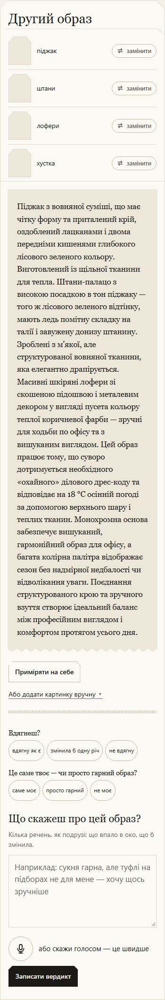

Перелік речей і текст саме цієї картки

Другий образ
піджак
штани
лофери
хустка
Піджак з вовняної суміші, що має чітку форму та приталений крій, оздоблений лацканами і двома передніми кишенями глибокого лісового зеленого кольору. Виготовлений із щільної тканини для тепла. Штани-палацо з високою посадкою в тон піджаку — того ж лісового зеленого відтінку, мають ледь помітну складку на талії і завужену донизу штанину. Зроблені з м’якої, але структурованої вовняної тканини, яка елегантно драпірується. Масивні шкіряні лофери зі скошеною підошвою і металевим декором у вигляді пусета кольору теплої коричневої фарби — зручні для ходьби по офісу та з вишуканим виглядом. Цей образ працює тому, що суворо дотримується необхідного «охайного» ділового дрес-коду та відповідає на 18 °C осінній погоді за допомогою верхнього шару і теплих тканин. Монохромна основа забезпечує вишуканий, гармонійний образ для офісу, а багата колірна палітра відображає сезон без надмірної недбалості чи відволікання уваги. Поєднання структурованого крою та зручного взуття створює ідеальний баланс між професійним виглядом і комфортом протягом усього дня.

Доречно: ____ · Причина: ____

## 20. ж3_церква / повтор 2 / рука 3

Слова жінки: «неділя, служба в церкві, потім обід з батьками».

[Відкрити знімок](ДО-2610/ж3_церква/повтор2/знімки/kartka_poz0_ruka3_seed4.png) · [вихідний текст усіх карток прогону](ДО-2610/ж3_церква/повтор2/знімки/картки.txt)

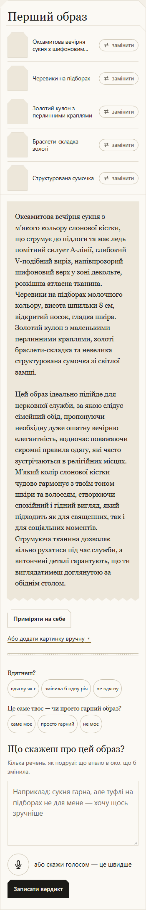

Перелік речей і текст саме цієї картки

Перший образ
Оксамитова вечірня сукня з шифоновим верхом
Черевики на підборах
Золотий кулон з перлинними краплями
Браслети-складка золоті
Структурована сумочка
Оксамитова вечірня сукня з м’якого кольору слонової кістки, що струмує до підлоги та має ледь помітний силует А-лінії, глибокий V-подібний виріз, напівпрозорий шифоновий верх у зоні декольте, розкішна атласна тканина. Черевики на підборах молочного кольору, висота шпильки 8 см, відкритий носок, гладка шкіра. Золотий кулон з маленькими перлинними краплями, золоті браслети-складка та невелика структурована сумочка зі світлої замші.
Цей образ ідеально підійде для церковної служби, за якою слідує сімейний обід, пропонуючи необхідну дуже ошатну вечірню елегантність, водночас поважаючи скромні правила одягу, які часто зустрічаються в релігійних місцях. М’який колір слонової кістки чудово гармонує з твоїм тоном шкіри та волоссям, створюючи спокійний і гідний вигляд, який підходить як для священних, так і для соціальних моментів. Струмуюча тканина дозволяє вільно рухатися під час служби, а витончені деталі гарантують, що ти виглядатимеш доглянутою за обіднім столом.

Доречно: ____ · Причина: ____

## 21. ж7_театр / повтор 2 / рука 3

Слова жінки: «вечір у театрі, вистава о 19:00».

[Відкрити знімок](ДО-2610/ж7_театр/повтор2/знімки/kartka_poz0_ruka3_seed4.png) · [вихідний текст усіх карток прогону](ДО-2610/ж7_театр/повтор2/знімки/картки.txt)

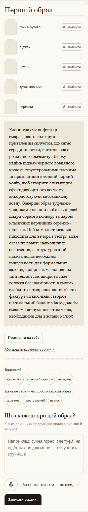

Перелік речей і текст саме цієї картки

Перший образ
сукня-футляр
піджак
штани
туфлі-човники
сережки
Елегантна сукня-футляр смарагдового кольору з приталеним силуетом, що сягає середини литки, виготовлена з розкішного оксамиту. Зверху надінь піджак чорного вовняного крою зі структурованими плечима та прямі штани в тонкий чорний колір, щоб створити елегантний ефект двобортного костюму, використовуючи високоякісну вовну. Заверши образ туфлями-човниками на шпильці з глянцевої шкіри чорного кольору та парою класичних перлинних сережок-підвісок. Цей комплект ідеально підходить для вечора в театрі, адже оксамит ловить навколишнє освітлення, а структурований піджак додає необхідної вишуканості для формальних заходів; колірна гама доповнює твій теплий тон шкіри та сиве волосся без надмірності в умовах слабкого світла; поєднання м’яких фактур і чітких ліній створює оптимальний баланс між художнім смаком і вишуканою етикеткою, необхідними для вистави о 19:00.

Доречно: ____ · Причина: ____

## 22. ж5_похорон / повтор 3 / рука 4

Слова жінки: «похорон дідуся в четвер зранку».

[Відкрити знімок](ДО-2610/ж5_похорон/повтор3/знімки/kartka_poz1_ruka4_seed5.png) · [вихідний текст усіх карток прогону](ДО-2610/ж5_похорон/повтор3/знімки/картки.txt)

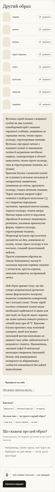

Перелік речей і текст саме цієї картки

Другий образ
піджак
штани
блузка
туфлі-човники
клатч
колготки
обручка
сережка
Вугільно-сірий піджак з вовняної суміші на два ґудзики, однобортний крій і лацкани середньої глибини, довжиною до середини стегна, темно-сірого кольору, структурована тканина.
Вугільно-сірі прямі штани з вовняної суміші із завищеною талією й акуратною застібкою спереду, повнорозмірні в області щиколотки, темно-сірого кольору, така ж структурована тканина, як і піджак.
Кремова блузка з шовкової суміші на ґудзиках із вільною посадкою й загорнутими манжетами, довжиною до стегон, кремового кольору, гладка сатинова тканина.
Чорні лаковані шкіряні туфлі-човники з підбором шпилькою 7,5 см і закритою передньою частиною, середньої висоти халяви, чорного кольору, теляча шкіра.
Матова чорна клатч із перловою обробкою й золотим ланцюжком-ремінцем, маленька прямокутна форма, чорного кольору, структурована тканина.
Непрозорі вугільно-сірі колготки щільністю 40 den, довжиною до коліна, темно-сірого кольору в тон костюму, гладкий трикотажний нейлон.
Просте платинове обручка на лівому безіменному пальці й маленька перлова сережка-гвоздик у мочці вуха, кругла огранка, металеве покриття, полірований метал.
Цей образ працює тому, що він суворо дотримується урочистих вимог формального похорону, водночас поважаючи конкретний час і погодні умови. Темно-сірий костюм з вовняної суміші надає необхідної серйозності й шани для цієї події, не будучи надто чорним, що може здатися занадто різким в осінній день при 18 °C. Кремова блузка пропонує ледь помітний контраст, який пом’якшує загальний вигляд відповідно до денного часу доби, забезпечуючи її видимість і гідність. Насамкінець, лаковані туфлі й мінімальні аксесуари створюють ідеальний баланс між вшануванням померлого та збереженням особистої елегантності без зайвої відволікання.

Доречно: ____ · Причина: ____

## 23. ж2_побачення_вечір / повтор 1 / рука 4

Слова жінки: «побачення в ресторані ввечері, о 19:30».

[Відкрити знімок](ДО-2610/ж2_побачення_вечір/повтор1/знімки/kartka_poz1_ruka4_seed3.png) · [вихідний текст усіх карток прогону](ДО-2610/ж2_побачення_вечір/повтор1/знімки/картки.txt)

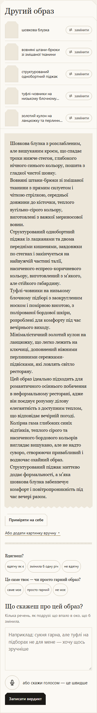

Перелік речей і текст саме цієї картки

Другий образ
шовкова блузка
вовняні штани-брюки зі змішаної тканини
структурований однобортний піджак
туфлі-човники на низькому блочному підборі
золотий кулон на ланцюжку та перлинні сережки-підвіски
Шовкова блузка з розслабленим, але вишуканим кроєм, що спадає трохи нижче стегон, глибокого нічного синього кольору, пошита з гладкої чистої шовку.
Вовняні штани-брюки зі змішаної тканини з прямим силуетом і чіткою стрілкою, середньої довжини до кісточки, теплого вугільно-сірого кольору, виготовлені з важкої мериносової вовни.
Структурований однобортний піджак із лацканами та двома передніми кишенями, завдовжки по стегнах і закінчується на найвужчій частині талії, насиченого еспресо-коричневого кольору, виготовлений з м’якого, але стійкого габардину.
Туфлі-човники на низькому блочному підборі з заокругленим носком і помірною висотою, з полірованої бордової шкіри, розроблені для комфорту під час вечірнього виходу.
Мінімалістичний золотий кулон на ланцюжку, що легко лежить на ключиці, доповнений ніжними перлинними сережками-підвісками, які ловлять світло ресторану.
Цей образ ідеально підходить для романтичного осіннього побачення в неформальному ресторані, адже він поєднує розумну ділову елегантність з доступним теплом, що відповідає вечірній погоді. Колірна гама глибоких синіх відтінків, теплого сірого та насиченого бордового кольорів виглядає вишукано, але не надто суворо, створюючи привабливий і водночас охайний образ. Структурований піджак миттєво додає формальності, а м’яка шовкова блузка забезпечує комфорт і повітропроникність під час вечері разом.

Доречно: ____ · Причина: ____

## 24. ж3_зима / повтор 1 / рука 1

Слова жінки: «на вулиці мінус десять і сніг, йду на роботу пішки 20 хвилин».

[Відкрити знімок](ДО-2610/ж3_зима/повтор1/знімки/kartka_poz2_ruka1_seed3.png) · [вихідний текст усіх карток прогону](ДО-2610/ж3_зима/повтор1/знімки/картки.txt)

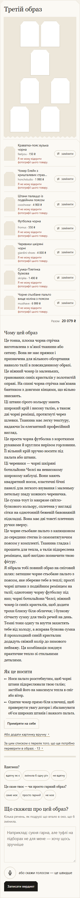

Перелік речей і текст саме цієї картки

Третій образ
Краватка-пояс вузька чорна
feelyou · 150 ₴
Чокер Елейн з кришталевих страз синій
honchstudio · 1 990 ₴
Штани палаццо із подвійним поясом
cooshwear · 4 900 ₴
Футболка чорна
fromus · 550 ₴
Черевики шкіряні чорні
giardini-shoes · 4 000 ₴
Сумка-Плетінка бузкова
skripka · 1 490 ₴
Чорне стьобане пальто вище коліна з поясом
musthave · 6 999 ₴
Разом
20 079 ₴
Чому цей образ
Це тонка, плоска чорна стрічка виготовлена з м’якої тканини або сатину. Вона не має пряжки і призначена для вільного обгортання навколо талії в повсякденному образі.
Це ніжний чокер із маленьких, гранованих синіх кристалів у золотистій оправі. На спині чорна стрічка зав’язана бантиком з довгими кінцями, що вільно звисають.
Ці штани сірого кольору мають широкий крій і високу талію, а також дві чорні ремінці, протягнуті через шлевки. Тканина має легку текстуру, надаючи їм елегантний професійний вигляд.
Це проста чорна футболка з короткими рукавами й круглим вирізом горловини. Її вільний крій зручно носити під пальта або штани.
Ці черевики — чорні шкіряні ботильйони Челсі на невисокому широкому каблуці. Вони мають квадратний носок, еластичні бічні панелі для легкого взування і маленьку петельку ззаду кожного черевичка.
Це сумка-тоут із макраме світло-бузкового кольору, сплетена у вигляді сітки на однотонній бежевій бавовняній підкладці. Вона має дві товсті плетених ручки зверху.
Це чорне стьобане пальто з капюшоном до середини стегна із самозатягуючим поясом у комплекті. Тканина гладка і прошита для тепла, а талія підкреслена ремінцем, щоб вигідно позначити твою фігуру.
Я зібрала тобі повний образ на сніговий шлях: затишне чорне стьобане пальто з поясом, яке збереже тебе в теплі; прості чорні штани з подвійним ремінцем на талії; однотонну чорну футболку під низ; чорні ботильйони Челсі; ніжний чокер із синіх кристалів, щоб додати трохи блиску біля обличчя; і бузкову сітчасту сумку для твоїх речей на день. Темні тони одягу та взуття захистять тебе від холоду, а яскрава бузкова сумка й прохолодний синій кристалик додадуть свіжий колір до зимового пейзажу. Ця комбінація поєднує практичне тепло зі стильними деталями.
Як це носити
Носи пальто розстебнутим, щоб чорні штани підкреслювали твою талію; застібай його на максимум тепла в сніг або вітер.
Одягни чокер прямо біля ключиці, щоб привернути увагу догори і збалансувати об’єм широких штанів і важкого пальта.

Доречно: ____ · Причина: ____

## 25. ж8_концерт_рок / повтор 2 / рука 3

Слова жінки: «рок-концерт у клубі, п'ятниця ввечері, стоятиму в натовпі».

[Відкрити знімок](ДО-2610/ж8_концерт_рок/повтор2/знімки/kartka_poz0_ruka3_seed4.png) · [вихідний текст усіх карток прогону](ДО-2610/ж8_концерт_рок/повтор2/знімки/картки.txt)

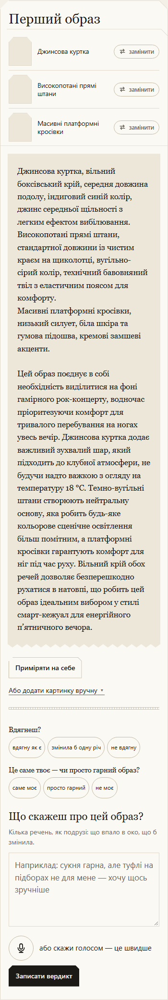

Перелік речей і текст саме цієї картки

Перший образ
Джинсова куртка
Високопотані прямі штани
Масивні платформні кросівки
Джинсова куртка, вільний боксівський крій, середня довжина подолу, індиговий синій колір, джинс середньої щільності з легким ефектом вибілювання.
Високопотані прямі штани, стандартної довжини із чистим краєм на щиколотці, вугільно-сірий колір, технічний бавовняний твіл з еластичним поясом для комфорту.
Масивні платформні кросівки, низький силует, біла шкіра та гумова підошва, кремові замшеві акценти.
Цей образ поєднує в собі необхідність виділитися на фоні гамірного рок-концерту, водночас пріоритезуючи комфорт для тривалого перебування на ногах увесь вечір. Джинсова куртка додає важливий зухвалий шар, який підходить до клубної атмосфери, не будучи надто важкою з огляду на температуру 18 °C. Темно-вугільні штани створюють нейтральну основу, яка робить будь-яке кольорове сценічне освітлення більш помітним, а платформні кросівки гарантують комфорт для ніг під час руху. Вільний крій обох речей дозволяє безперешкодно рухатися в натовпі, що робить цей образ ідеальним вибором у стилі смарт-кежуал для енергійного п’ятничного вечора.

Доречно: ____ · Причина: ____

## 26. ж3_зима / повтор 2 / рука 3

Слова жінки: «на вулиці мінус десять і сніг, йду на роботу пішки 20 хвилин».

[Відкрити знімок](ДО-2610/ж3_зима/повтор2/знімки/kartka_poz0_ruka3_seed4.png) · [вихідний текст усіх карток прогону](ДО-2610/ж3_зима/повтор2/знімки/картки.txt)

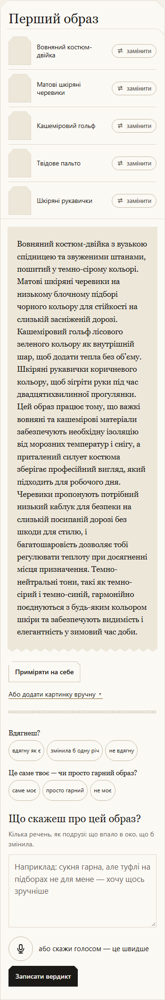

Перелік речей і текст саме цієї картки

Перший образ
Вовняний костюм-двійка
Матові шкіряні черевики
Кашеміровий гольф
Твідове пальто
Шкіряні рукавички
Вовняний костюм-двійка з вузькою спідницею та звуженими штанами, пошитий у темно-сірому кольорі.
Матові шкіряні черевики на низькому блочному підборі чорного кольору для стійкості на слизькій засніженій дорозі.
Кашеміровий гольф лісового зеленого кольору як внутрішній шар, щоб додати тепла без об’єму.
Шкіряні рукавички коричневого кольору, щоб зігріти руки під час двадцятихвилинної прогулянки.
Цей образ працює тому, що важкі вовняні та кашемірові матеріали забезпечують необхідну ізоляцію від морозних температур і снігу, а приталений силует костюма зберігає професійний вигляд, який підходить для робочого дня. Черевики пропонують потрібний низький каблук для безпеки на слизькій посипаній дорозі без шкоди для стилю, і багатошаровість дозволяє тобі регулювати теплоту при досягненні місця призначення. Темно-нейтральні тони, такі як темно-сірий і темно-синій, гармонійно поєднуються з будь-яким кольором шкіри та забезпечують видимість і елегантність у зимовий час доби.

Доречно: ____ · Причина: ____

## 27. ж5_похорон / повтор 2 / рука 3

Слова жінки: «похорон дідуся в четвер зранку».

[Відкрити знімок](ДО-2610/ж5_похорон/повтор2/знімки/kartka_poz0_ruka3_seed4.png) · [вихідний текст усіх карток прогону](ДО-2610/ж5_похорон/повтор2/знімки/картки.txt)

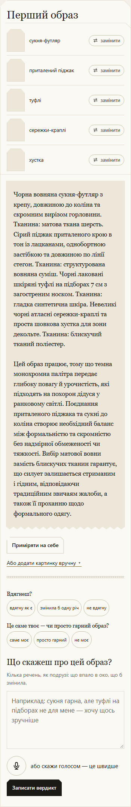

Перелік речей і текст саме цієї картки

Перший образ
сукня-футляр
приталений піджак
туфлі
сережки-краплі
хустка
Чорна вовняна сукня-футляр з крепу, довжиною до коліна та скромним вирізом горловини. Тканина: матова ткана шерсть. Сірий піджак приталеного крою в тон із лацканами, однобортною застібкою та довжиною по лінії стегон. Тканина: структурована вовняна суміш. Чорні лаковані шкіряні туфлі на підборах 7 см з загостреним носком. Тканина: гладка синтетична шкіра. Невеликі чорні атласні сережки-краплі та проста шовкова хустка для зони декольте. Тканина: блискучий тканий поліестер.
Цей образ працює, тому що темна монохромна палітра передає глибоку повагу й урочистість, які підходять на похорон дідуся у ранковому світлі. Поєднання приталеного піджака та сукні до коліна створює необхідний баланс між формальністю та скромністю без надмірної обмеженості чи тяжкості. Вибір матової вовни замість блискучих тканин гарантує, що силует залишається стриманим і гідним, відповідаючи традиційним звичаям жалоби, а також її проханню щодо формального одягу.

Доречно: ____ · Причина: ____

## 28. ж2_спорт_коментар / повтор 1 / рука 2

Слова жінки: «йога зранку, потім кава з подругою».

[Відкрити знімок](ДО-2610/ж2_спорт_коментар/повтор1/знімки/kartka_poz3_ruka2_seed3.png) · [вихідний текст усіх карток прогону](ДО-2610/ж2_спорт_коментар/повтор1/знімки/картки.txt)

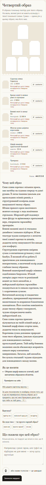

Перелік речей і текст саме цієї картки

Четвертий образ
Об’ємний укорочений джемпер з вовни ягнят полин
rito · 4 200 ₴
Штани
fromus · 990 ₴
Жіноча сумка через плече коричнева замшева
miraton · 4 249 ₴
LeBERDES Лофери коричневі
favoriteshoes · 3 179 ₴
Жилет стьобаний на запах з поясом
wearme · 2 055 ₴
Куртка пуховик жіноча коротка
wearme · 3 555 ₴
Разом
18 228 ₴
Чому цей образ
Це об’ємний укорочений джемпер з вовни ягнят полин із ребристою текстурою. Він має високий комір і довгі рукави глибокого оливкового відтінку, який привносить спокійну природність до твого ранкового образу.
Це прямі штани, виготовлені з м’якої темно-бежевої тканини з ледь помітною мармуровою текстурою. Вони мають еластичний пояс зі шнурками для комфорту та вільні штанини, які легко рухаються протягом дня.
Структурована сумка через плече з багатої коричневої замші, що має класичну куполоподібну форму, дві верхні ручки та декоративні ремінці з пряжками спереду в доповнюючому шкіряному тоні.
Це повсякденні лофери, виготовлені зі гладкої коричневої замші з чіткою китицею на носку. Вони низько сидять на стопі та мають зручну підошву кремового кольору для комфорту протягом усього дня.
Це стьобаний жилет, призначений для носіння розстебнутим, з діамантовим стібком і широким шкіряним поясом на талії. Його глибокий коричневий колір поєднується з твоєю сумкою та взуттям, щоб гармонійно зв’язати шари разом.
Я підібрала тобі образ для прохолодного осіннього ранку, який відчувається водночас затишно і без зусиль елегантно. Глибокий оливковий ребристий джемпер дарує м’який, структурований силует на початку твого дня, а темно-бежеві штани забезпечують комфортну та вишукану основу. Зверху я обрала коричневу замшеву сумку через плече і відповідні лофери з китицями, щоб додати текстуру й теплу природність без шкоди для стилю. Щоб зігрітися вранці або якщо подує вітерець, стьобаний коричневий жилет слугуватиме універсальним середнім шаром, який можна легко накинути чи зняти, ідеально поєднуючи невимушений вигляд твоєї нижньої половини з ноткою вишуканого багатошаровості.
Як це носити
Злегка заправ передній край оливкового джемпера в пояс штанів, щоб підкреслити твою талію і створити чітку лінію від грудей до стегон.

Доречно: ____ · Причина: ____

## 29. ж3_церква / повтор 3 / рука 4

Слова жінки: «неділя, служба в церкві, потім обід з батьками».

[Відкрити знімок](ДО-2610/ж3_церква/повтор3/знімки/kartka_poz1_ruka4_seed5.png) · [вихідний текст усіх карток прогону](ДО-2610/ж3_церква/повтор3/знімки/картки.txt)

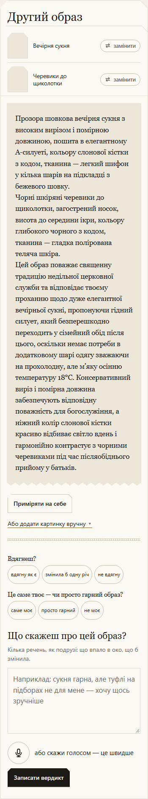

Перелік речей і текст саме цієї картки

Другий образ
Вечірня сукня
Черевики до щиколотки
Прозора шовкова вечірня сукня з високим вирізом і помірною довжиною, пошита в елегантному А-силуеті, кольору слонової кістки з кодом, тканина — легкий шифон у кілька шарів на підкладці з бежевого шовку.
Чорні шкіряні черевики до щиколотки, загострений носок, висота до середини ікри, кольору глибокого чорного з кодом, тканина — гладка полірована теляча шкіра.
Цей образ поважає священну традицію недільної церковної служби та відповідає твоєму проханню щодо дуже елегантної вечірньої сукні, пропонуючи гідний силует, який безперешкодно переходить у сімейний обід після цього, оскільки немає потреби в додатковому шарі одягу зважаючи на прохолодну, але м’яку осінню температуру 18°C. Консервативний виріз і помірна довжина забезпечують відповідну поважність для богослужіння, а ніжний колір слонової кістки красиво відбиває світло вдень і гармонійно контрастує з чорними черевиками під час післяобіднього прийому у батьків.

Доречно: ____ · Причина: ____

## 30. ж4_весілля_гостя / повтор 3 / рука 4

Слова жінки: «я гостя на весіллі сестри в серпні, церемонія надворі о 16:00, потім ресторан».

[Відкрити знімок](ДО-2610/ж4_весілля_гостя/повтор3/знімки/kartka_poz1_ruka4_seed5.png) · [вихідний текст усіх карток прогону](ДО-2610/ж4_весілля_гостя/повтор3/знімки/картки.txt)

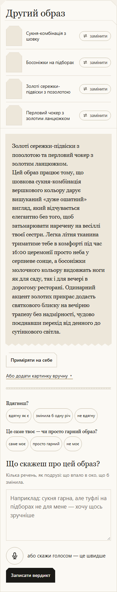

Перелік речей і текст саме цієї картки

Другий образ
Сукня-комбінація з шовку
Босоніжки на підборах
Золоті сережки-підвіски з позолотою
Перловий чокер з золотим ланцюжком
Золоті сережки-підвіски з позолотою та перловий чокер з золотим ланцюжком.
Цей образ працює тому, що шовкова сукня-комбінація вершкового кольору дарує вишуканий «дуже ошатний» вигляд, який відчувається елегантно без того, щоб затьмарювати наречену на весіллі твоєї сестри. Легка літня тканина триматиме тебе в комфорті під час 16:00 церемонії просто неба у серпневе сонце, а босоніжки молочного кольору видовжать ноги як для саду, так і для вечері в дорогому ресторані. Одинарний акцент золотих прикрас додасть святкового блиску на вечірню трапезу без надмірності, чудово поєднавши перехід від денного до сутінкового світла.

Доречно: ____ · Причина: ____
