# Б.1 ДО-2610 — сліпа повторна оцінка: відповіді

Оцінювач: Codex `gpt-6.1-sol`, зусилля `high`; знімки та тексти всіх карток переглянуто до відкриття первинних вердиктів.

Оцінювач отримує лише цей файл і вихідні картки. Для кожного образу: «доречно: так/ні» та причина одним реченням. Доречність — можливість вдягнути комплект на дослівно задану подію, з урахуванням погоди, руху, формальності, кольору та відповідності опису переліку речей. Порожні заглушки не включені. Вердиктів попереднього оцінювача тут немає.

## 01. ж5_похорон / повтор 2 / рука 3

Слова жінки: «похорон дідуся в четвер зранку».

[Відкрити знімок](ДО-2610/ж5_похорон/повтор2/знімки/kartka_poz0_ruka3_seed4.png) · [вихідний текст усіх карток прогону](ДО-2610/ж5_похорон/повтор2/знімки/картки.txt)

Перелік речей і текст саме цієї картки

Перший образ
сукня-футляр
приталений піджак
туфлі
сережки-краплі
хустка
Чорна вовняна сукня-футляр з крепу, довжиною до коліна та скромним вирізом горловини. Тканина: матова ткана шерсть. Сірий піджак приталеного крою в тон із лацканами, однобортною застібкою та довжиною по лінії стегон. Тканина: структурована вовняна суміш. Чорні лаковані шкіряні туфлі на підборах 7 см з загостреним носком. Тканина: гладка синтетична шкіра. Невеликі чорні атласні сережки-краплі та проста шовкова хустка для зони декольте. Тканина: блискучий тканий поліестер.
Цей образ працює, тому що темна монохромна палітра передає глибоку повагу й урочистість, які підходять на похорон дідуся у ранковому світлі. Поєднання приталеного піджака та сукні до коліна створює необхідний баланс між формальністю та скромністю без надмірної обмеженості чи тяжкості. Вибір матової вовни замість блискучих тканин гарантує, що силует залишається стриманим і гідним, відповідаючи традиційним звичаям жалоби, а також її проханню щодо формального одягу.

Доречно: так · Причина: Темна сукня до коліна з піджаком, закритими туфлями та стриманими аксесуарами відповідає ранковому похорону.

## 02. ж7_театр / повтор 3 / рука 1

Слова жінки: «вечір у театрі, вистава о 19:00».

[Відкрити знімок](ДО-2610/ж7_театр/повтор3/знімки/kartka_poz0_ruka1_seed5.png) · [вихідний текст усіх карток прогону](ДО-2610/ж7_театр/повтор3/знімки/картки.txt)

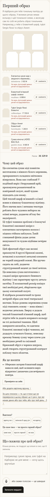

Перелік речей і текст саме цієї картки

Перший образ
Я підібрала для тебе тональну палітру до цього образу. У великих речах немає кольору з цієї тональної схеми, а аксесуар сам по собі не робить образ тональним. Наприклад, у тебе є блакитний шарф, туфлі Sergio Rossi та обруч Аннет.
Елегантна сукня міді з ажурного мережива Селеста
dolcedonna · 3 920 ₴
На жаль, фотографії деяких речей не відкриваються.
Блакитний в'язаний шарф з вовни
musthave · 6 999 ₴
На жаль, фотографії деяких речей не відкриваються.
Туфлі Sergio Rossi блакитні
cultboutique · 17 550 ₴
На жаль, фотографії деяких речей не відкриваються.
Обруч Аннет блакитний
honchstudio · 1 260 ₴
На жаль, фотографії деяких речей не відкриваються.
Сумка жіноча LADIES BAG ISLA
giardini-shoes · 6 600 ₴
На жаль, фотографії деяких речей не відкриваються.
Разом
36 329 ₴
Чому цей образ
Ця елегантна сукня міді повністю виготовлена з ніжного білого мережива, прикрашеного складним квітковим візерунком. Вона має глибокий V-подібний виріз і безрукавний крій, пропонуючи романтичний та повітряний силует, який чудово підходить для сезону.
Цей теплий шарф зв'язаний з м’якої вовни в ніжному блакитному відтінку. Його значна вага і затишна текстура роблять його чудовим вибором на осінні вечори, додаючи об’єму без надмірності.
Ці туфлі-човники зроблені з блискучої блакитної лакованої шкіри з елегантним загостреним носком і міцним стійким каблуком. Їхній глянцевий фініш додає дотик вишуканості та чудово відбиває вечірнє світло.
Цей ефектний обруч має великі прямокутні й круглі бірюзові камені, вставлені в золотисті металеві елементи на чорній шнуровій основі. Він зручно сидить на лобі, додаючи структурований акцент до твоєї зачіски.
Ця невелика сумка виготовлена з гладкої шкіри кремового бежевого відтінку і має характерну круглу деталь-застібку. Її компактний розмір вміщує твої необхідні речі, зберігаючи при цьому елегантний силует.
Я підібрала романтичний та трохи вечірній образ для твоєї театральної вистави. Блідо-рожева мереживна сукня міді становить основу — вона ніжна і водночас детальна. Зверху я додала теплий блакитний в’язаний шарф, щоб зігріти тебе та додати яскравого кольору на тлі делікатної тканини. Щоб завершити ансамбль, ти одягнеш блакитні лаковані туфлі-човники, які додадуть сучасного блиску, невелику кремову бежеву сумку через плече для необхідних речей та сміливий бірюзовий обруч з чорним шнуром, який створить структурований контраст поблизу твого обличчя.
Як це носити
Обережно загорни блакитний шарф навколо шиї, щоб залишити виріз відкритим і дихаючим для вечірнього повітря.

Доречно: так · Причина: Мереживна сукня міді з вечірніми туфлями, сумкою та шарфом утворює завершений ошатний комплект для театру о 19:00.

## 03. ж3_церква / повтор 2 / рука 2

Слова жінки: «неділя, служба в церкві, потім обід з батьками».

[Відкрити знімок](ДО-2610/ж3_церква/повтор2/знімки/kartka_poz3_ruka2_seed4.png) · [вихідний текст усіх карток прогону](ДО-2610/ж3_церква/повтор2/знімки/картки.txt)

Перелік речей і текст саме цієї картки

Четвертий образ
Вечірній корсет-бюстьє з блискітками
gepur · 2 199 ₴
Широкі штани зі стрілками, з фігурним поясом, з італійської костюмної тканини.
sarahberlin · 12 500 ₴
Чорні туфлі-човники на шпильці зі шкіри
theoriginals · 11 500 ₴
Крос-боді чорного кольору Pochette
theoriginals · 64 000 ₴
Пасок Базовий волошковий
likeangel · 450 ₴
Разом
90 649 ₴
Чому цей образ
Це чорний корсет-бюстьє з блискітками, який має складне оздоблення бісером і структурований крій, що підкреслює торс. Його безрукавний дизайн пропонує класичний елегантний силует, ідеальний для урочистих випадків, водночас забезпечуючи підтримку та комфорт.
Це бежеві широкі штани з фігурними розрізами спереду на ногах, виготовлені з італійської костюмної тканини. Вони мають підігнаний пояс, який гарантує охайний вигляд, водночас дозволяючи вільно рухатися протягом дня.
Це чорні туфлі-човники на шпильці зі шкіри з загостреним носком. Їхній елегантний дизайн доповнює як офіційний одяг, так і смарт-кежуал образи, надаючи вишуканого акценту будь-якому ансамблю.
Це чорна сумка через плече під назвою Pochette з компактним, але стильним дизайном із двома ремінцями для універсальних варіантів носіння. Її мінімалістична естетика робить її придатною для різних випадків, включно зі службами в церкві та вечірніми виходами.
Це блакитний пасок з гладкої шкіри із простою пряжкою, який додає визначення будь-якій лінії талії. Його м’який колір надає ледь помітного яскравого акценту на нейтральних або темних тонах у твоєму образі.
Я підібрала образ, що поєднує елегантність із комфортом, ідеальний для твого переходу від церкви до сімейного обіду. Чорний корсет-бюстьє з блискітками додає нотку сяйва, відповідної для служби, а бежеві широкі штани з розрізами спереду пропонують граціозні рухи, необхідні під час спілкування за столом пізніше. Ця комбінація створює образ, який відчувається святково, але при цьому стримано, вшановуючи урочистість неділі, залишаючись водночас доречним для компанії твоєї родини.
Як це носити
Заправлю блузку всередину штанів, якщо ти обереш інший верх, щоб підкреслити талію
Залишу куртку відкритою або застебнутою залежно від температури в церкві.
Впевнено йди з розрізами на штанах, які демонструють твої підбори.

Доречно: ні · Причина: Відкрите корсетне бюстьє з блискітками без прикриття плечей недоречне для церковної служби.

## 04. ж8_концерт_рок / повтор 2 / рука 1

Слова жінки: «рок-концерт у клубі, п'ятниця ввечері, стоятиму в натовпі».

[Відкрити знімок](ДО-2610/ж8_концерт_рок/повтор2/знімки/kartka_poz2_ruka1_seed4.png) · [вихідний текст усіх карток прогону](ДО-2610/ж8_концерт_рок/повтор2/знімки/картки.txt)

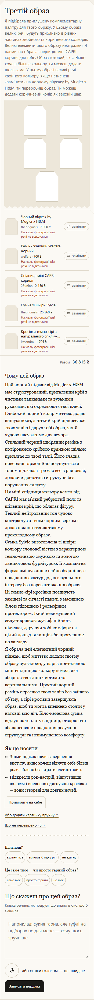

Перелік речей і текст саме цієї картки

Третій образ
Я підібрала приглушену комплементарну палітру для твого образу. У цьому образі великі речі будуть приблизно в рівних частинах хвойного та коричневого кольорів. Великі елементи цього образу нейтральні. Я навмисно обрала спідницю міні CAPRI кориця для тебе. Образ готовий, як є. Якщо хочеш більше кольору, ти можеш додати щось сама. У цьому образі великі речі хвойного кольору: якщо натиснеш «замінити» на чорному піджаку by Mugler x H&M, ти переробиш образ. Ти можеш додати коричневий колір як верхній шар.
Чорний піджак by Mugler x H&M
theoriginals · 7 000 ₴
На жаль, фотографії цієї речі не відкрилися.
Ремінь жіночий Welfare чорний
welfare · 700 ₴
На жаль, фотографії цієї речі не відкрилися.
Спідниця міні CAPRI кориця
25union · 2 150 ₴
На жаль, фотографії цієї речі не відкрилися.
Сумка зі шкіри Sylvie
theoriginals · 25 260 ₴
На жаль, фотографії цієї речі не відкрилися.
Кросівки темно-сірі з натурального спилку-замші та нейлонової сітки
kasandra · 1 705 ₴
На жаль, фотографії цієї речі не відкрилися.
Разом
36 815 ₴
Чому цей образ
Цей чорний піджак від Mugler x H&M має структурований, приталений крій з чистими лацканами та вузькими рукавами, які окреслюють твої плечі. Глибокий чорний колір миттєво додає вишуканості, а чіткий крій підкреслює твою талію і дарує тобі образ, який чудово пасуватиме для вечора.
Стильний чорний шкіряний ремінь з полірованою срібною пряжкою щільно прилягає до твоєї талії. Його гладка поверхня гармонійно поєднується з тоном піджака і тримає все в рівновазі, додаючи достатньо структури без порушення силуету.
Ця міні-спідниця кольору кемел від CAPRI має м’який ребристий пояс та щільний крій, що облягає фігуру. Теплий нейтральний тон чудово контрастує з твоїм чорним верхом і додає ніжного тепла твоєму прохолодному образу.
Сумка Sylvie виготовлена зі шкіри кольору слонової кістки з характерною темно-синьою смужкою та золотою ланцюговою фурнітурою. Її компактна форма вміщує лише найнеобхідніше, а поєднання фактур додає візуального інтересу без перевантаження образу.
Ці темно-сірі кросівки поєднують замшеві та сітчасті панелі з масивною білою підошвою і рельєфним протектором. Їхній невимушений силует врівноважує офіційність піджака, даруючи тобі комфорт на цілий день для танців або прогулянок по закладу.
Я обрала цей елегантний чорний піджак, щоб миттєво додати твоєму образу зухвалості, у парі з приталеною міні-спідницею кольору кемел, яка зберігає твої лінії чистими та вертикальними. Простий чорний ремінь окреслює твою талію без зайвого об’єму, а сірі кросівки завершують образ, щоб ти могла впевнено стояти у натовпі всю ніч. Біло-кемелова сумка відлунює теплоту спідниці, створюючи збалансоване поєднання розумної структури та невимушеного комфорту.
Як це носити
Зніми піджак після завершення виступу, якщо хочеш відчути себе більш розслаблено без втрати елегантності.
Підкресли рок-настрій, відпустивши волосся і впевнено одягнувши кросівки — вони створені для довгих ночей.

Доречно: ні · Причина: Порада зняти піджак залишає жінку без верху, бо під ним у комплекті немає ані топа, ані сорочки.

## 05. ж4_весілля_гостя / повтор 3 / рука 2

Слова жінки: «я гостя на весіллі сестри в серпні, церемонія надворі о 16:00, потім ресторан».

[Відкрити знімок](ДО-2610/ж4_весілля_гостя/повтор3/знімки/kartka_poz3_ruka2_seed5.png) · [вихідний текст усіх карток прогону](ДО-2610/ж4_весілля_гостя/повтор3/знімки/картки.txt)

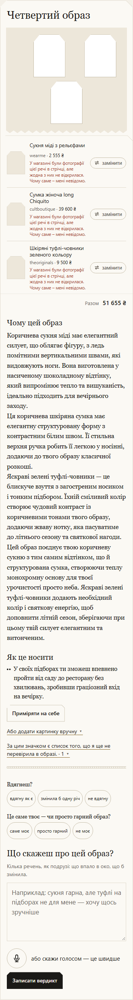

Перелік речей і текст саме цієї картки

Четвертий образ
Сукня міді з рельєфами
wearme · 2 555 ₴
У магазині були фотографії цієї речі в стрічці, але жодна з них не відкрилася. Чому саме – мені невідомо.
Сумка жіноча long Chiquito
cultboutique · 39 600 ₴
У магазині були фотографії цієї речі в стрічці, але жодна з них не відкрилася. Чому саме – мені невідомо.
Шкіряні туфлі-човники зеленого кольору
theoriginals · 9 500 ₴
У магазині були фотографії цієї речі в стрічці, але жодна з них не відкрилася. Чому саме – мені невідомо.
Разом
51 655 ₴
Чому цей образ
Коричнева сукня міді має елегантний силует, що облягає фігуру, з ледь помітними вертикальними швами, які видовжують ноги. Вона виготовлена у насиченому шоколадному відтінку, який випромінює тепло та вишуканість, ідеально підходить для вечірнього заходу.
Ця коричнева шкіряна сумка має елегантну структуровану форму з контрастним білим швом. Її стильна верхня ручка робить її легкою у носінні, додаючи до твого образу класичної розкоші.
Яскраві зелені туфлі-човники — це блискуче взуття з загостреним носиком і тонким підбором. Їхній сміливий колір створює чудовий контраст із коричневими тонами твого образу, додаючи жваву нотку, яка пасуватиме до літнього сезону та святкової нагоди.
Цей образ поєднує твою коричневу сукню з тим самим відтінком, що й структурована сумка, створюючи теплу монохромну основу для твоєї урочистості просто неба. Яскраві зелені туфлі-човники додають необхідний колір і святкову енергію, щоб доповнити літній сезон, зберігаючи при цьому твій силует елегантним та витонченим.
Як це носити
У своїх підборах ти зможеш впевнено пройти від саду до ресторану без хвилювань, зробивши граціозний вхід на вечірку.

Доречно: так · Причина: Коричнева сукня міді, сумка та зелені туфлі достатньо святкові для літньої весільної церемонії й ресторану та не повторюють біле вбрання нареченої.

## 06. ж2_спорт_коментар / повтор 2 / рука 4

Слова жінки: «йога зранку, потім кава з подругою».

[Відкрити знімок](ДО-2610/ж2_спорт_коментар/повтор2/знімки/kartka_poz1_ruka4_seed4.png) · [вихідний текст усіх карток прогону](ДО-2610/ж2_спорт_коментар/повтор2/знімки/картки.txt)

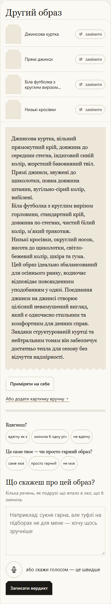

Перелік речей і текст саме цієї картки

Другий образ
Джинсова куртка
Прямі джинси
Біла футболка з круглим вирізом горловини
Низькі кросівки
Джинсова куртка, вільний прямокутний крій, довжина до середини стегна, індиговий синій колір, жорсткий бавовняний твіл.
Прямі джинси, звужені до щиколотки, повна довжина штанин, вугільно-сірий колір, вибілені.
Біла футболка з круглим вирізом горловини, стандартний крій, довжина по стегнах, чистий білий колір, м'який трикотаж.
Низькі кросівки, округлий носок, висота до щиколотки, світло-бежевий колір, шкіра та гума.
Цей образ ідеально збалансований для осіннього ранку, водночас відповідає повсякденним уподобанням у одязі. Поєднання джинси на джинсі створює цілісний невимушений вигляд, який є одночасно стильним та комфортним для денних справ. Завдяки структурованій куртці та нейтральним тонам він забезпечує достатньо тепла для сезону без відчуття надмірності.

Доречно: ні · Причина: Жорсткі прямі джинси й джинсова куртка обмежують рухи на йозі, хоча підходять для подальшої кави.

## 07. ж4_весілля_гостя / повтор 2 / рука 3

Слова жінки: «я гостя на весіллі сестри в серпні, церемонія надворі о 16:00, потім ресторан».

[Відкрити знімок](ДО-2610/ж4_весілля_гостя/повтор2/знімки/kartka_poz0_ruka3_seed4.png) · [вихідний текст усіх карток прогону](ДО-2610/ж4_весілля_гостя/повтор2/знімки/картки.txt)

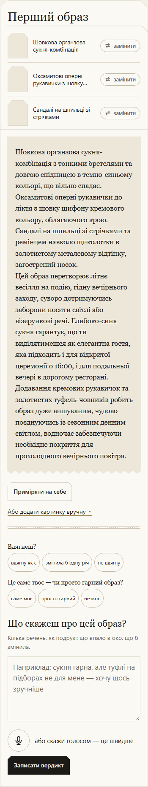

Перелік речей і текст саме цієї картки

Перший образ
Шовкова органзова сукня-комбінація
Оксамитові оперні рукавички з шовку шифону
Сандалі на шпильці зі стрічками
Шовкова органзова сукня-комбінація з тонкими бретелями та довгою спідницею в темно-синьому кольорі, що вільно спадає.
Оксамитові оперні рукавички до ліктя з шовку шифону кремового кольору, облягаючого крою.
Сандалі на шпильці зі стрічками та ремінцем навколо щиколотки в золотистому металевому відтінку, загострений носок.
Цей образ перетворює літнє весілля на подію, гідну вечірнього заходу, суворо дотримуючись заборони носити світлі або візерункові речі. Глибоко-синя сукня гарантує, що ти виділятимешся як елегантна гостя, яка підходить і для відкритої церемонії о 16:00, і для подальньої вечері в дорогому ресторані. Додавання кремових рукавичок та золотистих туфель-човників робить образ дуже вишуканим, чудово поєднуючись із сезонним денним світлом, водночас забезпечуючи необхідне покриття для прохолодного вечірнього повітря.

Доречно: ні · Причина: Оперні оксамитові рукавички надмірно театральні для серпневої церемонії о 16:00, а названих у поясненні туфель-човників у переліку немає.

## 08. ж5_похорон / повтор 2 / рука 4

Слова жінки: «похорон дідуся в четвер зранку».

[Відкрити знімок](ДО-2610/ж5_похорон/повтор2/знімки/kartka_poz1_ruka4_seed4.png) · [вихідний текст усіх карток прогону](ДО-2610/ж5_похорон/повтор2/знімки/картки.txt)

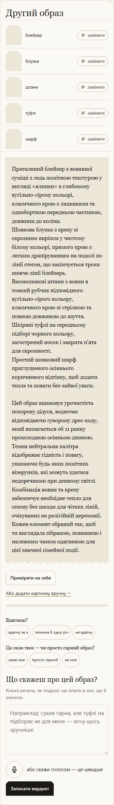

Перелік речей і текст саме цієї картки

Другий образ
блейзер
блузка
штани
туфлі
шарф
Приталений блейзер з вовняної суміші з ледь помітною текстурою у вигляді «ялинки» в глибокому вугільно-сірому кольорі, класичного крою з лацканами та однобортною передньою частиною, довжини до коліна.
Шовкова блузка з крепу зі скромним вирізом у чистому білому кольорі, прямого крою з легким драпіруванням на подолі по лінії стегон, що закінчується трохи нижче лінії блейзера.
Високопоясні штани з вовни в тонкий рубчик відповідного вугільно-сірого кольору, класичного крою зі стрілкою та повною довжиною до взуття.
Шкіряні туфлі на середньому підборі чорного кольору, загострений носок і закрита п’ята для скромності.
Простий шовковий шарф приглушеного осіннього коричневого відтінку, щоб додати тепла та поваги без зайвої уваги.
Цей образ вшановує урочистість похорону дідуся, водночас відповідаючи суворому дрес-коду, який вимагається об 11 ранку прохолодною осінньою дниною. Темна нейтральна палітра відображає гідність і повагу, уникаючи будь-яких помітних візерунків, які можуть здатися недоречними при денному світлі. Комбінація вовни та крепу забезпечує необхідне тепло для сезону без шкоди для чітких ліній, очікуваних на релігійній церемонії. Кожен елемент обраний так, щоб ти виглядала зібраною, поважною і належним чином одягненою для цієї значної сімейної події.

Доречно: так · Причина: Вугільно-сірі блейзер і штани з білою закритою блузкою, чорними туфлями та приглушеним шарфом доречні для ранкового похорону.

## 09. ж2_побачення_вечір / повтор 1 / рука 3

Слова жінки: «побачення в ресторані ввечері, о 19:30».

[Відкрити знімок](ДО-2610/ж2_побачення_вечір/повтор1/знімки/kartka_poz0_ruka3_seed3.png) · [вихідний текст усіх карток прогону](ДО-2610/ж2_побачення_вечір/повтор1/знімки/картки.txt)

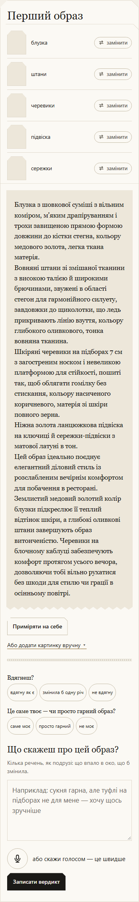

Перелік речей і текст саме цієї картки

Перший образ
блузка
штани
черевики
підвіска
сережки
Блузка з шовкової суміші з вільним коміром, м’яким драпіруванням і трохи завищеною прямою формою довжини до кістки стегна, кольору медового золота, легка ткана матерія.
Вовняні штани зі змішаної тканини з високою талією й широкими брючинами, звужені в області стегон для гармонійного силуету, завдовжки до щиколотки, що ледь прикривають лінію взуття, кольору глибокого оливкового, тонка вовняна тканина.
Шкіряні черевики на підборах 7 см з загостреним носком і невеликою платформою для стійкості, пошиті так, щоб облягати гомілку без стискання, кольору насиченого коричневого, матерія зі шкіри повного зерна.
Ніжна золота ланцюжкова підвіска на ключиці й сережки-підвіски з матової латуні в тон.
Цей образ ідеально поєднує елегантний діловий стиль із розслабленим вечірнім комфортом для побачення в ресторані. Землистий медовий золотий колір блузки підкреслює її теплий відтінок шкіри, а глибокі оливкові штани завершують образ витонченістю. Черевики на блочному каблуці забезпечують комфорт протягом усього вечора, дозволяючи тобі вільно рухатися без шкоди для стилю чи грації в осінньому повітрі.

Доречно: так · Причина: Шовкова блузка, вовняні штани, шкіряні черевики й невеликі прикраси дають завершений елегантний комплект для вечері в ресторані о 19:30.

## 10. ж7_театр / повтор 1 / рука 4

Слова жінки: «вечір у театрі, вистава о 19:00».

[Відкрити знімок](ДО-2610/ж7_театр/повтор1/знімки/kartka_poz1_ruka4_seed3.png) · [вихідний текст усіх карток прогону](ДО-2610/ж7_театр/повтор1/знімки/картки.txt)

Перелік речей і текст саме цієї картки

Другий образ
Оксамитова шовкова сукня міді довжини
Туфлі на підборах шпильці
Перлинні сережки-краплі
Невеличка оксамитова сумочка вугільно-сірого кольору
Тонка золота підвіска біля ключиці
Оксамитова шовкова сукня міді довжини темно-синього кольору з ледь помітним металевим блиском, пошита до підлоги із завищеною талією і ніжними складками. Легка тканина атласного шовку.
Чорні лакові туфлі на підборах шпильці довжиною до щиколотки з гладкою відполірованою поверхнею.
Перлинні сережки-краплі на тонких золотих гачках, невеличка оксамитова сумочка вугільно-сірого кольору і тонка золота підвіска біля ключиці.
Цей образ додасть тобі впевненості для вечірнього походу до театру о 19:00, поєднуючи глибокі вишукані відтінки з розкішними текстурами, які пасуватимуть прохолодній осінній погоді +18°C. Довжина міді і металевий акцент додадуть твоєму образу художнього шарму, який буде доречним для театральної атмосфери без надмірної помпезності. Кожен елемент відповідає твоїй потребі почуватися впевнено та вишукано, суворо дотримуючись формального дрес-коду.

Доречно: так · Причина: Темно-синя вечірня сукня з чорними туфлями, перлами й маленькою сумочкою відповідає вечірньому відвідуванню театру.

## 11. ж1_робота / повтор 1 / рука 1

Слова жінки: «робочий день в офісі».

[Відкрити знімок](ДО-2610/ж1_робота/повтор1/знімки/kartka_poz2_ruka1_seed3.png) · [вихідний текст усіх карток прогону](ДО-2610/ж1_робота/повтор1/знімки/картки.txt)

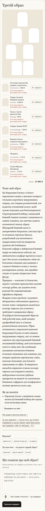

Перелік речей і текст саме цієї картки

Третій образ
Котонова сорочка без рукавів з корсетною шнурівкою персикова
honchstudio · 2 800 ₴
Піджак Architect бежевий меланж
morandi · 16 800 ₴
Пасок з пір’ям декольте беж
likeangel · 900 ₴
Лофери бежеві ROOT
emmeliedelage · 5 900 ₴
Бежева атласна спідниця міді довжини Айден
dolcedonna · 1 900 ₴
Прикраса
honchstudio · 3 510 ₴
Сумка Марсала абстракція
yakfaino · 2 070 ₴
Разом
33 880 ₴
Чому цей образ
Це безрукавна блузка з м’якого персикового шовку з високим коміром і стильним корсетним шнуруванням спереду, що створює романтичний, але водночас елегантний силует, який чудово підходить для багатошаровості.
Структурований блейзер у вишуканій бежевій тканині меланж з лацканами та однією ґудзиком, що миттєво додасть елегантності твоєму образу.
Шикарний бежевий пасок із декоративною бахромою у вигляді пір’я та атласною стрічкою-бантом, розроблений для витонченого підкреслення талії під відкритою курткою або блейзером.
Класичні лофери з нейтральної бежевої шкіри на невисокому каблуці, що забезпечують комфорт протягом усього дня і без зусиль подовжують лінію ніг.
Елегантна спідниця міді довжини з гладкого бежевого атласу з легким розширенням донизу, яка граційно спадає та чудово підкреслює твою фігуру.
Прикраса — комплект із блискучих перлів і сміливих прямокутних каменів кольору рубіна, що додають нотку розкоші без перевантаження офіційного вбрання.
Яскрава сумка-кросбоді з художнім абстрактним гобеленовим принтом у теплих тонах і шкіряними акцентами кольору марсала для сучасного, грайливого завершення образу.
Я підібрала багатошаровий образ на твій робочий день, який поєднує професійний шик із м’якими романтичними деталями. Образ починається з персикової шовкової безрукавної блузки зі своїм ніжним шнуруванням спереду, яку ти можеш одягнути під структурований бежевий меланжевий блейзер, щоб пом’якшити плечі та лінію шиї. Ця комбінація доповнена елегантною бежевою атласною спідницею міді довжини, яка створює граціозну вертикальну лінію, ідеально підходящу для вільного пересування по офісу. Я завершила ансамбль виразною сумкою кольору марсала для яскравого акценту, нейтральною золотою/срібною прикрасою на видноті та класичними бежевими лоферами для комфортного носіння протягом усього дня.
Як це носити
Персикову блузку з шнурівкою можна носити під бежевий блейзер або окремо, коли потеплішає вдень.

Доречно: ні · Причина: Поєднання корсетного шнурування, паска з пір’ям і виразної прикраси створює надмірно святковий комплект для звичайного робочого дня в офісі.

## 12. ж2_спорт_коментар / повтор 2 / рука 3

Слова жінки: «йога зранку, потім кава з подругою».

[Відкрити знімок](ДО-2610/ж2_спорт_коментар/повтор2/знімки/kartka_poz0_ruka3_seed4.png) · [вихідний текст усіх карток прогону](ДО-2610/ж2_спорт_коментар/повтор2/знімки/картки.txt)

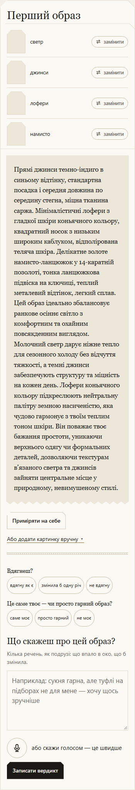

Перелік речей і текст саме цієї картки

Перший образ
светр
джинси
лофери
намисто
Прямі джинси темно-індиго в синьому відтінку, стандартна посадка і середня довжина по середину стегна, міцна тканина саржа. Мінімалістичні лофери з гладкої шкіри коньячного кольору, квадратний носок з низьким широким каблуком, відполірована теляча шкіра. Делікатне золоте намисто-ланцюжок у 14-каратній позолоті, тонка ланцюжкова підвіска на ключиці, теплий металевий відтінок, легкий сплав.
Цей образ ідеально збалансовує ранкове осіннє світло з комфортним та охайним повсякденним виглядом. Молочний светр дарує ніжне тепло для сезонного холоду без відчуття тяжкості, а темні джинси забезпечують структуру та міцність на кожен день. Лофери коньячного кольору підкреслюють нейтральну палітру земною насиченістю, яка чудово гармонує з твоїм теплим тоном шкіри. Він поважає твоє бажання простоти, уникаючи верхнього одягу чи формальних деталей, дозволяючи текстурам в’язаного светра та джинсів зайняти центральне місце у природному, невимушеному стилі.

Доречно: ні · Причина: Джинси з міцної саржі та лофери не забезпечують свободи рухів для ранкової йоги.

## 13. ж2_побачення_вечір / повтор 3 / рука 2

Слова жінки: «побачення в ресторані ввечері, о 19:30».

[Відкрити знімок](ДО-2610/ж2_побачення_вечір/повтор3/знімки/kartka_poz3_ruka2_seed5.png) · [вихідний текст усіх карток прогону](ДО-2610/ж2_побачення_вечір/повтор3/знімки/картки.txt)

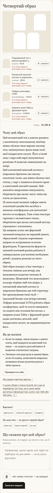

Перелік речей і текст саме цієї картки

Четвертий образ
Подовженний топ з довгим рукавом з велюру
wearme · 455 ₴
Елегантний жіночий костюм із широкими брюками
ricamare · 200 ₴
Лофери шоколадні LUNA
emmeliedelage · 1 650 ₴
Шкіряна сумка Tabby у фірмовий принт
theoriginals · 14 000 ₴
Разом
16 305 ₴
Чому цей образ
Цей вельветовий топ з довгим рукавом у насиченому шоколадному відтінку ніжно облягає твою верхню частину тіла, закінчуючись трохи вище талії, щоб підкреслити силует. Його м’який спад і округлий виріз відчуваються розкішно й водночас невимушено на шкірі.
Цей елегантний жіночий костюм з широкими брюками має високу еластичну талію, яка ніжно облягає твої стегна, у парі з піджаком вільного крою в однотонній матовій тканині. Цей ансамбль випромінює вишуканість, зберігаючи при цьому чисту лінію від плеча до щиколотки.
Ці шоколадні замшеві лофери мають класичний дизайн без застібок з низькою платформою для непомітної висоти та комфорту. Їхня м’яка текстура гармонує з вельветовим топом, зберігаючи при цьому загальний вигляд стриманим і елегантним.
Ця шкіряна сумка має фірмовий тиснений візерунок на передній панелі, обрамлений гладкою коричневою шкірою та полірованою золотою фурнітурою. Її прямокутна форма та знімний плечовий ремінь роблять її універсальною для носіння необхідних речей і додають розкоші до твого образу.
Цей образ поєднує м’яку текстуру з чіткими лініями для вечері, яка відчувається водночас інтимно й вишукано. Шовковий топ шоколадного кольору зігріває твій тон шкіри, а елегантний жіночий костюм із широкими брюками дає тобі структуру без приховування твоєї талії — ідеальний баланс для вечора назовні. Лофери шоколадні LUNA роблять образ комфортним, щоб ти могла танцювати чи ходити між столиків без втоми, а шкіряна сумка Tabby у фірмовий принт додає достатньо деталей, щоб підкреслити силует, не перевантажуючи його.
Як це носити
Коли ти сидиш, зніми піджак з одного плеча, щоб відкрити вельветовий топ знизу — це додасть розслабленого й водночас елегантного штриха.
Легенько поклади руки в кишені брюк, коли ти ходиш, дозволяючи широким штанинам вільно рухатися разом з твоїм кроком.

Доречно: так · Причина: Топ із довгими рукавами, брючний костюм, лофери та сумка утворюють доречний і комфортний комплект для вечірнього побачення в ресторані.

## 14. ж3_церква / повтор 1 / рука 1

Слова жінки: «неділя, служба в церкві, потім обід з батьками».

[Відкрити знімок](ДО-2610/ж3_церква/повтор1/знімки/kartka_poz2_ruka1_seed3.png) · [вихідний текст усіх карток прогону](ДО-2610/ж3_церква/повтор1/знімки/картки.txt)

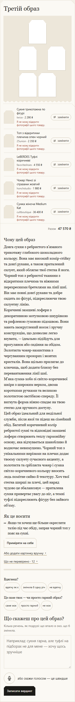

Перелік речей і текст саме цієї картки

Третій образ
Сукня трикотажна по фігурі
twice · 2 290 ₴
Топ з відкритими плечима опен чорний
25union · 2 350 ₴
LeBERDES Туфлі коричневі
favoriteshoes · 4 550 ₴
Чокер Ненсі зі стразами жовтий
honchstudio · 1 980 ₴
Сумка жіноча Medium Kat
cultboutique · 36 400 ₴
Разом
47 570 ₴
Чому цей образ
Довга сукня з ребристого в’язаного трикотажу глибокого шоколадного кольору. Вона має високий комір-стійку та довгі рукави, а також приталений силует, який облягає твої стегна й ноги.
Чорний топ з ребристої тканини з відкритими плечима та ніжними перехресними бретелями на лінії шиї. Він має повні довгі рукави та добре сидить по фігурі, підкреслюючи твою силуетну лінію.
Коричневі замшеві лофери з декоративною мотузковою шнурівкою та рифленою гумовою підошвою. Вони мають заокруглений носок і зручну конструкцію, що дозволяє легко взувати, — ідеально підійдуть для прогулянок або сидіння за обідом.
Золотиста чокер-намистина з чергуванням прозорих і жовтих кристалів. Вона щільно прилягає до ключиць, щоб додати блиску без перевантаження лінії шиї.
М’яка сумка-хобо зі світло-коричневої шкіри з широким верхом, двома короткими ручками та великою золотистою застібкою спереду. Її вигнута форма ніжно спадає на твою стегно для зручного доступу.
Цей образ ідеальний для недільної служби, після якої ти підеш на сімейний обід. Багатий коричневий колір ребристої сукні та відповідні замшеві лофери створюють теплу гармонійну основу, яка відчувається шанобливо й водночас невимушено. Чорний топ з унікальними вирізами на плечах додає твоєму силуету сучасного акценту, а золотиста та срібляста чокер і сумка світло-коричневого кольору вносять ледь помітне сяйво й текстуру. Хоч твої стегна ширші за плечі, цей наряд чудово це збалансовує — приталена сукня привертає увагу до ніг, а темні туфлі підкреслюють фігуру без зайвого об’єму.
Як це носити
Якщо ти хочеш ще більше окреслити талію під час обіду, заправ чорний топ у пояс на сукні.

Доречно: ні · Причина: Порада заправити топ у пояс сукні потребує відсутнього в переліку пояса й не пояснює носіння обтислого топа поверх сукні з довгими рукавами.

## 15. ж3_зима / повтор 1 / рука 1

Слова жінки: «на вулиці мінус десять і сніг, йду на роботу пішки 20 хвилин».

[Відкрити знімок](ДО-2610/ж3_зима/повтор1/знімки/kartka_poz2_ruka1_seed3.png) · [вихідний текст усіх карток прогону](ДО-2610/ж3_зима/повтор1/знімки/картки.txt)

Перелік речей і текст саме цієї картки

Третій образ
Краватка-пояс вузька чорна
feelyou · 150 ₴
Чокер Елейн з кришталевих страз синій
honchstudio · 1 990 ₴
Штани палаццо із подвійним поясом
cooshwear · 4 900 ₴
Футболка чорна
fromus · 550 ₴
Черевики шкіряні чорні
giardini-shoes · 4 000 ₴
Сумка-Плетінка бузкова
skripka · 1 490 ₴
Чорне стьобане пальто вище коліна з поясом
musthave · 6 999 ₴
Разом
20 079 ₴
Чому цей образ
Це тонка, плоска чорна стрічка виготовлена з м’якої тканини або сатину. Вона не має пряжки і призначена для вільного обгортання навколо талії в повсякденному образі.
Це ніжний чокер із маленьких, гранованих синіх кристалів у золотистій оправі. На спині чорна стрічка зав’язана бантиком з довгими кінцями, що вільно звисають.
Ці штани сірого кольору мають широкий крій і високу талію, а також дві чорні ремінці, протягнуті через шлевки. Тканина має легку текстуру, надаючи їм елегантний професійний вигляд.
Це проста чорна футболка з короткими рукавами й круглим вирізом горловини. Її вільний крій зручно носити під пальта або штани.
Ці черевики — чорні шкіряні ботильйони Челсі на невисокому широкому каблуці. Вони мають квадратний носок, еластичні бічні панелі для легкого взування і маленьку петельку ззаду кожного черевичка.
Це сумка-тоут із макраме світло-бузкового кольору, сплетена у вигляді сітки на однотонній бежевій бавовняній підкладці. Вона має дві товсті плетених ручки зверху.
Це чорне стьобане пальто з капюшоном до середини стегна із самозатягуючим поясом у комплекті. Тканина гладка і прошита для тепла, а талія підкреслена ремінцем, щоб вигідно позначити твою фігуру.
Я зібрала тобі повний образ на сніговий шлях: затишне чорне стьобане пальто з поясом, яке збереже тебе в теплі; прості чорні штани з подвійним ремінцем на талії; однотонну чорну футболку під низ; чорні ботильйони Челсі; ніжний чокер із синіх кристалів, щоб додати трохи блиску біля обличчя; і бузкову сітчасту сумку для твоїх речей на день. Темні тони одягу та взуття захистять тебе від холоду, а яскрава бузкова сумка й прохолодний синій кристалик додадуть свіжий колір до зимового пейзажу. Ця комбінація поєднує практичне тепло зі стильними деталями.
Як це носити
Носи пальто розстебнутим, щоб чорні штани підкреслювали твою талію; застібай його на максимум тепла в сніг або вітер.
Одягни чокер прямо біля ключиці, щоб привернути увагу догори і збалансувати об’єм широких штанів і важкого пальта.

Доречно: ні · Причина: Для двадцяти хвилин пішки при −10 °C бракує захисту рук і шиї та теплого шару під пальтом, яке до того ж радять носити розстебнутим.

## 16. ж3_церква / повтор 3 / рука 3

Слова жінки: «неділя, служба в церкві, потім обід з батьками».

[Відкрити знімок](ДО-2610/ж3_церква/повтор3/знімки/kartka_poz2_ruka3_seed5.png) · [вихідний текст усіх карток прогону](ДО-2610/ж3_церква/повтор3/знімки/картки.txt)

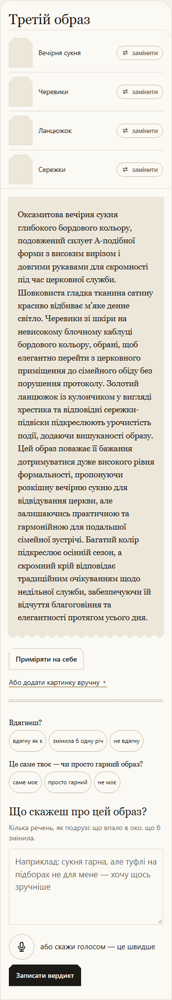

Перелік речей і текст саме цієї картки

Третій образ
Вечірня сукня
Черевики
Ланцюжок
Сережки
Оксамитова вечірня сукня глибокого бордового кольору, подовжений силует А-подібної форми з високим вирізом і довгими рукавами для скромності під час церковної служби. Шовковиста гладка тканина сатину красиво відбиває м’яке денне світло. Черевики зі шкіри на невисокому блочному каблуці бордового кольору, обрані, щоб елегантно перейти з церковного приміщення до сімейного обіду без порушення протоколу. Золотий ланцюжок із кулончиком у вигляді хрестика та відповідні сережки-підвіски підкреслюють урочистість події, додаючи вишуканості образу. Цей образ поважає її бажання дотримуватися дуже високого рівня формальності, пропонуючи розкішну вечірню сукню для відвідування церкви, але залишаючись практичною та гармонійною для подальшої сімейної зустрічі. Багатий колір підкреслює осінній сезон, а скромний крій відповідає традиційним очікуванням щодо недільної служби, забезпечуючи їй відчуття благоговіння та елегантності протягом усього дня.

Доречно: ні · Причина: Розкішна оксамитова вечірня сукня задає надмірну формальність для звичайної недільної служби й обіду з батьками.

## 17. ж3_зима / повтор 3 / рука 4

Слова жінки: «на вулиці мінус десять і сніг, йду на роботу пішки 20 хвилин».

[Відкрити знімок](ДО-2610/ж3_зима/повтор3/знімки/kartka_poz1_ruka4_seed5.png) · [вихідний текст усіх карток прогону](ДО-2610/ж3_зима/повтор3/знімки/картки.txt)

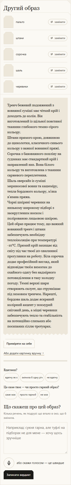

Перелік речей і текст саме цієї картки

Другий образ
пальто
штани
сорочка
шаль
черевики
Тренч бежевий подовжений з вовняної суміші має чіткий крій і доходить до колін. Він виготовлений із щільної повстяної тканини глибокого темно-сірого кольору.
Штани прямого крою, довжиною до щиколотки, класичного синього кольору з важкої вовняної пряжі.
Сорочка з бавовняного попліну на ґудзиках має стандартний крій і заправлений низ. Вона білого кольору та виготовлена з тканини саржевого переплетення.
Шаль оверсайз із суміші мериносової вовни та кашеміру, тепла бордового кольору, м'яка в’язана пряжа.
Чорні шкіряні черевики на низькому широкому підборі з заокругленим носком і полірованою лицьовою шкірою.
Цей образ працює тому, що важкий вовняний тренч і штани забезпечують необхідну теплоізоляцію при температурі -10°C. Прямий крій захищає від снігу під час твоєї 20-хвилинної прогулянки на роботу. Біла сорочка додає професійний вигляд, який відповідає твоїм вимогам до охайного одягу без надмірного потовиділення в таку холодну погоду. Темні верхні шари створюють силует, що стрункішає під зимовим тренчем. Нарешті, бордова шаль додає яскравий колірний акцент у похмурий сніговий день, а міцні черевики забезпечують тепло та стабільність на потенційно слизьких або посипаних сіллю тротуарах.

Доречно: ні · Причина: Вовняний тренч із самою бавовняною сорочкою, без рукавичок і головного убору, не дає достатнього захисту для двадцятихвилинної ходи при −10 °C у сніг.

## 18. ж1_робота / повтор 1 / рука 2

Слова жінки: «робочий день в офісі».

[Відкрити знімок](ДО-2610/ж1_робота/повтор1/знімки/kartka_poz3_ruka2_seed3.png) · [вихідний текст усіх карток прогону](ДО-2610/ж1_робота/повтор1/знімки/картки.txt)

Перелік речей і текст саме цієї картки

Четвертий образ
Зелені твідові брюки-палаццо
alot · 2 999 ₴
Сумка жіноча, ATTICO, екошкіра, колір рудий
attico · 1 799 ₴
Кімоно з органзи пудра
likeangel · 1 400 ₴
LeBERDES Туфлі бордові
favoriteshoes · 5 950 ₴
Пасок з пір’ям 2 беж
likeangel · 900 ₴
Разом
13 048 ₴
Чому цей образ
Це елегантна сумка з якісної шкіри теплого рудого відтінку, яка додає глибини твоєму образу. Її компактна форма дозволяє легко носити щоденні речі без зайвого об’єму, роблячи її ідеальною для офісних буднів.
Верхня частина має безрукавний дизайн з чітким силуетом та застібками на ґудзиках спереду. Виготовлений з тієї ж твідової тканини, що й штани, він створює гармонійний ансамбль і забезпечує свободу рухів протягом дня.
Це елегантні бордові туфлі-човники на шпильці середньої висоти, які поєднують стиль та комфорт. Їх насичений колір чудово контрастує із зеленими тонами у твоєму образі, додаючи вишуканості будь-якій події.
Бежевий пасок прикрашений м’яким пір’ям по нижньому краю, створюючи вражаючий та ніжний акцент на твоїй талії. Він легко поєднує традиційний крій з жіночим шармом, роблячи його ідеальним для підкреслення офіційного вбрання.
Ти одягнена у зелені широкі штани-палаццо з тканини в клітинку, які додають об’єму твоїй фігурі. Їх доповнює безрукавний топ з відповідної твідової текстури з чітким силуетом та застібками на ґудзиках спереду. Цей ансамбль підкреслює талію бежевим паском, прикрашеним м’яким пір’ям, яке додає ніжний контраст до чітких ліній костюма. Образ завершують бордові туфлі-човники на шпильці, які підкреслюють образ елегантним акцентом кольору, а руда шкіряна сумка ідеально гармонує з палітрою.
Як це носити
Одягни пасок з пір’ям поверх талії зелених штанів, щоб окреслити фігуру та пом’якшити строгий вигляд. Бордові туфлі чудово поєднуються із зеленим клітинковим візерунком для вечірнього контрасту, який підходить і для офісу. Руда сумка додає теплий, землистий відтінок, що доповнює холодні тони костюма та зберігає загальне враження вишуканим.

Доречно: ні · Причина: Описаний твідовий топ відсутній у переліку, де замість нього є кімоно з органзи, тому заявлений офісний комплект не зібраний.

## 19. ж8_концерт_рок / повтор 2 / рука 2

Слова жінки: «рок-концерт у клубі, п'ятниця ввечері, стоятиму в натовпі».

[Відкрити знімок](ДО-2610/ж8_концерт_рок/повтор2/знімки/kartka_poz3_ruka2_seed4.png) · [вихідний текст усіх карток прогону](ДО-2610/ж8_концерт_рок/повтор2/знімки/картки.txt)

Перелік речей і текст саме цієї картки

Четвертий образ
Я підібрала приглушену комплементарну палітру для твого образу. У цьому образі великі речі будуть приблизно в рівних частинах хвойного та бордового кольорів. На сукні й топі буде лише бордовий колір, а от хвойний ти не побачиш на цих речах. Я навмисно обрала для тебе цей піджак oversize чорного кольору. Образ готовий, як є. Якщо хочеш більше кольору, ти можеш додати щось сама. Ти можеш додати хвойний колір за допомогою топу.
Бордова в'язана сукня міді з віскозою
musthave · 6 999 ₴
На жаль, фотографії цієї речі не відкрилися.
Піджак oversize чорного кольору
theoriginals · 12 320 ₴
На жаль, фотографії цієї речі не відкрилися.
Обруч з бантом айворі
honchstudio · 1 400 ₴
На жаль, фотографії цієї речі не відкрилися.
LeBERDES Туфлі коричневі
favoriteshoes · 5 950 ₴
На жаль, фотографії цієї речі не відкрилися.
Сумка COOSH TOTE BAG шкіряна
cooshwear · 10 900 ₴
На жаль, фотографії цієї речі не відкрилися.
Разом
37 569 ₴
Чому цей образ
Ця довга бордова трикотажна сукня міді має короткі рукави, V-подібний виріз з ґудзиками спереду та комір на шиї. Тканина в’язана і достатньо структурована, щоб зберігати форму, водночас пропонуючи приталений силует, який повторює твої лінії.
Оверсайз-піджак чорного кольору з широкими лацканами та структурними плечима вільно сидить на твоєму торсі. На передній частині є великі клапани для кишень і чисті, мінімалістичні лінії, які створюють контрастний верхній шар до твоєї сукні.
Білий обруч з масивним тканинним бантом, розташованим на боці голови. Сам обруч товстий і м’який для комфорту, виконаний у молочному відтінку.
Коричневі замшеві туфлі-човники, що мають загострений носок та скульптурний широкий каблук, який звужується до підошви. Верхній матеріал має м’яку текстуру і насичений шоколадний коричневий тон.
Структурована чорна шкіряна сумка-тоут з верхніми ручками та великим тисненим логотипом на передній частині. Вона має трапецієподібну форму, яка щільно прилягає до твоїх ніг, коли її носиш в одній руці або опускаєш біля боку.
Ти одягла довгу бордову трикотажну сукню міді, яку стилізували з чорним оверсайз-піджаком для верхнього шару. Твої аксесуари включають білий обруч з великим бантом і стильну чорну шкіряну сумку-тоут.
Як це носити
Залиш оверсайз-піджак вільно висіти на плечах, не застібаючи його, щоб він був трохи вільним для балансу приталеного силуету твоєї сукні.

Доречно: ні · Причина: Туфлі на підборах і велика сумка в руці незручні для тривалого стояння й руху в натовпі на клубному рок-концерті.

## 20. ж4_весілля_гостя / повтор 3 / рука 4

Слова жінки: «я гостя на весіллі сестри в серпні, церемонія надворі о 16:00, потім ресторан».

[Відкрити знімок](ДО-2610/ж4_весілля_гостя/повтор3/знімки/kartka_poz1_ruka4_seed5.png) · [вихідний текст усіх карток прогону](ДО-2610/ж4_весілля_гостя/повтор3/знімки/картки.txt)

Перелік речей і текст саме цієї картки

Другий образ
Сукня-комбінація з шовку
Босоніжки на підборах
Золоті сережки-підвіски з позолотою
Перловий чокер з золотим ланцюжком
Золоті сережки-підвіски з позолотою та перловий чокер з золотим ланцюжком.
Цей образ працює тому, що шовкова сукня-комбінація вершкового кольору дарує вишуканий «дуже ошатний» вигляд, який відчувається елегантно без того, щоб затьмарювати наречену на весіллі твоєї сестри. Легка літня тканина триматиме тебе в комфорті під час 16:00 церемонії просто неба у серпневе сонце, а босоніжки молочного кольору видовжать ноги як для саду, так і для вечері в дорогому ресторані. Одинарний акцент золотих прикрас додасть святкового блиску на вечірню трапезу без надмірності, чудово поєднавши перехід від денного до сутінкового світла.

Доречно: ні · Причина: Вершкова шовкова сукня-комбінація з молочними босоніжками надто наближена до білого вбрання нареченої для гості на весіллі.
