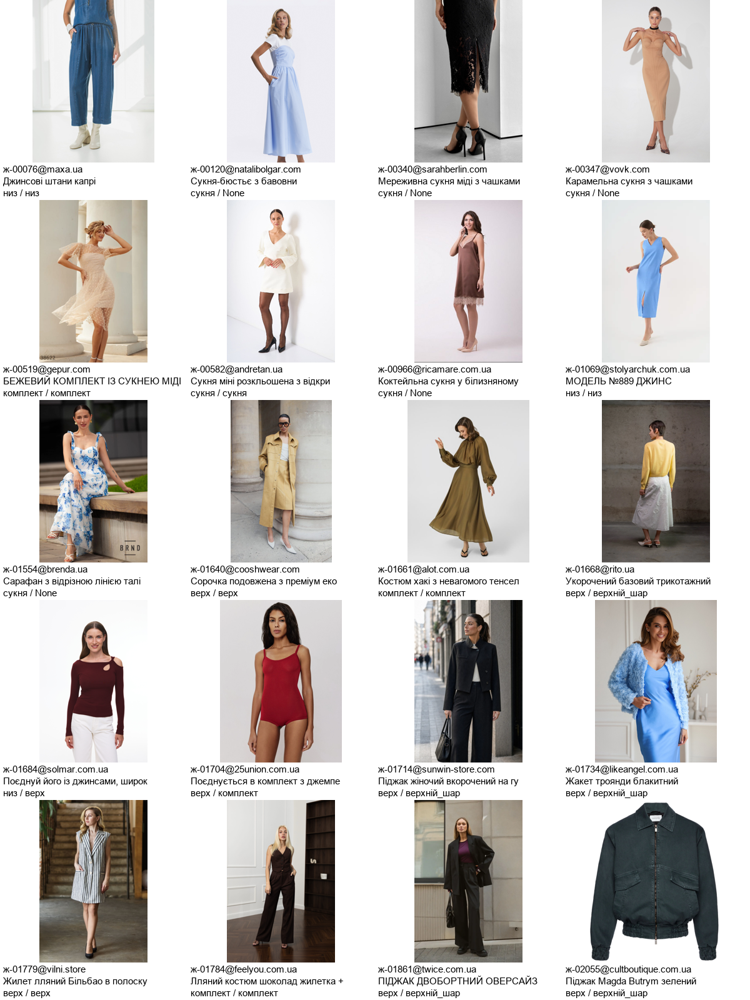

# Річ-запис-речі: частковий вимір каталогу, 30.10.2026 UTC

**ЗАБЛОКОВАНО:** п.3 наряду — немає товарних HTML для всієї вибірки. Наряд не завершено; PR не готовий до приймання.

База `main`: `7d80dcb52f1afc98f854fa9119401566ef7b2211`. Усі числа нижче — саме з цього дерева; SHA256 входів — `підсумок.json`.

## Що виміряно

- Повний `каталог_повний.xml.gz`: **30 375 оферів, 52 крамниці**. Це записи фіда, включно з відсіченими каналом і не одягом; не кількість речей у кінцевому пулі.
- **2 972** офери з різними виходами типу/слота серед викликаних входів; усі розбіжності — слот, розбіжностей типу немає. Це лічба різних виходів, а не доведена кількість хибно класифікованих речей.
- Серед входів готового запису — **744**: слот класифікатора проти `слот(offer)`/читання запису з перевіркою каналу. Окремо повтор жнив проти класифікатора — **1 430**; опис кадру проти класифікатора — **995 з 10 764** з описом. Ці множини перетинаються.
- **1 231** офер без типу в побудованому записі: причини кожного — `без_типу.jsonl.gz`. Не кожен офер є одягом: зокрема підставки для яєць, гаманець тощо не можна оголосити поломкою словника за самим None.
- **Частка чужих полів не виміряна.** Вибірка: 156 унікальних сторінок, по три з кожної крамниці, зерно **11658**, `Random.sample` після сортування крамниць і URL. Це вибірка, не суцільний вимір полів.
- `джерела/каталог_brief.xml.gz` містить **485** оферів і не використаний як знаменник повного каталогу. Маніфести `каталог_*.json.gz` зафіксовані відбитками; збагачення використане тільки там, де існує опис форми кадру.

## Відтворення

У дереві цього коміту, з незмінними джерелами базового main; Python 3.12, установлені залежності продукту. Повтор основного виміру не ходить у мережу й пише тільки в задану теку:

```powershell
python -X utf8 аудит/проби/річ_запис_каталог.py --вихід "$env:TEMP/річ-повтор"
python -X utf8 аудит/проби/річ_запис_звіт.py
```

Перша команда повторює функції продукту; очікувані числа наведено вище, gzip/JSON детерміновані. Друга звіряє збережені рядки з підсумком, унікальність ID, SHA256 усіх входів, HTML і 20 кадрів; не підміняє незалежну перевірку. Виконано суцільний прогін першої версії та перерахунок усього протоколу після виправлення застосовності верхнього читача. Остаточний CLI після цієї корекції повністю ще не повторювався; це явно лишено для продовження разом із заблокованим п.3.

Одноразове отримання HTML: `річ_запис_каталог.py --лише-сторінки`; збережених жнив і звичайного DOM: `річ_запис_докази.py --доступ --сирі --кадри`. Ці команди мережеві, стан сайту може змінитися; для повтору чисел вони не потрібні. Без прапорців друга проба читає лише збережені докази.

## Межі зіставлення читачів

У `читачі.jsonl.gz` є кожний офер, всі викликані виходи, вхід назви/категорії, опис кадру, кадр і всі розбіжні пари. `{}` у читача верхнього означає незастосовність, а не `тип=None`. Відсутній читач кадру означає, що опису кадру немає.

Рядки нижче — адреси виконаних функцій, не статичний прилад кореня:

- `_слот_фото` — `джерела/фід_збагачення.py:891`.
- `верхні_атрибути` — `джерела/фід_верхнє.py:161`.
- `вид_речі` — `джерела/фід_слот.py:1192`.
- `побудувати_запис_речі` — `джерела/фід_розбір.py:610`.
- `слот` — `джерела/фід_слот.py:1144`.
- `слот_речі` — `zhnyvarka/жниварка.py:2131`.
- `тип_речі` — `джерела/фід_слот.py:832`.
- `що_каже_код` — `zhnyvarka/../джерела/каталог_розбір.py:1219`.

Огляд 25.10 описує попередню архітектуру: `чистка.тип_назви` вже вилучено, `тип_набору` делегує `вид_речі`, `назва_речі.іменник_речі` повертає позицію слова, а `verify._зона_слова` — зону тіла. Позиція/зона й альтернативний дозволений слот не порівнювалися з основним типом/слотом. Виклики фасадів використовують ті самі функції. Повтор жнив використовує **поля з фіда** (`категорія_магазину`, назва, URL), а не відновлює невідомий історичний вхід усіх жнив. Виходи жнив і опису кадру не є незалежними читачами готового коду.

У 744 випадках треба відділити відсічення каналу/НЕ_ОДЯГ від класифікації; число не названо кількістю хибних слотів. Перший приклад — комплект мінісумочки із гаманцем: класифікатор дає «комплект», жіночий читач слота — None.

## Причини кожного відсутнього типу

| Причина з виконання словника | Оферів |
|---|---:|
| нема прийнятого іменника у словнику назви й розділу | 1223 |
| розділ називає деталь; категорію виключено через прийменник у назві | 4 |
| слово набір без підтвердження різних слотів; комплект виключено | 2 |
| іменник поза межею голови назви з опису | 2 |

Доказ кожного — ID, URL, сира назва, назва суду, джерело назви, категорія, оголошений тип, точна голова після обмеження опису та результат `предмет_типу` для назви/голови/категорії. «Нема прийнятого іменника» означає результат штатного словника, а не експертне твердження, що назва не називає одяг.

## Розклад за крамницями

| Крамниця | Весь фід | Різні виходи | Без типу |
|---|---:|---:|---:|
| 25union.com.ua | 595 | 22 | 2 |
| alot.com.ua | 375 | 16 | 2 |
| andretan.ua | 175 | 9 | 9 |
| attico.ua | 447 | 29 | 0 |
| bella-bicchi.com | 357 | 2 | 0 |
| brenda.ua | 485 | 47 | 8 |
| cooshwear.com | 455 | 52 | 6 |
| cultboutique.com.ua | 843 | 153 | 66 |
| diadia.ua | 391 | 17 | 10 |
| dolcedonna.com.ua | 745 | 18 | 51 |
| emmeliedelage.com | 555 | 28 | 15 |
| favoriteshoes.com.ua | 1087 | 259 | 40 |
| feelyou.com.ua | 624 | 159 | 8 |
| fromus.ua | 415 | 0 | 0 |
| gepur.com | 310 | 26 | 14 |
| giardini-shoes.com | 525 | 87 | 4 |
| honchstudio.com | 315 | 86 | 3 |
| intimo.com.ua | 6 | 4 | 0 |
| jecomestudio.com | 81 | 17 | 3 |
| kasandra.ua | 143 | 12 | 0 |
| likeangel.com.ua | 579 | 51 | 0 |
| maryline.ua | 279 | 1 | 0 |
| maxa.ua | 1673 | 89 | 10 |
| miraton.ua | 277 | 10 | 2 |
| morandi.ua | 327 | 30 | 11 |
| musthave.ua | 557 | 87 | 7 |
| natali-style.com.ua | 31 | 0 | 0 |
| natalibolgar.com | 157 | 11 | 0 |
| nyni.shop | 245 | 13 | 177 |
| onebyone.ua | 374 | 4 | 18 |
| otaje.com | 99 | 0 | 10 |
| pitaya.ua | 2095 | 596 | 439 |
| provenceshop.com.ua | 15 | 0 | 15 |
| ricamare.com.ua | 304 | 17 | 1 |
| rito.ua | 420 | 31 | 1 |
| sarahberlin.com | 114 | 28 | 0 |
| sezone.ua | 175 | 10 | 1 |
| skripka.com.ua | 353 | 117 | 0 |
| solmar.com.ua | 117 | 37 | 0 |
| stolyarchuk.com.ua | 359 | 59 | 0 |
| sunwin-store.com | 1786 | 74 | 31 |
| theoriginals.com.ua | 2922 | 354 | 73 |
| tm-beart.com | 501 | 99 | 113 |
| twice.com.ua | 572 | 16 | 0 |
| vilni.store | 335 | 29 | 19 |
| vittorossi.ua | 343 | 9 | 28 |
| vmma.com.ua | 364 | 17 | 2 |
| vovk.com | 76 | 20 | 2 |
| wearme.ua | 5115 | 18 | 10 |
| welfare.ua | 620 | 84 | 2 |
| yakfaino.com | 84 | 15 | 15 |
| yulashop.com.ua | 178 | 3 | 3 |

## Розклад за парами

| Пара / поле | Різні | Спільне покриття |
|---|---:|---:|
| вид_офера / жниварка_повтор / слот | 1430 | 30375 |
| вид_офера / кадр / слот | 995 | 10764 |
| вид_офера / розбір_коду / слот | 744 | 30375 |
| вид_офера / фід_суд / слот | 744 | 30375 |
| вид_офера / читання_запису / слот | 744 | 30375 |
| жниварка_повтор / запис_входу / слот | 1430 | 30375 |
| жниварка_повтор / кадр / слот | 1283 | 10764 |
| жниварка_повтор / розбір_коду / слот | 1952 | 30375 |
| жниварка_повтор / фід_суд / слот | 1952 | 30375 |
| жниварка_повтор / читання_запису / слот | 1952 | 30375 |
| запис_входу / кадр / слот | 995 | 10764 |
| запис_входу / розбір_коду / слот | 744 | 30375 |
| запис_входу / фід_суд / слот | 744 | 30375 |
| запис_входу / читання_запису / слот | 744 | 30375 |
| кадр / розбір_коду / слот | 1006 | 10764 |
| кадр / фід_суд / слот | 1006 | 10764 |
| кадр / читання_запису / слот | 1006 | 10764 |

Розклад кожної пари за крамницею — `підсумок.json` → `пари_крамниці`; нульові пари — `покриття_пар`.

## 20 прикладів із кадром

Кадри завантажені й оглянуті на контактному аркуші; це доказ вигляду прикладів, не перевірка власника кожного кадру.



Усі виходи кожного з 20 прикладів — `приклади_20.json`, оригінальні файли — `кадри/`, відбитки — `кадри.json`. На аркуші підписані слот класифікатора / слот повтору жнив; інші розбіжності див. JSON.

## Чого бракує для полів із чужого блоку

Після HTTP, архіву жнив і звичайного Chromium: **144 HTTP 200, 10 HTTP 403, 2 збої**. HTTP 200 не дорівнює товарній сторінці: є порожній DOM і JavaScript без тексту. Товарні тексти не отримані щонайменше для attico, intimo, theoriginals, tm-beart; повний список з URL і доказом — `брак_доказів.json`. Захисти й CAPTCHA не обходились.

Непридатних відповідей (HTTP не 200 або порожній текст після вилучення script/style): **38**. Навіть решта непорожніх відповідей ще не дає частки чужих полів: потрібна звірка всіх чотирьох полів із власним блоком очима. Тому третього числа немає і стан паспорта — частковий.

Для продовження потрібні **товарні HTML саме відсутніх адрес** від диспетчера/смуги з доступним журналом; паролі й нові секрети не потрібні. Після отримання — завершити огляд 156 сторінок, записати рішення щодо кожного поля з DOM-якорем, порахувати частки за полем/крамницею. «Відрізняється від поточного сайта» саме по собі не доводить чужого блоку.

Зафіксовано 38 сирих рядків цієї вибірки з доступної смуги 5.3: `сирі_вибірки.json.gz`, джерела й відбитки цілих журналів — `джерела_жнив.json`. Це **вибірка 38/156**, не повні сирі жнива всіх 52 крамниць. Оригінальні журнали відкривались тільки для читання.

## ДО → ПІСЛЯ та межі

ДО: суцільних чисел у паспорті не було. ПІСЛЯ: протокол 30 375 оферів, 2 972 різних виходи, 1 231 без типу з причиною кожного, 20 кадрів, зафіксована вибірка й конкретний брак доказів п.3. Продукт, каталог, прилади кореня та храповик не змінені. Наряд лишено в черзі. Прилад від виконання та визначення пріоритету кореня — наступні кроки менеджера, після завершення цього мірила.
